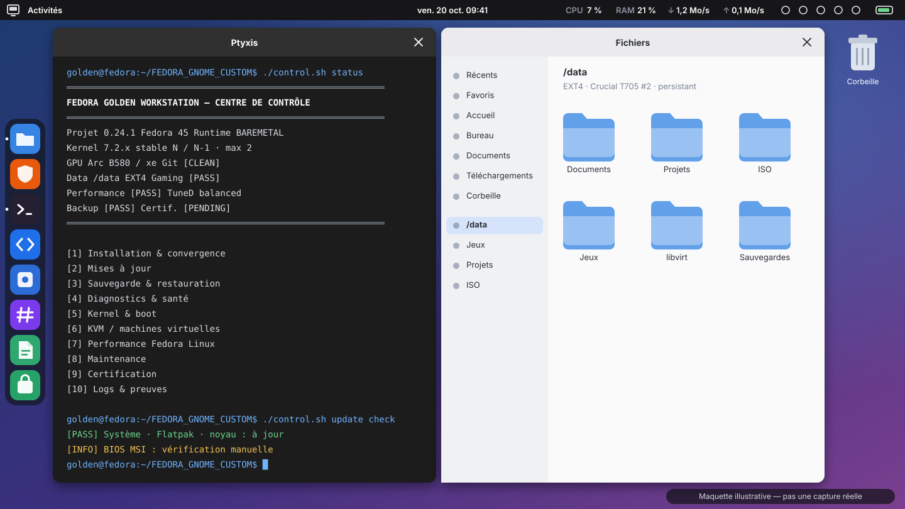

# Fedora Golden Workstation

Un dépôt qui décrit, installe et vérifie un poste **Fedora 45 Workstation avec GNOME 51**, pour un PC précis consacré au développement, au jeu vidéo et aux machines virtuelles.

*Maquette illustrative, pas une capture réelle. Les captures du poste seront ajoutées après sa qualification matérielle.*

## Démarrage rapide

| Objectif | Par où passer |
|---|---|
| Comprendre le projet | Les [notions clés](docs/CONCEPTS.md) : les sept idées qui reviennent dans tous les guides |
| Vérifier le code, sans matériel | Après un clone : `python3 -B tests/test_docs_integrity.py` ; la [CI](docs/CI_VALIDATION.md) reste l'autorité |
| Vérifier le PC avant d'installer | Démarrer sur le média Fedora, puis le [contrôle Live USB](docs/FEDORA45_LIVE_PREFLIGHT.md) : rien ne s'écrit sur les disques |
| Installer | Le [guide d'installation](docs/INSTALLATION_GUIDE.md#le-parcours) ; premier pas : l'essai à blanc `./install.sh --dry-run` |
| Configurer et utiliser au quotidien | `./control.sh`, le point d'entrée unique, ouvre le [centre de contrôle](docs/CONTROL_CENTER.md) ; réglages propres au poste dans `config/local.conf` |
| Voir tous les guides | Le [portail de la documentation](docs/README.md) |

Pour aller plus loin : l'[architecture](docs/ARCHITECTURE.md), les [décisions (ADR)](docs/adr/README.md), le [glossaire](docs/GLOSSARY.md), le [dépannage](docs/TROUBLESHOOTING.md), la [qualification](docs/QUALIFICATION.md), la [feuille de route](docs/ROADMAP.md).

Ce tableau oriente, il ne remplace ni les guides ni les preuves : le Live USB ne déverrouille jamais l'APPLY, et ce qui est vérifié, par quoi, est dans [État réel](#état-réel).

## Le problème et l'objectif

Une installation faite à la main se perd : après une réinstallation, il faut retrouver chaque réglage, chaque logiciel et chaque correctif, sans savoir si le résultat est le même. Ce projet écrit tout cela dans un dépôt Git. Chaque réglage y est versionné, expliqué, testé et rejouable.

L'objectif est un poste de référence (« Golden ») : la même Fedora, sur le même matériel, reconstruite à l'identique et vérifiée par des contrôles reproductibles. Le dépôt sert aussi de terrain d'apprentissage des pratiques DevOps : configuration déclarative, tests de comportement, intégration continue et preuves.

## Ce que fait le projet

| Domaine | Contenu | Guide |
|---|---|---|
| Bureau | GNOME sous Wayland, dock, bureau avec icônes, tuilage, applications GTK4, soin de l'écran QD-OLED | [GNOME](docs/GNOME.md) |
| Données | Un second SSD monté sur `/data`, conservé lors d'une réinstallation : documents, projets, projets IA, jeux, disques des VM | [Installation](docs/INSTALLATION_GUIDE.md) |
| Sauvegardes | Borg vers un SSD externe, sauvegarde vérifiée avant toute application, restauration d'abord dans un dossier d'essai | [Sauvegardes](docs/BACKUP_RESTORE.md) |
| Développement | Terminal Ptyxis et Bash, laboratoire Rocky Linux en machine virtuelle KVM, réseau isolé du réseau local | [KVM](docs/KVM_QUICKSTART.md) |
| Jeu vidéo | Steam, Proton et Vulkan sur l'Intel Arc B580 | [Gaming](docs/GAMING.md) |
| Entretien | Mises à jour, noyau Linux amont avec retour arrière, diagnostics par domaine | [Centre de contrôle](docs/CONTROL_CENTER.md) |

Tout passe par un point d'entrée unique, `./control.sh`. Rien ne s'applique sans un essai à blanc (dry-run), une sauvegarde vérifiée et une confirmation explicite, et uniquement sur le PC physique. Le matériel visé est décrit dans l'[architecture](docs/ARCHITECTURE.md#le-matériel-cible) : Ryzen 7 7700, Intel Arc B580, 48 Gio de RAM, deux SSD Crucial T705.

## État réel

Ce tableau distingue ce que le dépôt contient, ce que la CI a vérifié et ce qui reste à prouver sur le vrai PC. Dernière mise à jour : 2026-11-04.

| Élément | Statut | Preuve |
|---|---|---|
| Configuration, scripts, modules et diagnostics | Réalisé | Ce dépôt |
| Tests de comportement et contrats | Vérifié par la CI le 2026-11-04, au commit `0007d97` de la préversion [v0.24.1-rc.1](https://github.com/mathiasseguincadiche/FEDORA_GNOME_CUSTOM/releases/tag/v0.24.1-rc.1) | [run `Tests`](https://github.com/mathiasseguincadiche/FEDORA_GNOME_CUSTOM/actions/runs/41880009717) ; les mêmes contrôles tournent sur chaque PR et chaque commit de `main` ([CI](docs/CI_VALIDATION.md)) |
| Session GNOME 51 avec les six extensions, redémarrage et restauration | Vérifié par la CI le 2026-11-04, au même commit, en VM jetable | même [run `Tests`](https://github.com/mathiasseguincadiche/FEDORA_GNOME_CUSTOM/actions/runs/41880009717) ([laboratoire Fedora/GNOME](docs/FEDORA_GNOME_CI_LAB.md)) |
| Profil Fedora 45 : média final 1.4 et RPM stables | Vérifié le 2026-11-03 | Signature du CHECKSUM et SHA-256 de l'ISO ([fiche Fedora 45](docs/FEDORA45_PRIMARY.md)) |
| Contrôle du PC depuis le Live USB | Non vérifié | À faire sur le matériel |
| Installation, application et qualification (Gate 3) | Non vérifié | À faire sur le matériel ([qualification](docs/QUALIFICATION.md)) |

**Une CI verte ne certifie pas le PC.** Seule la Gate 3, exécutée sur la machine installée, peut établir le statut « Golden runtime-certified ». Les versions publiées sont listées dans les [releases](https://github.com/mathiasseguincadiche/FEDORA_GNOME_CUSTOM/releases) ; les prochaines étapes, dans la [feuille de route](docs/ROADMAP.md).

## Contexte du projet

C'est un projet personnel, mené par le propriétaire du PC ([@mathiasseguincadiche](https://github.com/mathiasseguincadiche)) pour son propre poste et comme terrain d'apprentissage. Il en fixe les objectifs, les décisions d'architecture, consignées dans les [ADR](docs/adr/README.md), et le niveau de preuve exigé. Chaque changement passe par une pull request qu'il fusionne lui-même.

## Contribuer

Les changements passent par pull request, avec les tests adaptés à leur portée. Les [consignes de contribution](CONTRIBUTING.md) décrivent le flux de travail, la CI et les règles de rédaction ; l'[historique des versions](CHANGELOG.md) retrace les changements.

## Licence

[Apache License 2.0](LICENSE). La version courante du projet figure dans [`VERSION`](VERSION).
