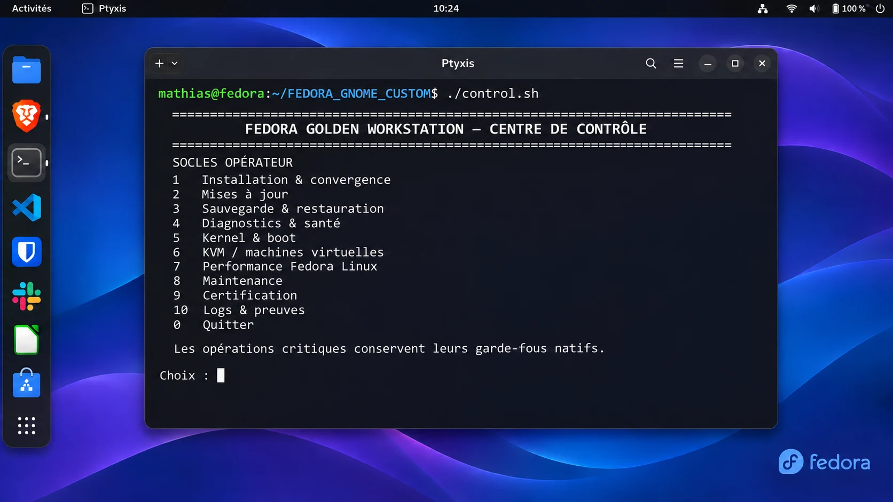

# Fedora Golden Workstation

> Mise à jour : 2026-11-06 · Responsable : @mathiasseguincadiche
> Dernière vérification : 2026-11-06 — parcours rapproché des scripts et guides ; validation sur le PC physique à réaliser — matériel : non vérifié

**Un poste Fedora personnel, reproductible et piloté depuis un centre de contrôle.**  
Fedora 45 Workstation · GNOME 51 · Automatisation · Vérification · Sauvegarde et restauration

## Pourquoi ce projet existe

Après une réinstallation, retrouver son environnement de travail ne devrait pas dépendre d'une liste de réglages oubliés, de commandes improvisées ou de fichiers dispersés. Ce projet est né de cette idée : **décrire une workstation Fedora de référence, automatiser ce qui peut l'être et vérifier ce qui a réellement fonctionné**.

Le dépôt rassemble les configurations, scripts, diagnostics et procédures nécessaires pour préparer un PC, installer et personnaliser Fedora, entretenir le système, protéger ses données et retrouver une configuration connue après un incident. Il sert aussi de laboratoire pratique aux méthodes DevOps : versionnement, automatisation, contrôles, traçabilité et retour arrière.

Le terme *Golden* désigne ici une **configuration de référence que l'on cherche à reproduire et à qualifier**. Il ne signifie ni image ISO personnalisée, ni PC déjà certifié.

> [!IMPORTANT]
> **État du projet :** le profil Fedora 45 est déclaré `ready` et les contrôles logiciels existent en CI. **Gate 2 (Live USB), installation réelle et Gate 3 (qualification du système installé) ne sont pas encore validées sur le PC cible.** Une CI verte ne certifie pas le matériel. [Voir l'état et les preuves](#état-réel).

## Le centre de contrôle, point de départ de toutes les opérations

**L'utilisateur pilote le projet avec `./control.sh`.** Cette commande donne accès au tableau de bord, aux opérations d'installation, de mise à jour, de sauvegarde, de restauration et de qualification. Elle transmet ensuite le travail aux scripts spécialisés : un seul point d'entrée pour l'opérateur, sans supprimer les protections propres à chaque action.



*Aperçu de l'expérience visée **après configuration** : GNOME, dock latéral et menu `./control.sh` ouvert dans Ptyxis. Il s'agit d'une **maquette illustrative**, pas d'une capture du PC physique ni d'une preuve de validation.*

**Ce que montre l'image :** depuis le dépôt, on lance `./control.sh` dans un terminal. Le menu donne accès aux fonctions courantes et dirige chaque action vers le script qui la réalise. Il ne faut pas confondre cet **aperçu du système configuré** avec la session **Live USB de Gate 2** : avant installation, la personnalisation GNOME et le dock du projet ne sont pas encore appliqués.

Les deux qualifications se lancent aussi depuis `./control.sh`, mais par des **sous-commandes explicites** : `validate live` pour Gate 2 **avant installation**, puis `validate gate3` pour Gate 3 **après installation et configuration**. Elles ne figurent pas comme entrées distinctes dans le menu illustré.

[Architecture technique de la façade et des moteurs](docs/assets/diagrams/centre-de-controle.svg) · [Source modifiable Draw.io](docs/assets/diagrams/centre-de-controle.drawio) · [Toutes les commandes et leurs effets](docs/CONTROL_CENTER.md)

Depuis le dossier du dépôt :

```bash
./control.sh          # ouvre le menu interactif des opérations courantes
./control.sh help     # affiche les commandes disponibles, sans agir
./control.sh status   # présente l'état du poste et les preuves connues
```

> [!NOTE]
> Le centre de contrôle pilote les **opérations automatisées du dépôt**. Le démarrage sur clé USB, le choix du SSD dans l'installateur Fedora, les réglages UEFI, certains enrôlements matériels et les observations humaines restent des gestes explicites. Aucun script ne doit faire passer ces décisions pour des tâches automatiques.

## Démarrer : le parcours en un coup d'œil

| Moment | Action principale | Résultat attendu | Guide |
| --- | --- | --- | --- |
| **Gate 1 — CI** | Lire les contrôles du commit retenu. | Le logiciel est contrôlé ; **pas** le PC. | [CI](docs/CI_VALIDATION.md) |
| **Gate 2 — Live USB** | Démarrer *Try Fedora*, réaliser les observations, exporter les preuves. | `GO` calculé, rapport conservé, puis **décision humaine**. | [Préinstallation Live](docs/FEDORA45_LIVE_PREFLIGHT.md) |
| **Installer et configurer** | Installer Fedora sur le bon SSD, importer la preuve Live, certifier la baseline, réaliser le dry-run et l'APPLY protégé. | Fedora configuré, sauvegarde pré-APPLY vérifiée, premier démarrage contrôlé. | [Installation](docs/INSTALLATION_GUIDE.md) |
| **Gate 3 — qualification** | Tester le vrai système : matériel, périphériques, GNOME, applications, sauvegardes et KVM selon le profil. | Certification *Golden* seulement si tous les critères requis réussissent. | [Qualification](docs/QUALIFICATION.md) |
| **Vie du poste** | Mettre à jour, diagnostiquer, sauvegarder, restaurer. | Un poste entretenu avec des preuves et des chemins de reprise. | [Centre de contrôle](docs/CONTROL_CENTER.md) |

Les sections suivantes permettent de suivre ces étapes dans l'ordre. **Les guides liés restent les références pour les prérequis complets, les écrans de confirmation et les décisions à risque.**

### 1. Avant la clé USB — le minimum à préparer

1. Disposer du **média final officiel Fedora 45 Workstation**, dont l'ISO et le `CHECKSUM` signé ont été vérifiés selon le [guide d'installation](docs/INSTALLATION_GUIDE.md#1-vérifier-le-média-fedora-45). Ne pas substituer une Beta ou une RC.
2. Vérifier sur [GitHub Actions](https://github.com/mathiasseguincadiche/FEDORA_GNOME_CUSTOM/actions?query=branch%3Amain) les contrôles du **commit exact** qui servira à l'essai. Gate 1 est une vérification logicielle, pas une étape à rejouer sur le PC.
3. Préparer **un support externe accessible en écriture** pour exporter les preuves Live. La session Live est temporaire ; ses fichiers peuvent disparaître au redémarrage.
4. Connaître les **numéros de série des deux SSD** : l'un est destiné au système, l'autre aux données. Ne jamais choisir un disque à effacer sur la seule base d'un nom `/dev/nvme…`.

### 2. Gate 2 — tester le PC sans installer Fedora

Démarrer sur la clé Fedora et choisir **Try Fedora**. Ouvrir un terminal dans cette session, connecter le réseau, vérifier la présence de Git et Python 3, puis récupérer le dépôt :

```bash
command -v git python3                    # vérifier les deux outils
git clone https://github.com/mathiasseguincadiche/FEDORA_GNOME_CUSTOM.git
cd FEDORA_GNOME_CUSTOM
git switch --detach SHA_DU_COMMIT_AUDITE  # remplacer par le SHA effectivement vert en CI
git rev-parse HEAD                        # noter le SHA qui sera réutilisé après installation
```

Si Git manque dans le Live, le [guide de préinstallation](docs/FEDORA45_LIVE_PREFLIGHT.md#2-utiliser-le-commit-audité) explique comment l'ajouter **dans la session temporaire**, avant de reprendre. Ne modifier aucun fichier versionné pendant l'essai.

Le centre de contrôle prend ensuite le relais :

```bash
./control.sh validate live plan    # affiche les points à observer, sans lancer les essais
./control.sh validate live run     # lance les contrôles et demande les observations humaines
./control.sh validate live status  # présente PASS, FAIL, NOT_TESTED et la décision calculée
```

La Gate 2 porte sur **16 points** : session Fedora/GNOME, GPU Intel Arc, deux SSD NVMe, affichage, accès Internet et observations complémentaires (réseau, audio, Bluetooth, USB, veille). **Six critères sont obligatoires**. Un point non essayé ne doit jamais devenir `PASS` par supposition.

| Résultat Live | Signification | Décision immédiate |
| --- | --- | --- |
| `GO` | Six critères requis réussis ; aucun `FAIL`. Des points complémentaires peuvent rester `NOT_TESTED`. | Exporter les preuves, puis **s'arrêter pour les faire examiner**. |
| `A_VERIFIER` | Aucun échec, mais un critère obligatoire manque. | Compléter l'essai requis. |
| `NO-GO` | Au moins un point en échec. | Diagnostiquer, corriger puis recommencer les observations nécessaires. |

**Si le résultat calculé est `GO`**, exporter le JSON et son empreinte SHA-256 sur un support **externe aux SSD internes** :

```bash
SUPPORT="/run/media/$USER/SUPPORT_FGC/preinstallation"  # adapter au vrai point de montage
./control.sh validate export live "$SUPPORT"
```

Vérifier la présence du JSON et du `.sha256` sur le support ; conserver également le TSV de détail et le SHA Git. Le JSON contient des **identifiants matériels privés** : ne pas le publier tel quel dans une issue publique.

> [!CAUTION]
> **Point d'arrêt obligatoire entre Gate 2 et installation :** même un `GO` logiciel ne donne aucune autorisation d'effacer un SSD. Le propriétaire examine les preuves, les `NOT_TESTED` et les éventuelles réserves, puis donne un **accord explicite**. Sans cet accord, on n'installe pas Fedora. [Comment prendre la décision](docs/FEDORA45_LIVE_PREFLIGHT.md#6-décider-avant-toute-installation).

### 3. Après l'accord — installer Fedora et appliquer le profil

**Installation initiale du système (manuelle).** Depuis l'installateur Fedora, choisir le **T705 système identifié par son numéro de série**, installer Fedora 45 en Btrfs sans LUKS, et **ne pas toucher au second T705 `/data`**. Le dépôt ne partitionne ni ne formate ce disque à ta place. Les réglages UEFI (dont Secure Boot désactivé) et le récapitulatif de stockage doivent être vérifiés avant confirmation. [Procédure d'installation détaillée](docs/INSTALLATION_GUIDE.md#installer-fedora-sur-le-t705-système).

Au premier démarrage sur le SSD, récupérer le dépôt au **même commit que pendant Gate 2**, puis importer sa preuve :

```bash
git clone https://github.com/mathiasseguincadiche/FEDORA_GNOME_CUSTOM.git
cd FEDORA_GNOME_CUSTOM
git switch --detach SHA_DU_COMMIT_AUDITE  # exactement le SHA de Gate 2
./control.sh validate import /chemin/du/support/live-SHA_DU_COMMIT_AUDITE.json
./control.sh validate status
```

**Préparer avant d'appliquer.** Le parcours protégé est le suivant :

1. **Outils et configuration** — `./control.sh install prepare-tools`, puis création et relecture de `config/local.conf` à partir de `config/local.conf.example`. Définir le dépôt Borg externe et conserver `REAL_MACHINE_APPROVED="false"` jusqu'au moment prévu par le guide.
2. **Disque de données** — monter le second T705 sur `/data` en ext4, l'identifier et l'enrôler selon le [guide](docs/INSTALLATION_GUIDE.md#4-préparer-le-second-t705-pour-data). Cette opération sur les partitions est manuelle et doit respecter les données existantes.
3. **Baseline matérielle** — enrôler les périphériques, contrôler refroidissement, mémoire, CPU et SSD, puis certifier. Les essais détaillés et leur ordre figurent dans le [guide d'installation](docs/INSTALLATION_GUIDE.md#5-certifier-la-baseline-matérielle) ; `./control.sh doctor baseline` consulte l'état et `./control.sh cert baseline-certify` lance la certification après les essais.
4. **Autorisation de la machine** — seulement après ces préparatifs, régler `REAL_MACHINE_APPROVED="true"` dans `config/local.conf`, puis relancer les contrôles si une donnée a changé.
5. **Dry-run, sauvegarde et APPLY** — suivre les trois commandes ci-dessous, **dans cet ordre**, avec le SSD Borg branché. Elles ne sont pas interchangeables.

```bash
./control.sh install dry-run  # contrôle le plan sans appliquer la configuration
./control.sh install backup   # crée et vérifie la sauvegarde Borg pré-APPLY
./control.sh install apply    # modifie le système après confirmation et garde-fous
```

L'APPLY refuse notamment une baseline invalide, un changement depuis le dry-run, une sauvegarde pré-APPLY absente, Secure Boot actif ou une exécution hors du PC physique. **Ne contourner aucun refus.** La sauvegarde externe est vérifiée avec restauration d'un fichier témoin avant d'autoriser l'APPLY.

Après l'APPLY, redémarrer puis consulter :

```bash
./control.sh kernel status   # noyau actif, précédent et secours Fedora
./control.sh status          # tableau de bord et preuves
./control.sh doctor all      # bilan large ; certains contrôles attendent Gate 3
```

La vérification du premier démarrage GNOME et de Nautilus fait partie du [parcours d'installation](docs/INSTALLATION_GUIDE.md#10-contrôler-le-premier-login-gnome). **Fedora configuré ne signifie pas encore Fedora qualifié** : il reste Gate 3.

### 4. Gate 3 — qualifier le système réellement installé

Cette étape se déroule **sur le PC physique**, dans sa vraie session GNOME Wayland, avec les périphériques et usages du quotidien. Elle ne se remplace ni par la CI, ni par le Live USB, ni par une VM.

```bash
./control.sh validate gate3 status  # point de départ : preuves présentes et manquantes
./control.sh doctor all             # diagnostics du système installé
```

Le [protocole de qualification](docs/QUALIFICATION.md#4-gate-3--système-installé) précise les tests et leur ordre. En pratique, vérifier successivement :

1. **Le matériel et les pilotes** : noyau, stockage, GPU Intel Arc, réseau, audio et affichage. Les preuves physiques sont déclenchées par `./control.sh validate gate3 gpu-soak`, `network-lan`, `network-wifi`, `audio-cert` et `display-cert` ; certaines demandent une confirmation humaine.
2. **Les périphériques** : enregistrer les identités audio et webcam, puis exercer réellement leurs fonctions, selon la [fiche physique](docs/PHYSICAL_QUALIFICATION_CHECKLIST.md).
3. **La sauvegarde et la restauration** : produire une archive complète avec `./control.sh backup now`, la faire certifier selon le guide et **essayer une extraction isolée**, sans écraser les fichiers actifs.
4. **Le laboratoire DevOps** : créer et qualifier la VM Rocky Linux si KVM fait partie du profil activé ; [guide KVM](docs/KVM_QUICKSTART.md).
5. **GNOME et les applications** : vérifier la vraie session, les portails, les associations de fichiers, les applications et l'accès aux fichiers des VM selon le protocole.
6. **La veille et la reprise** : effectuer cinq cycles physiques, noter `./control.sh validate gate3 record-suspend` **après chaque cycle**, puis réaliser la matrice d'expérience utilisateur prévue par le guide.

Après **tous** les contrôles requis et seulement s'ils sont concluants :

```bash
./control.sh validate gate3 certify  # tente la qualification finale ; peut refuser
./control.sh validate status         # consulte l'ensemble des preuves
./control.sh cert status             # vérifie l'état Golden courant
```

Un résultat valide de Gate 3 peut établir l'état **Golden runtime-certified** pour le **matériel, le commit et la configuration testés**. Si l'un de ces éléments change, les preuves concernées peuvent devenir `STALE` et nécessiter une nouvelle qualification. Aucun marqueur de succès n'est créé manuellement.

## Une fois le poste installé : les opérations du quotidien

Le centre de contrôle reste le point d'entrée après les Gates. Les commandes ci-dessous sont des **exemples réels du dépôt** ; elles s'exécutent sur le système installé, avec les prérequis de leur guide.

### Mettre Fedora à jour

```bash
./control.sh update check     # recherche les mises à jour disponibles
./control.sh update all       # sauvegarde Borg puis prépare la mise à jour sécurisée
./control.sh update status    # vérifie l'état de la transaction hors ligne
./control.sh update reboot    # redémarre pour la transaction hors ligne, si prête
./control.sh update finalize  # vérifie et finalise après le redémarrage
```

`update all` dépend d'une sauvegarde Borg complète et peut préparer une transaction DNF5 hors ligne ; **ne pas débrancher le support** ni interrompre volontairement le cycle. Le firmware est **consulté**, pas flashé automatiquement. [Comprendre les mises à jour et le noyau N / N-1](docs/CONTROL_CENTER.md#mises-à-jour).

### Sauvegarder et vérifier

```bash
./control.sh backup now    # archive complète de l'hôte et des données sélectionnées
./control.sh backup daily  # sauvegarde des données utilisateur prévues
./control.sh backup list   # liste les archives Borg
./control.sh backup check  # diagnostic du dépôt
./control.sh backup deep   # vérification profonde : lecture des données, plus longue
```

Le dépôt Borg est installé sur le **Kingston XS1000 externe**, en ext4 et **sans chiffrement** : c'est un choix documenté, qui impose une protection physique du support. `/data` n'est pas une sauvegarde ; les ISO, jeux et disques de VM ne sont pas automatiquement couverts. [Périmètre exact et exclusions](docs/BACKUP_RESTORE.md).

### Restaurer sans écraser ses fichiers

```bash
./control.sh backup list            # choisir une archive existante
./control.sh backup deep            # vérifier le dépôt avant extraction
./control.sh backup restore latest  # extraire la plus récente en zone d'essai
./control.sh backup dr-plan         # afficher le plan de reprise après sinistre
```

**La restauration s'effectue d'abord dans `~/Restores/fedora-gnome-custom/`, jamais directement dans les emplacements d'origine.** Inspecter les fichiers extraits avant toute copie manuelle. La restauration d'un fichier ne certifie pas à elle seule qu'une machine entière redémarrera. [Procédure de restauration sûre](docs/BACKUP_RESTORE.md#restaurer).

### Comprendre un problème

```bash
./control.sh status       # état général et preuve courante
./control.sh doctor all   # contrôles des composants ; un échec doit être interprété
./control.sh logs tail    # derniers journaux disponibles
```

Pour un problème concret, commencer par le [guide de dépannage](docs/TROUBLESHOOTING.md), puis le [centre de contrôle](docs/CONTROL_CENTER.md). Un état `PASS` indique seulement ce que le contrôle concerné a réellement vérifié.

## Le PC et les données : ce qui est prévu

Ce projet est adapté à **une workstation précise**, pas à n'importe quel ordinateur sans vérification préalable.

| Élément | Configuration cible | Rôle principal |
| --- | --- | --- |
| Plateforme | Ryzen 7 7700 · 48 Go DDR5 · MSI B850M Mortar | Travail quotidien et virtualisation. |
| Graphiques et écran | Intel Arc B580 · écran ASUS QD-OLED 1440p 240 Hz | GNOME, multimédia, jeux et contrôles réels d'affichage. |
| Système | Crucial T705 1 To n° 1 · Fedora 45 / GNOME 51 · Btrfs | Système et logiciels à reconstruire. |
| Données | Crucial T705 1 To n° 2 · ext4 monté sur `/data` | Documents, projets et fichiers persistants. |
| Sauvegardes | Kingston XS1000 externe · Borg 1.x · ext4 | Copie distincte et restauration contrôlée. |
| Connectivité | Ethernet 5 GbE · Wi-Fi 7 · Bluetooth | Réseau et périphériques qualifiés sur le matériel réel. |

Le second SSD n'est **jamais** une garantie de récupération : il sépare les données du système, tandis que Borg conserve une copie indépendante. [Architecture complète et décisions matérielles](docs/ARCHITECTURE.md).

## État réel

| Domaine | Situation documentée | Ce qui reste à démontrer |
| --- | --- | --- |
| **Gate 1 / code** | Tests et workflows disponibles ; résultats consultables pour chaque commit. | Leur succès ne s'étend pas automatiquement au matériel. |
| **Profil Fedora 45 / GNOME 51** | Profil marqué `ready` ; média officiel final sélectionné et vérifié dans le projet. | Comportement réel du PC pendant l'installation. |
| **Gate 2** | Scripts de préinstallation et export de preuves disponibles. | Essai Live USB sur le PC et décision humaine. |
| **Installation et sauvegarde initiale** | Parcours et garde-fous codés et documentés. | Premier passage physique, premier dry-run, première sauvegarde et APPLY réels. |
| **Gate 3** | Contrat de qualification et diagnostics disponibles. | Essais matériels, restauration, usages GNOME/KVM et certification sur le système installé. |

**Une réussite dans le dépôt n'est pas une réussite sur le PC.** La [qualification](docs/QUALIFICATION.md), les [résultats GitHub Actions](https://github.com/mathiasseguincadiche/FEDORA_GNOME_CUSTOM/actions?query=branch%3Amain) et la [feuille de route](docs/ROADMAP.md) permettent de situer chaque preuve à sa bonne portée.

## Pour aller plus loin

| Je cherche… | Documentation |
| --- | --- |
| Toutes les commandes de la façade, leurs effets et leurs gardes | [Centre de contrôle](docs/CONTROL_CENTER.md) |
| La procédure complète de la clé USB à Fedora installé | [Live USB](docs/FEDORA45_LIVE_PREFLIGHT.md) · [Installation](docs/INSTALLATION_GUIDE.md) |
| Les critères physiques et la preuve *Golden* | [Qualification](docs/QUALIFICATION.md) · [Fiche de tests](docs/PHYSICAL_QUALIFICATION_CHECKLIST.md) |
| Les raisons des choix d'architecture | [Architecture](docs/ARCHITECTURE.md) · [Décisions ADR](docs/adr/README.md) |
| GNOME, applications, jeu vidéo, KVM et laboratoire Rocky | [GNOME](docs/GNOME.md) · [Jeux](docs/GAMING.md) · [KVM](docs/KVM_QUICKSTART.md) |
| Sauvegarder, restaurer ou diagnostiquer un échec | [Borg](docs/BACKUP_RESTORE.md) · [Dépannage](docs/TROUBLESHOOTING.md) |
| Explorer tous les guides | [Portail documentaire](docs/README.md) · [Glossaire](docs/GLOSSARY.md) |

---

Projet personnel de [Mathias SEGUIN-CADICHE](https://github.com/mathiasseguincadiche), conçu pour disposer d'une workstation maîtrisée et apprendre par la pratique l'automatisation, la fiabilité et l'exploitation de systèmes Linux. [Contribuer](CONTRIBUTING.md) · [Historique](CHANGELOG.md) · [Licence Apache 2.0](LICENSE) · [Version du projet](VERSION)
