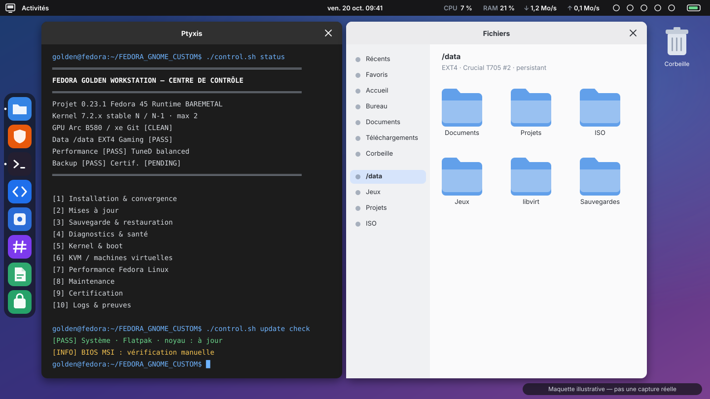
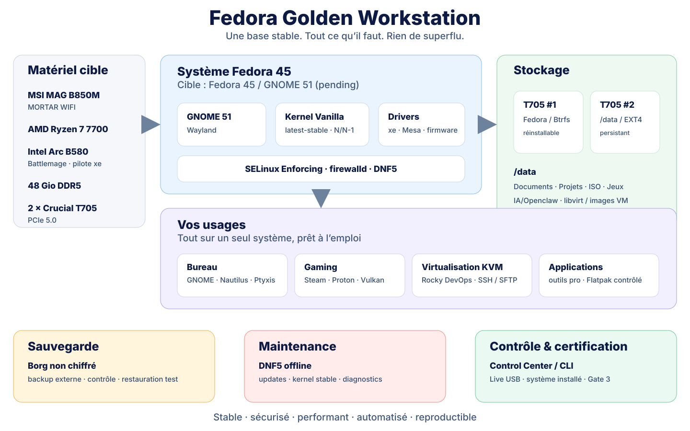
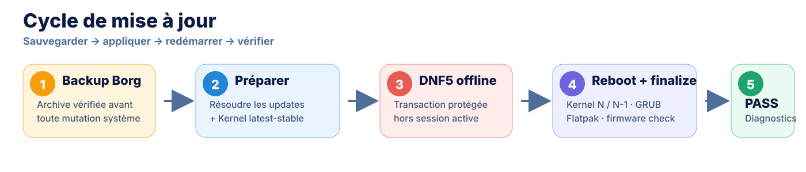
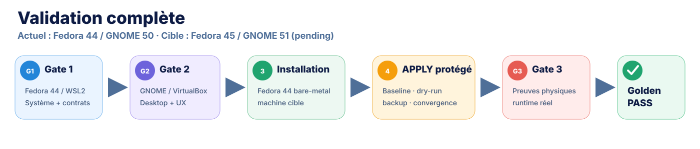

<div align="center">


# Fedora Golden Workstation

**Une Fedora Workstation sur mesure, expliquée, versionnée, sauvegardable et vérifiable**

**Installation neuve : Fedora 45 Workstation · GNOME 51**

**Ryzen 7 7700 · Intel Arc B580 · DevOps · Gaming · KVM**

[](https://github.com/mathiasseguincadiche/FEDORA_GNOME_CUSTOM/actions/workflows/tests.yml)
[](https://github.com/mathiasseguincadiche/FEDORA_GNOME_CUSTOM/actions/workflows/shell-quality.yml)
[](https://github.com/mathiasseguincadiche/FEDORA_GNOME_CUSTOM/actions/workflows/fedora-package-preflight.yml)
[](https://github.com/mathiasseguincadiche/FEDORA_GNOME_CUSTOM/actions/workflows/fedora-gaming-pretest.yml)
[](https://github.com/mathiasseguincadiche/FEDORA_GNOME_CUSTOM/actions/workflows/fedora45-package-preflight.yml)
[](https://github.com/mathiasseguincadiche/FEDORA_GNOME_CUSTOM/actions/workflows/release-readiness.yml)

**Golden Workstation 0.22.3**

Le dépôt décrit comment préparer, personnaliser, maintenir, sauvegarder et qualifier ce poste. **L'installation de production reste bloquée** tant que le média final signé et les paquets stables requis ne sont pas qualifiés et que le profil `pending` n'est pas promu. [Conditions de promotion](docs/FEDORA45_PRIMARY.md).

**État logiciel : CODE-READY seulement après CI verte du commit exact** · **Certification matérielle : Gate 3 bare-metal à exécuter**

</div>

> **Pourquoi ce projet existe, ses quatre piliers et les décisions du propriétaire : [docs/VISION.md](docs/VISION.md).** Vérifier les contrôles du commit exact ; la machine reste à certifier (Gate 2 puis Gate 3).
> Les sauvegardes utilisent Borg **sans chiffrement**, par décision du propriétaire (ADR 0014). Un PASS CI ne certifie pas le poste physique.
> La [fiche d'exécution physique](docs/PHYSICAL_QUALIFICATION_CHECKLIST.md) prépare les mesures sur le PC. La [qualification réseau Docker](docs/ROCKY_DEVOPS_READY.md#qualification-réseau-docker) couvre redémarrage/restauration (les notices de maintenance du labo Rocky Linux 10 restent visibles dans ces guides).

---

<p align="center">
  <a href="#en-bref">En bref</a> ·
  <a href="#aperçu-du-bureau">Aperçu</a> ·
  <a href="#démarrage-rapide">Démarrage</a> ·
  <a href="#architecture-globale">Architecture</a> ·
  <a href="#les-quatre-piliers">4 piliers</a> ·
  <a href="#matériel-cible">Matériel</a> ·
  <a href="#performance-fedora-linux">Performance</a> ·
  <a href="#finition-du-bureau-ubuntu-grade">Finition</a> ·
  <a href="#gaming">Gaming</a> ·
  <a href="#virtualisation">KVM</a> ·
  <a href="#sauvegarde-et-restauration">Backup</a> ·
  <a href="#mises-à-jour">Updates</a> ·
  <a href="#validation-complète--à-lire-avant-linstallation-de-production">Validation</a> ·
  <a href="#documentation">Docs</a>
</p>

## En bref

- **Quoi :** une Fedora Workstation installée, réglée, sauvegardée et diagnostiquée par scripts versionnés, avec un point d'entrée unique : `./control.sh`.
- **Pour qui / quoi :** un PC précis (Ryzen 7 7700, Intel Arc B580, 48 Gio, deux SSD) pour le DevOps, le gaming et les VM KVM.
- **Où on en est :** configuration et contrôles principaux sur Fedora 45 / GNOME 51 ; production verrouillée jusqu’au média final signé, à la promotion du profil et aux preuves du commit exact.
- **Par où commencer :** [Démarrage rapide](#démarrage-rapide), puis [l'installation bare-metal](#installation-bare-metal) et [la documentation](#documentation).

## L'idée de la Golden, expliquée simplement

**Imagine que tu réinstalles Fedora après une panne du SSD système.** Sur une installation traditionnelle, il faut se souvenir des commandes, des applications et de toutes les personnalisations. Ici, le dépôt devient **le plan vérifiable de la workstation** :

1. **Décrire** la machine et le résultat attendu : Ryzen 7 7700, Arc B580, deux T705, GNOME, DevOps et gaming.
2. **Préparer sans casser** : média Fedora authentifié, contrôles matériels, dry-run et sauvegarde Borg vérifiée.
3. **Construire** : modules ordonnés pour GNOME, pilotes natifs, noyau Linux amont stable, logiciels, données et KVM.
4. **Vérifier** : diagnostics, démarrage, récupération, tests CI et certification sur la vraie machine.
5. **Entretenir** : mises à jour contrôlées, noyau N/N-1, sauvegardes et restauration documentée.

La Golden **n'est pas** une distribution Fedora dérivée, une ISO personnalisée prête à flasher ou un simple thème GNOME. C'est une **méthode d'installation reproductible**, liée à un commit Git et à une configuration précise.

| Je veux comprendre… | Réponse courte | Document |
|---|---|---|
| **Pourquoi ce projet ?** | Un poste Fedora récent, soigné, rapide et récupérable | [Vision](docs/VISION.md) |
| **Comment ça marche ?** | Un plan Git → des préconditions → des modules → des preuves | [Architecture expliquée avec schémas](docs/ARCHITECTURE_PEDAGOGIQUE.md) |
| **À quoi ressemblera GNOME 51 ?** | Bureau natif Wayland, ergonomie GNOME choisie et extensions compatibles | [Le bureau GNOME](docs/GNOME.md) |
| **Pourquoi reste-t-il des fichiers Fedora 44 ?** | Ils servent uniquement au laboratoire historique lancé explicitement | [Historique Fedora 44](docs/HISTORICAL_FEDORA44.md) |
| **Puis-je installer tout de suite ?** | Seulement avec la release promue et les garde-fous de production | [Guide d'installation](docs/INSTALLATION_GUIDE.md) |
| **Comment sait-on que c'est réussi ?** | La CI teste le code ; la Gate 3 certifie le vrai matériel | [Validation en trois gates](docs/THREE_GATE_VALIDATION.md) |

> **Ce projet sert autant à obtenir une excellente workstation qu'à comprendre sa construction** : chaque composant a un rôle, chaque modification une raison, chaque réussite une preuve.

## Aperçu du bureau

<p align="center">
  
</p>

> **Maquette illustrative, pas une capture réelle.** Elle montre ce que le profil vise : GNOME 51 natif sous Wayland, dock à gauche avec les huit favoris certifiés, bouton « Afficher le bureau » et télémétrie CPU / RAM / réseau dans la barre, Corbeille sur le bureau, Ptyxis et Fichiers en tuilage, données de travail sur `/data`. Les captures réelles viendront de la Gate 3 sur la machine.

---

## État du projet

| Contrôle | État |
|---|---|
| **Code / contrats** | `CODE-READY` |
| **CI et protection de `main`** | Les contextes obligatoires du ruleset et les workflows exécutés sont distincts : voir [gouvernance](docs/GITHUB_GOVERNANCE.md) et [Actions](https://github.com/mathiasseguincadiche/FEDORA_GNOME_CUSTOM/actions). Ne pas déduire le statut courant d'une ancienne PR. |
| **Matériel cible** | MSI MAG B850M MORTAR WIFI · Ryzen 7 7700 · Arc B580 · 48 Gio · 2× Crucial T705 |
| **Fedora 45 / GNOME 51** | Référence de configuration et de CI ; profil `pending` jusqu'à qualification du média final signé et des paquets stables, puis promotion revue ([détails](docs/FEDORA45_PRIMARY.md)) |
| **Certification physique** | **PENDING** — Gate 3 bare-metal |
| **Golden runtime-certified** | Non, tant que `gate3 certify` n'a pas réussi sur la machine cible |

**Suivi de fiabilité :** [corrections, preuves et parcours restant](docs/RELIABILITY_QUALIFICATION.md).

Les badges ci-dessus donnent l'état live des principaux workflows. La CI prouve les contrats logiciels ; **elle ne remplace jamais la preuve physique Gate 3**.

---

## Démarrage rapide

**Avant une installation neuve :** commencer par le [contrôle USB Live Fedora 45 en cinq vérifications](docs/FEDORA45_LIVE_PREFLIGHT.md). Un résultat GO autorise uniquement la poursuite de la préparation, jamais une installation automatique. Le profil Fedora 45 reste `pending` tant que les conditions de promotion ne sont pas réunies.

Le point d'entrée public est le **Workstation Control Center**.

```bash
git clone https://github.com/mathiasseguincadiche/FEDORA_GNOME_CUSTOM.git
cd FEDORA_GNOME_CUSTOM
./control.sh
```

Routes opérateur essentielles :

```bash
./control.sh status
./control.sh install dry-run
./control.sh update check
./control.sh backup now
./control.sh doctor all
./control.sh doctor gaming
./control.sh perf status
./control.sh kernel status
./control.sh cert status
```

<details>
<summary><strong>Aperçu du Control Center</strong></summary>

```text
══════════════════════════════════════════════════════════════════════════════════════
  FEDORA GOLDEN WORKSTATION — CENTRE DE CONTRÔLE
══════════════════════════════════════════════════════════════════════════════════════
  Projet      0.22.3      Fedora 45      Runtime BAREMETAL
  Kernel      <kernel actif>             N / N-1 · max 2
  GPU         Arc B580 / xe              Git      [CLEAN]
  Data        /data EXT4                 Gaming   [PASS]
  Performance [PASS] TuneD balanced
  Backup      [PASS]                     Certif.  [PENDING]
══════════════════════════════════════════════════════════════════════════════════════

  [1] Installation & convergence
  [2] Mises à jour
  [3] Sauvegarde & restauration
  [4] Diagnostics & santé
  [5] Kernel & boot
  [6] KVM / machines virtuelles
  [7] Performance Fedora Linux
  [8] Maintenance
  [9] Certification
  [10] Logs & preuves
```

</details>

`./menu.sh` reste un alias de compatibilité. Le détail de l'interface est dans [`docs/CONTROL_CENTER.md`](docs/CONTROL_CENTER.md).

> **Important :** ne lancer `install apply` qu'après préparation du matériel, de `/data`, de la baseline et du backup pré-APPLY. Les garde-fous restent actifs même lorsque l'opération est lancée depuis le menu.

---

## Architecture globale

<p align="center">
  
</p>

**Architecture du poste.** Fedora Workstation constitue le système hôte. Le premier SSD héberge l'OS et les applications ; le second conserve les données de travail et les machines virtuelles sur `/data`. Le bureau GNOME, les outils DevOps et le gaming partagent ce socle, tandis que Borg assure les sauvegardes sur un support externe. Les opérations d'installation, de maintenance et de certification restent encadrées par les contrôles du projet.

Pour les responsabilités des composants, les conditions d'installation et les niveaux de validation, consulter [l'architecture détaillée](docs/ARCHITECTURE_PEDAGOGIQUE.md).

---

## Fedora 45 / GNOME 51

L'installation neuve suit directement le [guide Fedora 45 / GNOME 51](docs/INSTALLATION_GUIDE.md), après [promotion du profil](docs/FEDORA45_PRIMARY.md). La [migration depuis Fedora 44](docs/UPGRADE_FEDORA_45.md) concerne uniquement les anciens postes ; le [laboratoire Fedora 44](docs/HISTORICAL_FEDORA44.md) reste historique et facultatif.

## Les quatre piliers

Le projet poursuit quatre objectifs **d'importance égale** ; aucun n'a le droit d'en casser un autre ([vision complète](docs/VISION.md)).

| Pilier | Ce qu'on veut | Guide d'entrée |
|---|---|---|
| **Finition GNOME façon Ubuntu** | Dock, bureau, tuilage, applications harmonisées, soin de l'écran QD-OLED | [`docs/GNOME.md`](docs/GNOME.md) |
| **Performance et réactivité** | Dernier noyau stable, réglages mesurés, aucun réglage aveugle | [`docs/PERFORMANCE.md`](docs/PERFORMANCE.md) |
| **Fiabilité et sauvegardes** | Dry-run, baseline et sauvegarde avant toute modification ; restauration prouvée | [`docs/CERTIFICATION.md`](docs/CERTIFICATION.md) · [`docs/BACKUP_RESTORE.md`](docs/BACKUP_RESTORE.md) |
| **Outils DevOps** | KVM isolé, labo Rocky Linux, terminal et Bash soignés | [`docs/KVM_QUICKSTART.md`](docs/KVM_QUICKSTART.md) |

### Le socle technique

| Couche | Contrat |
|---|---|
| **HOST** | Fedora Linux 45 Workstation · GNOME 51 · Wayland · SELinux Enforcing · firewalld |
| **Kernel & hardware** | Linux amont officiel, dernière stable vérifiée sur kernel.org · politique **N / N-1** · Arc B580 sur `xe` · hardware cible mesuré |
| **Données & recovery** | T705 système Btrfs · T705 `/data` EXT4 · Borg non chiffré (ADR 0014) · restauration staging-first |
| **Workloads** | Desktop GNOME · applications pro · Steam/Proton · bibliothèque `/data/Jeux` · QEMU/KVM/libvirt |
| **Opérations** | dry-run avant mutation · DNF5 offline · diagnostics · rollback kernel · firmware en consultation |
| **Preuves & gouvernance** | CI obligatoire · logs/reports/fingerprints · Gate 1/2/3 · Golden release manifest |

```text
valider → mesurer → sauvegarder → converger → qualifier → certifier → maintenir
```

---

## Matériel cible

| Élément | Cible |
|---|---|
| Carte mère | MSI MAG B850M MORTAR WIFI |
| CPU | AMD Ryzen 7 7700 |
| RAM | 48 Gio DDR5, validation 5600 puis 6000 MT/s |
| GPU | Intel Arc B580 `8086:e20b`, pilote `xe` |
| GPU PCIe | ReBAR actif, lien x8, capacité ≥ PCIe 4.0 |
| SSD système | Crucial T705, Btrfs non chiffré |
| SSD données | Crucial T705, EXT4 monté sur `/data` |
| NVMe PCIe | x4, capacité PCIe 5.0 |
| Écran | ASUS ROG Strix OLED XG27AQDMES, 2560×1440/~240 Hz |

Le profil d'affichage est lié à l'EDID réellement certifié sur un connecteur appartenant à la B580. L'iGPU Ryzen est **désactivé dans le BIOS** par décision du propriétaire : la B580 est le seul GPU.

---

## Stockage persistant

Le premier T705 contient le système. Le second protège les données de travail d'une réinstallation du disque système.

```text
Crucial T705 #1
└── Fedora 45 / Btrfs (après promotion du profil)
    └── système, applications, HOME système

Crucial T705 #2
└── /data / EXT4
    ├── Documents/      → XDG Documents
    ├── Projets/        → travail / Git / DevOps
    ├── ISO/            → bibliothèque ISO
    ├── Jeux/           → bibliothèque Steam / jeux
    ├── IA/Openclaw/    → projets et sources Openclaw IA
    └── libvirt/        → images et données KVM
```

L’identité de `/data` est approuvée explicitement avec `baseline-doctor storage-identity` puis `enroll-data NUMERO_DE_SERIE`. Les contrôles suivants comparent les UUID des filesystems et les numéros de série des deux NVMe ; deux partitions du même disque ne sont pas acceptées.

Les corrections et leurs tests sont détaillés dans la [revue avant installation](docs/PREINSTALL_SAFETY_REVIEW.md).

Le dépôt **ne formate jamais automatiquement le second T705**. Une réinstallation doit remonter `/data` et réutiliser son contenu existant.

`Documents`, `Projets` et `IA/Openclaw` sont protégés par Borg. `ISO`, `Jeux` et **les VM** restent hors des sauvegardes automatiques. Le propriétaire exporte lui-même ses VM lorsqu'il en a besoin.

---

## Kernel et boot

Le projet accepte uniquement le **noyau officiel Linux amont stable, sans patch de distribution ni noyau personnalisé**. Sa référence est `latest_stable` sur [kernel.org](https://www.kernel.org/), vérifiée à chaque installation et mise à jour ; les RC et linux-next sont refusés ([ADR 0015](docs/adr/0015-official-upstream-linux.md)).

Les RPM `@kernel-vanilla/stable` permettent de suivre Linux indépendamment du calendrier des mises à jour Fedora. La dépendance `@kernel-vanilla/fedora` fournit aussi des noyaux amont sans patch. Une version RPM en retard sur kernel.org bloque l'installation : elle n'est jamais présentée comme « dernière stable ». Les [sources officielles signées](docs/UPSTREAM_LINUX.md) peuvent être récupérées immédiatement ; ce téléchargement ne compile ni n'installe un noyau.

```text
N   = dernière stable officielle effectivement installée, défaut GRUB
N-1 = version installée immédiatement précédente, conservée pour revenir en arrière
max = 2 versions kernel-core ; aucun second canal ni secours supplémentaire épinglé
```

Lors du premier passage, le noyau Fedora déjà démarré peut servir de N-1. Après une deuxième mise à jour amont, N et N-1 sont tous deux amont. DNF protège le noyau en cours d'exécution : si cela empêche la rétention à deux versions, il faut démarrer sur N puis relancer la purge. Secure Boot actif ou indéterminé bloque l'installation ; aucune protection n'est désactivée automatiquement.

Commandes ciblées :

```bash
./diagnostics/kernel-doctor
./control.sh kernel install-latest
./control.sh kernel prune
./control.sh kernel rollback
./control.sh kernel rollback-fedora   # récupération d'urgence uniquement
```

---

## Performance Fedora Linux

La Golden Workstation ajoute une couche de performance **mesurée, réversible et Fedora-native** :

- AMD P-State/EPP observé et qualifié sur le Ryzen 7 7700 ;
- TuneD/tuned-ppd comme pont avec les profils d'alimentation GNOME ;
- `sched_ext`/SCX disponible en mode `auto`, mais jamais activé globalement sans smoke test bare-metal ;
- zram conservé sur les defaults Fedora ;
- NVMe T705 en politique `benchmark-only`, sans ADIOS/APST/ASPM forcé ;
- GameMode dynamique par workload ;
- analyse de frametimes MangoHud p50/p95/p99/p99.9 pour les comparaisons A/B à 240 Hz.

```bash
./control.sh perf status
./control.sh perf balanced
./control.sh perf performance
./control.sh perf sched-status
./control.sh perf sched-smoke
./control.sh perf zram
./control.sh perf nvme
```

Le contrat interdit les tweaks globaux non mesurés : pas de `sysctl -w` de performance, pas de `nohz_full`, pas de scheduler I/O expérimental imposé, pas d'overclock GPU automatique. La Gate 3 exige aussi le contrat performance Golden dans son état normal avant de produire un PASS final. Voir [`docs/PERFORMANCE.md`](docs/PERFORMANCE.md).

---

## Finition du bureau Ubuntu-grade

Fedora livre GNOME brut ; Ubuntu y ajoute une finition. Le module `gnome.polish` apporte **la même finition sur Fedora** ([`docs/GNOME_POLISH.md`](docs/GNOME_POLISH.md), [ADR 0013](docs/adr/0013-ubuntu-grade-gnome-polish.md)) :

- dock à gauche avec masquage intelligent pour l’écran OLED, clic = focus / réduire / aperçus ;
- session ouverte directement sur le bureau ;
- **Tiling Assistant** (l'« Enhanced Tiling » d'Ubuntu), épinglé par SHA-256 ;
- couleur d'accent, jour dans l'horloge, fenêtres centrées ;
- applications GTK3 au look libadwaita, qui suivent le mode clair/sombre.

```bash
./control.sh doctor polish
```

Tout est réglable dans `config/local.conf`, sans toucher au code.

---

## Intégration du bureau et des périphériques

GNOME Logiciels reste le catalogue d’applications ; ses mises à jour sont verrouillées pour conserver la sauvegarde préalable et la transaction système via `./control.sh update all`. Les Flatpak se mettent à jour explicitement avec `flatpak update`. Après APPLY, ouvrir une nouvelle session puis vérifier `diagnostics/lifecycle-doctor`.

GNOME Disques et Flatseal sont intégrés au catalogue. Le laboratoire Fedora 45 teste les six extensions actives et un aller-retour bureautique réel. Les contrôles de présence/sandbox ne remplacent pas les essais d’usage, de partage d’écran ou de webcam. Les identités audio de la carte mère et Brio 100 sont enrôlées séparément ; les capacités Wi-Fi déclarées obligatoires bloquent si elles ne sont pas prouvées.

L’afficheur DeepCool LD240 dispose d’une intégration **facultative**, communautaire et épinglée, inactive par défaut. Voir [le guide d’intégration et de qualification](docs/DESKTOP_COMPLETION.md). La qualification matérielle reste à exécuter sur le PC.

---

## Gaming

Gaming fait partie du **profil Golden canonique**.

Le socle couvre Steam RPM, Proton géré par Steam, Mesa/Vulkan x86_64+i686, GameMode, MangoHud, GOverlay, Gamescope, Steam Input et la bibliothèque persistante `/data/Jeux`.

Le projet conserve la pile graphique Fedora : pas de Mesa git/COPR, pas de `force_probe`, pas de Proton-GE imposé globalement. Le pilote `xe` vient du noyau Linux amont officiel ; Mesa/ANV restent fournis par Fedora.

```bash
./control.sh doctor gaming
```

La preuve finale reste bare-metal : rendu Vulkan Arc B580, Wayland, VRR/~240 Hz et lancement Steam/Proton. Voir [`docs/GAMING.md`](docs/GAMING.md).

---

## Accès distant

Profil **optionnel et désactivé par défaut** pour piloter le PC depuis une tablette : Tailscale (aucun port exposé), SSH par clés, Wake-on-LAN et, en option, Sunshine + Moonlight.

```bash
./control.sh remote status   # contrôle complet, lecture seule
./control.sh remote info     # MAC / diffusion LAN à reporter sur le relais de réveil
```

Le réveil d'un PC éteint exige un **relais toujours allumé** sur le LAN, et le Wake-on-LAN depuis un arrêt complet se **mesure** au Gate 3. Le guide analyse l'architecture demandée, ses limites et ses alternatives : [`docs/REMOTE_ACCESS.md`](docs/REMOTE_ACCESS.md) · [ADR 0017](docs/adr/0017-remote-access.md).

---

## Virtualisation

KVM/libvirt est isolé du profil Gaming et utilise le second T705.

```text
qemu:///system
└── pool devops-data → /data/libvirt/images

réseau devops-nat
└── virbr50 / 192.168.50.0/24
    ├── Internet autorisé
    ├── forwarding entrant refusé
    └── accès aux réseaux HOST protégés fail-closed
```

Profils prévus :

- **Rocky Linux 10.2 DevOps** — Q35, host-passthrough, VirtIO, cloud image authentifiée ;
- **Windows 11** — Q35, TPM 2.0, UEFI Secure Boot, VirtIO, QEMU Guest Agent.

```bash
./control.sh kvm status
```

Pour créer Windows, fournir les deux ISO et leurs empreintes SHA-256 issues des sources de confiance. Remplacer les valeurs d'exemple avant exécution :

```bash
./control.sh kvm create-windows \
  --windows-iso /data/libvirt/iso/windows-11.iso \
  --virtio-iso /data/libvirt/iso/virtio-win.iso \
  --windows-sha256 '<sha256-windows-de-confiance>' \
  --virtio-sha256 '<sha256-virtio-de-confiance>'
```

La préparation de l'image Rocky signée, les préconditions et les deux procédures de création sont dans [`docs/KVM_QUICKSTART.md`](docs/KVM_QUICKSTART.md). Voir [`docs/VIRTUALIZATION.md`](docs/VIRTUALIZATION.md) pour les contrats techniques.

---

## Mises à jour

La maintenance suit une chaîne protégée :

<p align="center">
  
</p>

```bash
./control.sh update all
./control.sh update status
./control.sh update reboot
# après le redémarrage
./control.sh update finalize
```

`finalize` vérifie le nouveau kernel, GRUB, `dnf5 check`, puis applique la rétention N/N-1. Aucun firmware n'est flashé automatiquement.

Si le dernier noyau stable n'est pas encore publié en paquet (ou si kernel.org est injoignable), **seul le noyau est reporté** : toutes les autres mises à jour, sécurité comprise, sont appliquées, et le bilan l'indique ([détails](docs/UPSTREAM_LINUX.md)).

---

## Sauvegarde et restauration

Borg fournit la deuxième couche de résilience :

```text
T705 système perdu
    → réinstallation Fedora
    → /data conservé

T705 données perdu
    → Borg externe (non chiffré, ADR 0014)
    → restauration staging-first
```

```bash
./control.sh backup now
./control.sh backup check
./control.sh backup deep
./control.sh backup restore latest
./control.sh backup dr-plan
```

Les sauvegardes Borg concernent uniquement le HOST et les données utilisateur ; elles n'exportent aucun disque QCOW2, XML libvirt, état UEFI/TPM ni média cloud-init. Les VM sont gérées et exportées manuellement par leur propriétaire. Une restauration Borg ne remplace jamais silencieusement le système actif.

Voir [`docs/BACKUP_RESTORE.md`](docs/BACKUP_RESTORE.md).

---

## Sécurité et garde-fous

Les invariants principaux sont explicites :

- SELinux **Enforcing** ;
- firewalld actif ;
- Secure Boot **désactivé** par politique ;
- aucun LUKS/dm-crypt sur les disques locaux du HOST ;
- les sauvegardes Borg externes ne sont pas chiffrées non plus (ADR 0014) : le disque de sauvegarde se range comme un document sensible ;
- aucun formatage automatique du second T705 ;
- aucun flash firmware automatique ;
- aucun GPU passthrough de la B580 ;
- aucun `force_probe`, Mesa git ou dépôt GPU tiers ;
- réseau KVM fail-closed ;
- APPLY réel uniquement sur bare-metal, avec Git propre, baseline, dry-run et backup valides.

Lire [`SECURITY.md`](SECURITY.md) et [`docs/HOST_SECURITY_POLICY.md`](docs/HOST_SECURITY_POLICY.md) avant de modifier ces invariants.

---

## Documentation

Le README reste la **synthèse opérateur** ; les détails normatifs et runbooks vivent dans `docs/`.

| Besoin | Référence |
|---|---|
| Comprendre pourquoi | [`docs/VISION.md`](docs/VISION.md) · [`docs/CAHIER_DES_CHARGES.md`](docs/CAHIER_DES_CHARGES.md) |
| Installer | [`docs/INSTALLATION_GUIDE.md`](docs/INSTALLATION_GUIDE.md) · [`docs/HARDWARE_BASELINE_CERTIFICATION.md`](docs/HARDWARE_BASELINE_CERTIFICATION.md) |
| Piloter | [`docs/CONTROL_CENTER.md`](docs/CONTROL_CENTER.md) |
| Comprendre l'architecture | **[`docs/ARCHITECTURE_PEDAGOGIQUE.md`](docs/ARCHITECTURE_PEDAGOGIQUE.md)** · [`docs/GOLDEN_WORKSTATION.md`](docs/GOLDEN_WORKSTATION.md) · [`docs/adr/README.md`](docs/adr/README.md) |
| Performance / Linux amont | [`docs/PERFORMANCE.md`](docs/PERFORMANCE.md) · [`docs/UPSTREAM_LINUX.md`](docs/UPSTREAM_LINUX.md) |
| Bureau GNOME | [`docs/GNOME.md`](docs/GNOME.md) · [`docs/GNOME_POLISH.md`](docs/GNOME_POLISH.md) |
| Gaming | [`docs/GAMING.md`](docs/GAMING.md) |
| KVM | [`docs/KVM_QUICKSTART.md`](docs/KVM_QUICKSTART.md) · [`docs/VIRTUALIZATION.md`](docs/VIRTUALIZATION.md) |
| Backup / recovery | [`docs/BACKUP_RESTORE.md`](docs/BACKUP_RESTORE.md) |
| Dépanner | [`docs/TROUBLESHOOTING.md`](docs/TROUBLESHOOTING.md) |
| Certifier | [`docs/CERTIFICATION.md`](docs/CERTIFICATION.md) · [`docs/GATE2_GUIDE_PAS_A_PAS.md`](docs/GATE2_GUIDE_PAS_A_PAS.md) · [`docs/THREE_GATE_VALIDATION.md`](docs/THREE_GATE_VALIDATION.md) |
| Reproduire une release | [`docs/GOLDEN_RELEASE.md`](docs/GOLDEN_RELEASE.md) |
| Comprendre la CI | [`docs/CI_VALIDATION.md`](docs/CI_VALIDATION.md) |

Le portail complet se trouve dans [`docs/README.md`](docs/README.md).

La source de vérité reste :

```text
code + configuration + tests CI
            ↓
document normatif courant
            ↓
document historique / release note
```

---

## Contribuer

Les changements doivent préserver les garde-fous Golden et passer la CI avant fusion.

Lire [`CONTRIBUTING.md`](CONTRIBUTING.md) avant d'ouvrir une PR. Les bugs, problèmes de validation hardware et écarts documentaires disposent de templates dédiés dans GitHub Issues.

---

## Validation complète — à lire avant l'installation de production

> Gate 1 et Gate 2 sont des prévalidations avant installation de production. **Gate 3 est la certification de la vraie machine après installation/APPLY** ; il ne peut donc pas être déclaré PASS à l'avance.

<p align="center">
  
</p>

### Gate 1 — système / WSL2

Le [guide WSL2](docs/WSL2_VALIDATION.md) décrit l'exécution et l'export de la preuve portable, avec `hardware_certification=DEFERRED`.

### Gate 2 — GNOME / VirtualBox

Après import de la preuve Gate 1, le [guide Gate 2 pas à pas](docs/GATE2_GUIDE_PAS_A_PAS.md) vérifie GNOME 51/Wayland, Nautilus, Ptyxis, extensions et contrôles visuels. La preuve ne déverrouille pas l'APPLY bare-metal.

### Installation bare-metal

La procédure détaillée est dans [`docs/INSTALLATION_GUIDE.md`](docs/INSTALLATION_GUIDE.md). Le chemin normal est :

```text
média final Fedora 45 vérifié + profil promu
      ↓
second T705 /data préparé et identité physique approuvée
      ↓
baseline hardware + configuration définitive approuvée
      ↓
./control.sh install dry-run
      ↓
./control.sh install backup
      ↓
./control.sh install apply
      ↓
reboot sur le dernier Linux amont stable N
      ↓
qualification matérielle Gate 3
```

### Gate 3 — certification physique

Après installation et redémarrage, importer les preuves Gate 1 et Gate 2 sur le HOST, puis qualifier GPU/Vulkan, LAN, Wi-Fi, audio, affichage VRR/HDR, KVM/Windows et cinq cycles veille/réveil. Le [guide des trois gates](docs/THREE_GATE_VALIDATION.md) et le [runbook de clôture](docs/GOLDEN_COMPLETENESS_CLOSURE.md) donnent les commandes et preuves requises avant `./control.sh validate gate3 certify`.

Un PASS produit le marker Golden et [`golden-release.json`](docs/GOLDEN_RELEASE.md). La workstation devient **Golden runtime-certified** uniquement après cette certification sur le matériel cible.
