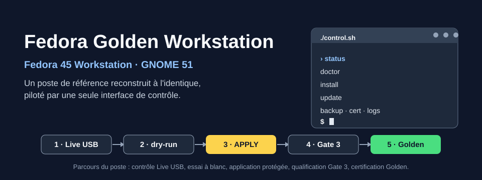
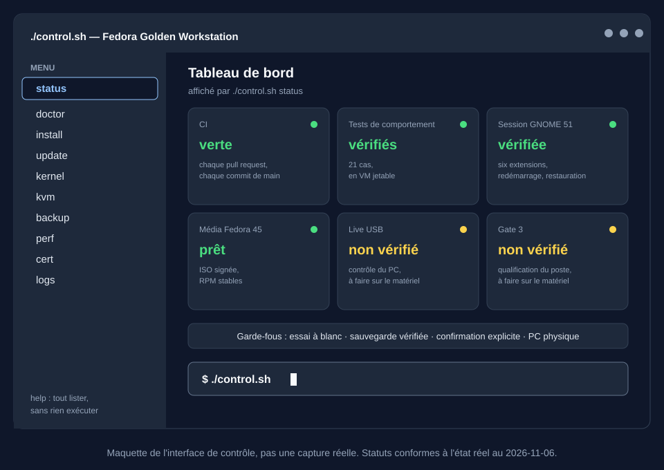

# Fedora Golden Workstation

**72 pages de documentation** · **77 modules décrits** · **21 cas de comportement testés** · **16 domaines de commandes**

*(constatés sur `main` le 2026-11-06)*

## Le problème que ce dépôt règle

Une installation faite à la main se perd : après une réinstallation, il faut retrouver chaque réglage, chaque logiciel et chaque correctif, sans savoir si le résultat est le même. Ici, tout vit dans un dépôt Git : chaque réglage est versionné, expliqué, testé et rejouable. Le dépôt décrit un PC précis consacré au développement, au jeu vidéo et aux machines virtuelles, et sert de terrain d'apprentissage des pratiques DevOps : configuration déclarative, tests de comportement, intégration continue et preuves.

## Tout se pilote depuis la console

Tester le PC avant d'installer, installer, configurer, diagnostiquer, entretenir, sauvegarder, prouver : chaque interaction avec le poste passe par `./control.sh`, l'**interface de contrôle** unique. Sans argument, il ouvre le menu interactif ; `./control.sh help` liste toutes les commandes sans rien exécuter.

*Maquette illustrative, pas une capture réelle ; les statuts affichés reprennent l'[état réel](#état-réel) du projet.*

Le parcours du poste, de bout en bout :

- **Tester avant d'installer**, depuis le Live USB : `./control.sh validate live plan` puis `./control.sh validate live run`
- **Voir le plan d'installation**, sans rien écrire : `./control.sh install dry-run`
- **Installer réellement**, PC physique uniquement : `./control.sh install apply`
- **Connaître l'état du poste** : `./control.sh status`
- **Diagnostiquer** : `./control.sh doctor all`
- **Mettre à jour** : `./control.sh update all`
- **Sauvegarder** : `./control.sh backup now`
- **Qualifier le poste installé** : `./control.sh validate gate3 status`

Rien ne s'applique sans essai à blanc, sauvegarde vérifiée et confirmation explicite, et uniquement sur le PC physique. La liste complète des commandes, qui fait foi : le [centre de contrôle](docs/CONTROL_CENTER.md) ; les réglages propres au poste : `config/local.conf`.

## Trois promesses

- **Reproductible** : la même Fedora, sur le même matériel, reconstruite à l'identique ; tout est décrit dans le dépôt et se vérifie par un essai à blanc avant d'agir.
- **Prouvé** : la CI contrôle chaque pull request et chaque commit ; l'[état réel](#état-réel) distingue ce qui est vérifié de ce qui ne l'est pas ; seule la Gate 3 qualifie le PC.
- **Gardé** : rien ne s'applique sans sauvegarde vérifiée ni confirmation explicite, uniquement sur le PC physique ; les garde-fous ne se retirent jamais.

## Le poste en bref

- **Système** : Fedora 45 Workstation · GNOME 51 sous Wayland
- **Machine** : Ryzen 7 7700 · Intel Arc B580 · 48 Gio de RAM · deux SSD Crucial T705 ([architecture](docs/ARCHITECTURE.md#le-matériel-cible))
- **Usages** : développement, jeu vidéo, machines virtuelles KVM
- **Interface de contrôle** : `./control.sh` ([centre de contrôle](docs/CONTROL_CENTER.md))

*Maquette illustrative, pas une capture réelle. Les captures du poste seront ajoutées après sa qualification matérielle.*

Ce que le dépôt installe, domaine par domaine

- **Bureau** : GNOME sous Wayland, dock, bureau avec icônes, tuilage, applications GTK4, soin de l'écran QD-OLED ([GNOME](docs/GNOME.md))
- **Données** : un second SSD monté sur `/data`, conservé lors d'une réinstallation : documents, projets, jeux, disques des VM ([Installation](docs/INSTALLATION_GUIDE.md))
- **Sauvegardes** : Borg vers un SSD externe, sauvegarde vérifiée avant toute application, restauration d'abord dans un dossier d'essai ([Sauvegardes](docs/BACKUP_RESTORE.md))
- **Développement** : terminal Ptyxis et Bash, laboratoire Rocky Linux en machine virtuelle KVM, réseau isolé du réseau local ([KVM](docs/KVM_QUICKSTART.md))
- **Jeu vidéo** : Steam, Proton et Vulkan sur l'Intel Arc B580 ([Gaming](docs/GAMING.md))
- **Entretien** : mises à jour, noyau Linux amont avec retour arrière, diagnostics par domaine ([Centre de contrôle](docs/CONTROL_CENTER.md))

## Démarrer

- Sans matériel : cloner le dépôt, puis `python3 -B tests/test_docs_integrity.py` ; la [CI](docs/CI_VALIDATION.md) reste l'autorité.
- Sur le PC : la console, ci-dessus, du test Live USB à la qualification.
- Pour comprendre : les [notions clés](docs/CONCEPTS.md) ; pour tous les guides : le [portail de la documentation](docs/README.md).

## État réel

Ce tableau distingue ce que le dépôt contient, ce que la CI a vérifié et ce qui reste à prouver sur le vrai PC. Dernière mise à jour : 2026-11-04.

| Élément | Statut | Preuve |
|---|---|---|
| Configuration, scripts, modules et diagnostics | Réalisé | Ce dépôt |
| Tests de comportement et contrats | Vérifié par la CI le 2026-11-04, au commit `0007d97` de la préversion [v0.24.1-rc.1](https://github.com/mathiasseguincadiche/FEDORA_GNOME_CUSTOM/releases/tag/v0.24.1-rc.1) | [run `Tests`](https://github.com/mathiasseguincadiche/FEDORA_GNOME_CUSTOM/actions/runs/41880009717) ; les mêmes contrôles tournent sur chaque PR et chaque commit de `main` ([CI](docs/CI_VALIDATION.md)) |
| Session GNOME 51 avec les six extensions, redémarrage et restauration | Vérifié par la CI le 2026-11-04, au même commit, en VM jetable | même [run `Tests`](https://github.com/mathiasseguincadiche/FEDORA_GNOME_CUSTOM/actions/runs/41880009717) ([laboratoire Fedora/GNOME](docs/FEDORA_GNOME_CI_LAB.md)) |
| Profil Fedora 45 : média final 1.4 et RPM stables | Vérifié le 2026-11-03 | Signature du CHECKSUM et SHA-256 de l'ISO ([fiche Fedora 45](docs/FEDORA45_PRIMARY.md)) |
| Contrôle du PC depuis le Live USB | Non vérifié | À faire sur le matériel |
| Installation, application et qualification (Gate 3) | Non vérifié | À faire sur le matériel ([qualification](docs/QUALIFICATION.md)) |

**Une CI verte ne certifie pas le PC.** Seule la Gate 3, exécutée sur la machine installée, peut établir le statut « Golden runtime-certified ». Les versions publiées sont listées dans les [releases](https://github.com/mathiasseguincadiche/FEDORA_GNOME_CUSTOM/releases) ; les prochaines étapes, dans la [feuille de route](docs/ROADMAP.md).

## Contexte, contribution et licence

Projet personnel de [@mathiasseguincadiche](https://github.com/mathiasseguincadiche), propriétaire du PC et terrain d'apprentissage des pratiques DevOps. Il fixe les objectifs, consigne les [décisions (ADR)](docs/adr/README.md) et le niveau de preuve exigé, et fusionne lui-même chaque pull request.

Les changements passent par pull request, avec les tests adaptés à leur portée ([consignes de contribution](CONTRIBUTING.md)) ; l'[historique des versions](CHANGELOG.md) retrace les changements. Licence : [Apache License 2.0](LICENSE) ; la version courante figure dans [`VERSION`](VERSION).
