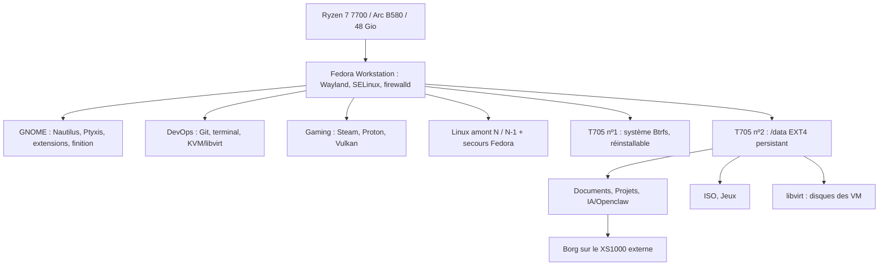

# Vision et architecture

## Pourquoi ce projet

Faire de **Fedora + GNOME l'OS principal** du propriétaire, sur **son PC exact**, et que ce soit la meilleure installation possible : la plus récente (Fedora 45 / GNOME 51), la plus finie (l'ergonomie qu'Ubuntu apporte à GNOME), la plus réactive, et **reproductible et récupérable**. Un dépôt plutôt qu'une installation à la main : chaque réglage est écrit, expliqué, vérifiable et rejouable, ce qui sert aussi d'apprentissage des pratiques DevOps (configuration déclarative, tests, CI, preuves).

**Golden** veut dire *installation de référence reproductible et vérifiable*, pas « ISO modifiée » ni « certification déjà acquise ». Le profil Fedora 45 reste `pending` jusqu'à la promotion du média final ([fiche Fedora 45](FEDORA45_PRIMARY.md)).

Quatre piliers d'importance égale ; aucun n'a le droit d'en casser un autre (une optimisation qui rend la machine instable ou impossible à sauvegarder est refusée, une finition qui fige l'écran OLED aussi) :

| Pilier | Ce qu'on veut | Où |
|---|---|---|
| Finition GNOME | dock, bureau avec icônes, tuilage, apps GTK3 harmonisées, soin OLED | [GNOME](GNOME.md), ADR 0013 |
| Performance | noyau stable le plus récent, réglages mesurés, aucun réglage aveugle | [performance](PERFORMANCE.md), [Linux amont](UPSTREAM_LINUX.md) |
| Fiabilité et sauvegardes | rien sans dry-run, baseline et sauvegarde ; restauration prouvée | [qualification](QUALIFICATION.md), [sauvegardes](BACKUP_RESTORE.md) |
| Outils DevOps | KVM isolé, labo Rocky en VM, terminal et Bash soignés | [KVM](KVM_QUICKSTART.md), [Ptyxis](PTYXIS.md) |

## Le matériel cible

| Composant | Modèle | Ce que le projet en fait |
|---|---|---|
| Processeur | AMD Ryzen 7 7700 (8C/16T, 65 W) | amd-pstate, profils d'énergie, contrôle de stabilité |
| Carte mère | MSI MAG B850M Mortar WiFi, BIOS 1.A66 minimum | identité vérifiée ; BIOS mis à jour par le propriétaire, aucune version exacte imposée |
| Mémoire | 48 Go DDR5-6000 CL30 (2 × 24 Go G.Skill) | testée à 5600 puis 6000 MT/s (EXPO/XMP) |
| GPU | ASRock Intel Arc B580 Challenger 12 Go | pilote `xe` et Mesa de Fedora, réservé à l'hôte |
| Stockage | 2 × Crucial T705 1 To (PCIe 5.0) | système Btrfs sur le premier, `/data` EXT4 persistant sur le second |
| Sauvegarde | Kingston XS1000 USB 3.2 (~1,8 To) | cible Borg externe en ext4 |
| Réseau | Wi-Fi 7 Qualcomm FastConnect 7800, Realtek 5 GbE, Bluetooth Qualcomm | identités et pilotes vérifiés |
| Audio, webcam | Realtek ALC4080, Logitech Brio 100 | identités vérifiées |
| Écran | ASUS ROG Strix XG27AQDMES, 27" QD-OLED 1440p 240 Hz | 2560×1440 à 240 Hz, reprise après veille, soin OLED |
| Refroidissement | DeepCool LD240 (AIO 240 mm), 3 × Arctic P12 Pro | surveillance ; afficheur LD240 en option manuelle |
| Alimentation, boîtier | Corsair RM650e, ASUS Prime AP201 | — |

## Décisions du propriétaire

Ces choix sont volontaires. Une maintenance ne les « corrige » pas sans nouvelle décision écrite (ADR) :

- **aucun chiffrement** des disques (ADR 0002) ni des sauvegardes (ADR 0014), mais jamais de clé SSH ou GnuPG dans Borg (ADR 0021) ;
- **Secure Boot désactivé** (ADR 0002) ; le projet ne le désactive ni ne gère de clé MOK lui-même ;
- **noyau** : Linux amont officiel stable (ADR 0015), avec un noyau Fedora signé en secours (ADR 0020) ; un retard de publication du noyau ne bloque jamais les autres mises à jour ;
- **labo DevOps** : Rocky Linux 10.2 en VM KVM, créée uniquement à la demande ;
- **pas de nouvelle fonctionnalité avant la Gate 3** : la priorité est la première installation réelle certifiée. On améliore par petites étapes vérifiées, et chaque ajout sert un pilier.

## Ce que contient le dépôt

| Élément | Rôle | Exemple |
|---|---|---|
| `config/`, `manifests/`, `profiles/` | le résultat voulu (le plan de la maison) | `config/kernel.conf`, `manifests/module-plan.conf` |
| `config/local.conf` | les choix propres au PC, non versionnés | `REAL_MACHINE_APPROVED=true` |
| `control.sh` | la façade de l'opérateur ; aucune logique métier | `./control.sh status` |
| `install.sh`, `lib/` | l'orchestration du dry-run et de l'APPLY, les verrous | `lib/apply_gate.sh` |
| `modules/` | les étapes spécialisées : precheck, plan, apply, postcheck | `modules/gnome/` |
| `scripts/` | les opérations ciblées : noyau, KVM, sauvegarde, mise à jour | `scripts/maintenance/update-system.sh` |
| `diagnostics/` | les doctors : lire le système, jamais transformer un échec en succès | `./control.sh doctor all` |
| `installer/` | vérification du média, Kickstart sur un disque explicite | `installer/verify-fedora-media.sh` |
| `tests/`, `.github/workflows/` | contrats, tests de comportement, laboratoires CI | `tests/test_docs_integrity.py` |
| `state/`, `logs/` (locaux) | preuves, états et journaux d'exécution | preuve liée au commit courant |

`install.sh` exécute les modules dans l'ordre de `manifests/module-plan.conf` ; il n'existe aucun raccourci « tout forcer ».

## Le système obtenu



**Deux SSD ne font pas deux sauvegardes.** Le T705 système se reconstruit depuis le dépôt. Le T705 `/data` survit à une réinstallation et n'est jamais formaté par le projet. Il ne protège pas contre sa propre panne, un effacement ou une compromission : c'est le rôle de Borg, sur un support externe non chiffré à ranger comme un document sensible. `ISO` et `Jeux` sont hors Borg par défaut ; les VM s'exportent à la main.

**La B580 reste à l'hôte** (bureau, Vulkan, Steam) : jamais de VFIO vers une VM. **GNOME n'est pas « une extension »** : les six extensions remplissent des fonctions précises ([GNOME](GNOME.md)).

## Contrat d'exécution

- `./diagnostic.sh` et les doctors sont en **lecture seule** : aucun paquet, service ou périphérique modifié.
- `./install.sh --dry-run` exécute precheck, plan, apply et postcheck avec toutes les mutations neutralisées, et écrit une preuve liée au commit, à la configuration effective, au plan de modules et à l'empreinte matérielle. Hors du PC physique, il peut s'arrêter sur une preuve matérielle indisponible : ce refus n'autorise jamais l'APPLY.
- `./install.sh --apply` exige : Fedora 45 installé et démarré sur le PC physique (jamais une VM, WSL, un conteneur, la CI ni la session Live) ; un profil `ready` ; `REAL_MACHINE_APPROVED=true` dans `config/local.conf` ; un terminal interactif ; un dépôt Git propre ; un dry-run réussi au même état ; une baseline valide pour l'empreinte courante ; une sauvegarde pré-APPLY récente, vérifiée et liée au même état ; la phrase exacte `APPLY FEDORA 45 WORKSTATION`.
- Le Live USB observe le matériel sans installer de paquet ni toucher aux SSD ; sa preuve est exportée puis importée sur le système installé.

**Interdits, sans exception** : formatage ou partitionnement automatique ; `force_probe` GPU ou dépôt Mesa expérimental ; désactivation de SELinux ou firewalld ; changement automatique de C-State, ASPM, APST ou mode de veille (`pcie_aspm=off`, `mem_sleep_default`…) ; VFIO de la B580 ; contournement de la barrière du système installé.

## Chaîne de confiance

```text
Fedora 45 neuve → baseline matérielle → dry-run → sauvegarde Borg + restauration canari
  → APPLY protégé → redémarrage sur Linux amont N → doctors (matériel, bureau, KVM, sauvegarde)
  → 5 cycles de veille → certification → matrice logicielle de référence
```

La baseline (avant l'APPLY) et la certification (après) sont séparées : un défaut que l'APPLY doit corriger ne doit pas empêcher d'installer son correctif. Remédiation : **mesurer → reproduire → corriger → recertifier**. Détails : [qualification](QUALIFICATION.md).

Trois niveaux à ne jamais confondre :

| Statut | Ce qu'il veut dire |
|---|---|
| CI verte | le commit testé passe les contrôles automatisés ; rien n'est installé ni prouvé sur le PC |
| Live `PREINSTALL_ONLY` | observations sur le PC avant installation |
| Golden runtime-certified | Gate 3 réussie et encore valide pour le matériel, le code et la configuration ; une évolution peut la rendre `STALE`, et l'on requalifie au lieu de réécrire un marqueur |

## Invariants par domaine

- **Noyau** : Linux amont stable depuis `@kernel-vanilla/stable`, version comparée à kernel.org, plancher dans `config/kernel.conf`, RC et paquets en retard refusés. N est le défaut, N-1 le retour arrière, un noyau Fedora signé le secours. Voir [Linux amont](UPSTREAM_LINUX.md).
- **Stockage** : root et `/data` sur deux NVMe physiques distincts. L'APPLY crée `Documents`, `Projets`, `ISO`, `Jeux`, `IA/Openclaw` et `libvirt` sans supprimer leur contenu (`0750`, `user_home_t` ; `virt_image_t` pour libvirt). XDG Documents pointe vers `/data/Documents`, sans lien symbolique bricolé dans le HOME. Aucun test n'écrit sur un disque brut.
- **GPU** : `8086:e20b` sur `xe` ; le projet valide noyau, firmware, Mesa, Vulkan, VA-API et calcul au lieu de forcer quoi que ce soit.
- **Affichage** : 2560×1440 à ~240 Hz, échelle 1.0, SDR, RGB complet. Un texte dégradé après veille est d'abord un problème DRM/KMS/Mutter, pas Fontconfig. Le watcher capture la disposition avant la veille et ne la rétablit que si les mêmes écrans et modes existent (échelle, position, écran principal, HDR et plage RGB conservés ; aucune écriture si rien ne change). Les options `DISPLAY_REPAIR_ON_*` contrôlent les watchers ; `~/.local/libexec/fedora-gnome-display-repair --reset-certified` réimpose le profil et refuse plusieurs écrans.
- **Nautilus** : démarrage à froid mesuré de `nautilus --new-window` jusqu'à l'apparition de `org.gnome.Nautilus` sur D-Bus ; cible 1200 ms, limite 2000 ms. Le préchauffage du login touche Portal/GIO mais ne lance jamais Nautilus.
- **Performance** : P-State/EPP observé, TuneD/tuned-ppd, zram aux valeurs Fedora, GameMode par jeu, sched_ext jamais imposé sans essai, T705 en `benchmark-only`, frametimes comparés. Le mode certifiable reste `balanced` ([performance](PERFORMANCE.md)).
- **KVM** : `qemu:///system`, pool sur `/data/libvirt/images`, réseau `devops-nat` IPv4 seulement, guard fail-closed, image Rocky authentifiée avant création du disque ([virtualisation](VIRTUALIZATION.md), [réseau KVM](KVM_NETWORK.md)).
- **Sauvegarde** : dépôt Borg non chiffré refusant un dépôt chiffré, cible externe, sauvegarde pré-APPLY liée à l'état, `borg check --verify-data`, restauration canari, restauration toujours en staging. Les disques QCOW2, le XML libvirt et la NVRAM ne sont jamais sauvegardés automatiquement.

La 1.0 se justifiera par une installation complète sur le PC et une période d'usage réel stable, pas par l'ajout de fonctionnalités.
