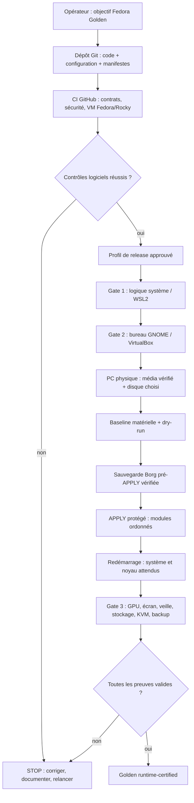
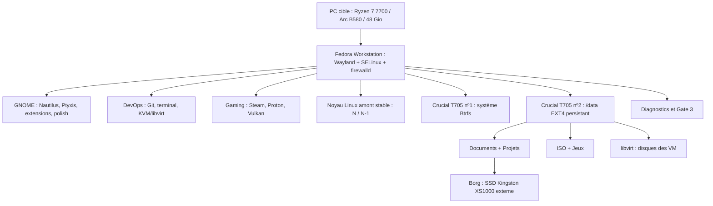
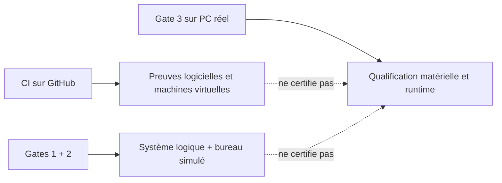

# Comprendre l'architecture — Fedora Golden Workstation

> **Lecture guidée (10–15 min).** Ce document explique le *pourquoi*, le *comment*, le rôle de chaque composant et ce qui prouve qu'une opération a réellement fonctionné. Pour exécuter des commandes de production, utiliser les [guides d'installation](INSTALLATION_GUIDE.md) et de [validation](THREE_GATE_VALIDATION.md), pas les schémas seuls.

## 1. L'idée en une minute

Une installation Fedora classique se personnalise souvent « au fil de l'eau » : quelques logiciels, des commandes, des extensions et des réglages dont on oublie ensuite l'origine. Ici, **la configuration souhaitée est décrite dans Git** et le système doit converger vers cette description, sous contrôle.

La cible à terme est **Fedora 45 Workstation + GNOME 51, sur un PC bien précis**. Le profil de production actuellement qualifié par les contrats logiciels reste **Fedora 44 + GNOME 50** : `profiles/fedora45/profile.json` est encore `pending`. Le passage à 45 ne consiste donc **pas** à changer un numéro dans le README.

**Golden** signifie *installation de référence reproductible et vérifiable*, **pas** « ISO modifiée », « image magique » ou « certification déjà acquise ». Le dépôt utilise des scripts, des configurations, des manifestes, des preuves et des procédures. La certification physique est à produire sur le matériel réel.

### Une analogie utile

| Image mentale | Dans le dépôt | Pourquoi c'est utile |
|---|---|---|
| **Le plan d'une maison** | `config/`, `manifests/`, `profiles/` | Dire précisément quel résultat on cherche |
| **Les artisans spécialisés** | `modules/`, `scripts/` | Construire chaque fonction dans un ordre maîtrisé |
| **Le tableau électrique** | `./control.sh` | Disposer d'un point d'entrée lisible pour l'opérateur |
| **L'inspecteur indépendant** | `diagnostics/`, `tests/`, GitHub Actions | Détecter un écart au lieu d'afficher un faux succès |
| **L'assurance et le carnet d'entretien** | Borg, preuves Gate, journaux | Pouvoir retrouver ses données et expliquer l'état du poste |

## 2. Schéma général : de la décision à la certification

**Pour lire le schéma :**

1. **La CI vérifie du code et des environnements virtualisés.** Un résultat vert sur `main` n'installe rien sur le PC et ne signifie pas Gate 3 PASS.
2. **Gate 1 et Gate 2 sont des prévalidations distinctes.** Elles produisent des preuves, mais la partie matérielle reste `DEFERRED`.
3. **La baseline et le dry-run observent avant de modifier.** Un prérequis refusé bloque `APPLY` (*fail-closed*).
4. **La sauvegarde externe précède les mutations.** Le système ne doit pas « réparer » une installation en risquant les fichiers.
5. **Gate 3 teste la réalité du poste.** C'est seulement après cette étape qu'on peut employer le terme de machine certifiée.

L'ordre exact et les commandes autorisées sont dans [THREE_GATE_VALIDATION.md](THREE_GATE_VALIDATION.md) et [EXECUTION_CONTRACT.md](EXECUTION_CONTRACT.md).

## 3. Ce que contient le dépôt et qui fait quoi

| Élément | Rôle concret | Exemple |
|---|---|---|
| `README.md` et `docs/` | Expliquer la vision, la procédure, les limites et les symptômes | ce document, [INSTALLATION_GUIDE.md](INSTALLATION_GUIDE.md) |
| `config/` | Paramètres attendus du système et du matériel | `config/hardware.conf`, `config/kernel.conf` |
| `config/local.conf` | Choix locaux propres au PC (non versionnés) | autorisation explicite de machine réelle |
| `profiles/fedora45/` | Identité et verrous de la future release GNOME 51 | `profile.json`, `gnome-extensions.lock` |
| `manifests/` | Liste des paquets, ordre des modules et logiciels | `module-plan.conf`, manifestes GNOME |
| `installer/` | Média Fedora vérifié, générateur Kickstart ciblant un disque explicite | `generate-fedora44-kickstart.sh` |
| `control.sh` / `install.sh` | Interface opérateur / orchestration du dry-run et de l'APPLY | `./control.sh status` |
| `lib/` | Moteurs communs, verrouillages, politique d'exécution | protection du gate APPLY |
| `modules/` | Étapes spécialisées avec préconditions et validations | `modules/gnome/`, `modules/backup/` |
| `diagnostics/` | Doctors : lire le système, vérifier le résultat | `./control.sh doctor all` |
| `scripts/` | Opérations spécialisées d'upgrade, KVM, noyau, sauvegarde, etc. | `scripts/maintenance/upgrade-fedora.sh` |
| `tests/` et `.github/workflows/` | Contrats statiques et laboratoires CI | `Tests`, `fedora-gnome-vm`, `rocky-devops-vm` |
| `state/` (local) | Journaux, plans, preuves et états produits lors de l'exécution | preuve liée au commit courant |

**Important :** `control.sh` est une **façade**, pas un script qui implémente tout. Il dirige chaque action vers un moteur spécialisé ; `install.sh` appelle un orchestrateur dont l'ordre est défini par les manifestes. Il n'existe pas de raccourci « tout forcer ».

## 4. Schéma du système obtenu : où se trouvent les fonctions

### Deux SSD ne veulent pas dire deux sauvegardes

- **T705 système :** Fedora, le bureau et la base réinstallable. Il peut être reconstruit depuis le dépôt.
- **T705 `/data` :** documents, projets, ISO, jeux et VM. Il est **préservé lors d'une réinstallation**, jamais formaté automatiquement par le dépôt.
- **SSD Borg externe :** seconde protection contre la perte de données, notamment en cas de panne du disque `/data`. Les sauvegardes sont **non chiffrées** par choix explicite : ce support doit être protégé physiquement. Les dossiers `ISO` et `Jeux` sont exclus du backup automatique par défaut ; les sauvegardes de VM exigent leur arrêt.

Le fait d'avoir un second T705 ne protège pas contre sa propre panne, un effacement accidentel ou une compromission : c'est pourquoi [BACKUP_RESTORE.md](BACKUP_RESTORE.md) reste central.

### La carte graphique et les VM

La **Intel Arc B580** fournit le bureau, le rendu Vulkan/Steam et les travaux graphiques de l'hôte ; elle n'est **pas** passée en VFIO aux machines virtuelles. Les VM Rocky Linux et Windows 11 utilisent QEMU/KVM/libvirt, avec un réseau `devops-nat` protégé. Voir [VIRTUALIZATION.md](VIRTUALIZATION.md) et [GAMING.md](GAMING.md).

### GNOME n'est pas « une extension »

Fedora livre les composants natifs GNOME/Wayland. Le projet y ajoute une **ergonomie voulue** : dock, tuilage, icônes du bureau, télémétrie et terminal. Le profil Fedora 44 utilise six extensions précises. Pour Fedora 45 / GNOME 51, les rôles restent comparables, mais certaines identités sont remplacées par des extensions compatibles et doivent être qualifiées séparément. Voir [GNOME.md](GNOME.md) et [UPGRADE_FEDORA_45.md](UPGRADE_FEDORA_45.md).

## 5. Exemple pratique : « j'installe, je mets à jour, je restaure »

| Situation | Premier réflexe | Ce qui doit être prouvé |
|---|---|---|
| **Je découvre le dépôt** | `./control.sh status` | commit, release et diagnostics compris |
| **Je veux installer** | guide d'installation + `./control.sh install dry-run` | média, disque, baseline et sauvegarde pré-APPLY valides |
| **Je veux modifier GNOME** | modifier la configuration prévue, puis doctor | extension activée, comportement réel et absence de crash |
| **Une mise à jour est proposée** | `./control.sh update check` | transaction préparée et possibilité de retour |
| **Je veux mettre à jour le système** | `./control.sh update all` | sauvegarde, redémarrage hors ligne et `finalize` |
| **Je perds le système** | réinstallation contrôlée sans toucher à `/data` | données intactes et environnement requalifié |
| **Je perds `/data`** | procédure Borg staging-first | intégrité, permissions et contenu vérifiés avant copie |
| **Une CI devient rouge** | lire le job et sa première erreur réelle | cause résolue et nouveau commit entièrement testé |

**Ne pas exécuter un APPLY, une restauration, un flash BIOS ou un formatage simplement pour « essayer ».** Une commande de consultation réussie ne donne pas l'autorisation de modifier.

## 6. Trois formes de validation à ne pas confondre

**CI verte** : le commit testé satisfait les contrôles automatisés. **`CODE-READY`** : le projet peut franchir l'étape de qualification prévue, sans prétendre que le poste réel est certifié. **`Golden runtime-certified`** : des preuves physiques sont complètes, encore valides pour l'identité du matériel, du code et de la configuration.

Lorsqu'une mise à jour change le noyau ou une brique critique, une preuve peut devenir `STALE` : le bon réflexe est de **requalifier**, pas de réécrire un marqueur.

## 7. Fedora 45 / GNOME 51 : l'ambition et la condition de réussite

| Dimension | Fedora 44 / GNOME 50 | Fedora 45 / GNOME 51 |
|---|---|---|
| Rôle | Référence opérationnelle et labo GNOME personnalisé | Cible de la prochaine Golden |
| Profil | Chemin d'installation et de validation documenté | `profiles/fedora45/profile.json` = `pending` |
| GNOME | Six extensions fonctionnelles testées en VM | Session native GNOME 51 en labo ; extensions personnalisées à qualifier |
| Média | Verrou Fedora 44 versionné | Média **final signé** et empreinte exacte à promouvoir |
| Installation physique | Gate 3 encore à produire | Gate 3 à refaire pour la nouvelle release |

Le parcours de migration détaillé est dans [UPGRADE_FEDORA_45.md](UPGRADE_FEDORA_45.md). Les tests Fedora 45 ne changent pas automatiquement le profil sélectionné. La promotion doit être explicite, revue et suivie de contrôles sur **le commit exact**.

## 8. Comment approfondir sans se perdre

1. [VISION.md](VISION.md) : pourquoi ce projet existe.
2. [GNOME.md](GNOME.md) : ce que verra l'utilisateur sur son bureau.
3. [CONTROL_CENTER.md](CONTROL_CENTER.md) : comment l'opérateur interagit avec le système.
4. [INSTALLATION_GUIDE.md](INSTALLATION_GUIDE.md) : installation **actuellement autorisée** et conditions d'arrêt.
5. [UPGRADE_FEDORA_45.md](UPGRADE_FEDORA_45.md) : ce qui manque pour l'objectif Fedora 45.
6. [THREE_GATE_VALIDATION.md](THREE_GATE_VALIDATION.md) : la différence entre préparer et certifier.
7. [GLOSSARY.md](GLOSSARY.md) : les termes techniques expliqués simplement.

> **Phrase à retenir :** « Je ne cherche pas seulement à installer Fedora 45 : je cherche à pouvoir expliquer et reproduire *pourquoi* chaque composant de mon Fedora GNOME sur mesure se trouve là, *comment* il est installé, *comment* il est testé, et *comment* je récupère mes données si quelque chose se passe mal. »
