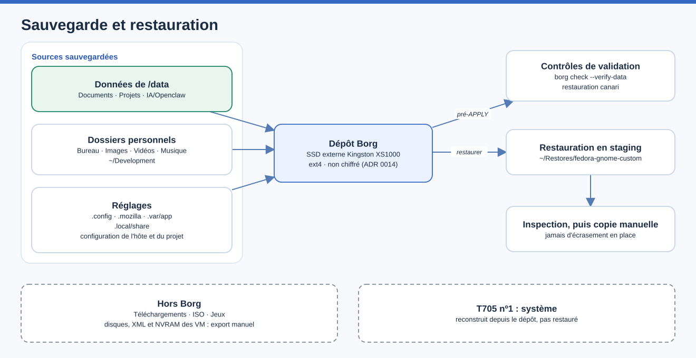

# Sauvegarde, restauration et reprise après sinistre

> Mise à jour : 2026-11-06 · Responsable : @mathiasseguincadiche
> Dernière vérification : 2026-11-06 — types d'archives et restitution relus contre `prepare-preapply-backup.sh`, `scripts/backup/restore.sh` et `config/backup.conf` ; essais physiques non rejoués — matériel : non vérifié

**Une sauvegarde doit permettre de récupérer quelque chose, pas seulement produire un fichier.**

Si l'APPLY modifie une configuration de façon inattendue, une archive pré-APPLY doit permettre de retrouver les réglages précédents. Si un document personnel disparaît plusieurs semaines plus tard, une archive quotidienne ou complète doit permettre de le récupérer. Les deux situations n'utilisent pas les mêmes sauvegardes.

Le projet utilise **Borg 1.x** dans un dépôt **non chiffré** — un choix explicite du propriétaire ([ADR 0014](adr/0014-borg-unencrypted-backups.md)). Une archive créée sans erreur n'est pas automatiquement une bonne sauvegarde : le projet contrôle son intégrité et, pour les archives pré-APPLY et complètes, essaie une restauration d'un fichier témoin (*canary*).

**Dans ce guide :** comprendre le périmètre de chaque archive, préparer le SSD externe, sauvegarder, vérifier puis restaurer **sans écraser les fichiers d'origine**. Le principe de la restauration est expliqué dans les [notions clés](CONCEPTS.md#5-une-sauvegarde-nest-bonne-que-restaurée).

## Comprendre la stratégie

Le projet distingue trois moments. Ils n'ont pas le même objectif :

| Moment | Ce qui est protégé | Pourquoi |
|---|---|---|
| **Avant APPLY** | Configuration et éléments système sélectionnés | Revenir sur une modification de configuration risquée ; preuve exigée par le garde d'installation. |
| **Pendant l'exploitation** | Données personnelles et projets sélectionnés | Retrouver un fichier supprimé ou endommagé ; sauvegardes quotidiennes. |
| **À la demande** | Données et inventaire de l'hôte, sans VM | Conserver une vue plus large de l'état et préparer une récupération. |

Le second SSD `/data` sert à séparer les données du système ; le SSD externe Borg sert à disposer d'une autre copie. Ces deux rôles ne sont pas interchangeables.



Par les sauvegardes quotidienne et complète, trois familles de sources partent vers un dépôt Borg sur le SSD externe XS1000 (ext4, non chiffré) : les données de `/data` (Documents, Projets, IA/Openclaw), les dossiers personnels (Bureau, Images, Vidéos, Musique, `~/Development`) et les réglages (`.config`, `.mozilla`, `.var/app`, `.local/share`, configuration de l'hôte et du projet).

La sauvegarde pré-APPLY n'est validée qu'après `borg check --verify-data` et une restauration canari. Une restauration se fait toujours dans `~/Restores` avant inspection et copie manuelle. Restent hors Borg : Téléchargements, ISO, Jeux et tout ce qui concerne les VM ; le système, lui, est reconstruit depuis le dépôt. Les listes exactes viennent de `config/backup.conf`.

Source éditable : [`sauvegarde-restauration.drawio`](assets/diagrams/sauvegarde-restauration.drawio).

> [!IMPORTANT]
> **Séparer les SSD n'est pas sauvegarder.** Le second T705 peut survivre à une réinstallation, mais pas nécessairement à une panne ni à un effacement. Borg apporte une copie indépendante. Son dépôt n'étant pas chiffré, le support externe doit être protégé physiquement comme un document sensible.

## Ce qui est sauvegardé

| Source | Quotidienne | Complète | Pré-APPLY |
| --- | --- | --- | --- |
| `/data/Documents` (via XDG Documents), `/data/Projets`, `/data/IA/Openclaw` | oui | oui | non |
| Bureau, Images, Vidéos, Musique (dossiers XDG), `~/Development` | oui | oui | non |
| `.config` | oui | oui | oui |
| `.mozilla`, `.var/app`, `.local/share` | oui | oui | `.local/share/gnome-shell` seulement |
| Inventaire du système (paquets RPM et Flatpak, services, montages, PCI, réglages GNOME), `/etc` et `/boot`, copie privée de `config/local.conf` | non | oui | oui |
| Fichiers suivis du dépôt du projet | non | non | oui |

La sauvegarde **pré-APPLY** est un point de retour de l'état du système avant l'APPLY, pas une sauvegarde des données : celles-ci sont protégées par les sauvegardes quotidienne et complète. Les listes exactes figurent dans `scripts/backup/daily-user-backup.sh`, `scripts/backup/backup-now.sh` et `prepare-preapply-backup.sh`.

Les dossiers XDG sont résolus avec `xdg-user-dir` au moment de chaque sauvegarde quotidienne ou complète ; une résolution ambiguë, qui renverrait par exemple directement vers `$HOME`, bloque la sauvegarde au lieu d'archiver un emplacement imprévu. La sauvegarde quotidienne n'accepte, en chemin absolu, que `/data/Documents`, `/data/Projets` et `/data/IA/Openclaw` : une dérive de configuration ne peut pas y ajouter `/data/ISO`, `/data/Jeux` ou `/data/libvirt`. Les profils Firefox et les données Flatpak peuvent être volumineux : dimensionner le support en conséquence.

### Ce qui n'est jamais sauvegardé

- **Les machines virtuelles** : disques, définitions XML libvirt, NVRAM, état TPM (swtpm) et médias cloud-init. `BACKUP_VM_DISKS`, `BACKUP_LIBVIRT_METADATA` et `BACKUP_VM_CLOUD_INIT_METADATA` sont forcés à `false` ; une valeur `true` fait échouer la sauvegarde, et l'option `--include-vms` est refusée. Les exports de VM restent manuels (voir [plus bas](#exports-de-vm)).
- **`/data/ISO` et `/data/Jeux`** : volumineux et retéléchargeables. Une sauvegarde de partie, de mod rare ou de contenu irremplaçable stocké sous `/data/Jeux` demande une politique explicite de l'opérateur ; les sauvegardes de parties rangées dans les dossiers utilisateur restent couvertes.
- **Le dossier Téléchargements.**
- **Les clés privées** : tout dossier `.ssh` ou `.gnupg`, à n'importe quelle profondeur (y compris dans `/data/Projets`), est exclu de toutes les archives, même si la configuration locale le liste ([ADR 0021](adr/0021-no-private-keys-in-unencrypted-backups.md)). Le dossier `~/.config/fedora-gnome-custom/secrets` est exclu de la même façon.

### Sauvegarder les clés privées à part

Ces clés se gardent dans un emplacement chiffré, hors Borg :

- **SSH** : enregistrer chaque clé privée dans un gestionnaire de mots de passe (par exemple un élément « Clé SSH » de Bitwarden) ou sur un support chiffré. Après réinstallation, la recopier dans `~/.ssh` avec les droits `0600`. Une clé perdue peut aussi être régénérée, puis redéclarée sur GitHub et sur les serveurs ; `authorized_keys`, qui contient par exemple la clé de la tablette pour l'accès distant, se redéclare de la même façon.
- **GnuPG** : exporter, stocker dans le même emplacement chiffré, puis supprimer les fichiers en clair :

  ```bash
  gpg --export-secret-keys --armor IDENTIFIANT > cle.asc
  gpg --export-ownertrust > confiance.txt
  ```

  À la restauration : `gpg --import cle.asc`, puis `gpg --import-ownertrust confiance.txt`.

## Préparer le support de sauvegarde

Le support prévu est le **Kingston XS1000** (~1,8 To), un SSD externe USB 3.2 Gen 2. Il doit être :

- **externe** (USB, amovible) : le projet refuse un dépôt sur le disque système ou sur `/data`. Un dépôt Borg distant `ssh://` est aussi accepté ;
- formaté en **ext4** (`BACKUP_PREAPPLY_REQUIRED_FSTYPE`). Un XS1000 neuf est livré en exFAT : le reformater une fois, **ce qui efface son contenu** ;
- **le seul** support externe monté lors de la sauvegarde pré-APPLY, si `BACKUP_REPOSITORY` est vide. Sinon, renseigner `BACKUP_REPOSITORY` dans `config/local.conf`.

Un dépôt chiffré est refusé : aucune phrase de passe n'existe, et aucune ne peut donc être perdue. Un Fedora neuf avec `borgbackup` suffit pour restaurer.

## Sauvegarder

### Sauvegarde pré-APPLY

Elle précède tout APPLY, après un dry-run réussi au même commit ([guide d'installation](INSTALLATION_GUIDE.md#7-créer-la-sauvegarde-pré-apply)) :

```bash
./prepare-preapply-backup.sh
```

Si `BACKUP_REPOSITORY` est vide, le script cherche exactement **un** support externe monté et utilise `Backup-Fedora/borg` dessus ; plusieurs supports montés le bloquent. Au premier lancement, il crée le dépôt avec `borg init --encryption=none` après une confirmation tapée à la main. Il écrit ensuite l'archive `fgc-preapply-<date>`, la relit intégralement (`borg check --verify-data`), extrait et compare un fichier témoin, puis écrit `state/preapply-backup.ok`. Ce marqueur est lié au commit Git du dry-run et à l'archive exacte (nom et identifiant) ; l'APPLY rouvre le dépôt pour vérifier que cette archive existe toujours.

### Sauvegarde complète

```bash
./control.sh backup now
```

Cette commande lance `scripts/backup/backup-now.sh`, qui sauvegarde l'hôte, la configuration et les données, jamais les VM. Deux options sont disponibles en appel direct :

```bash
scripts/backup/backup-now.sh --prune                             # applique ensuite la rétention
scripts/backup/backup-now.sh --staging-root /chemin/absolu/staging   # autre espace de capture
```

La capture du système passe par un espace de travail (`state/backup-staging` par défaut). Avant d'archiver, le script vérifie que la taille estimée des sources et la réserve configurée (20 Gio par défaut, `BACKUP_PREAPPLY_MIN_FREE_GIB`) tiennent sur le support externe ; l'estimation est volontairement prudente, sans compter sur la compression ni la déduplication. La capacité d'un dépôt distant ne se mesure pas localement : une erreur Borg y reste bloquante.

### Sauvegarde quotidienne

Après l'APPLY, un timer systemd utilisateur lance la sauvegarde quotidienne. Elle peut aussi se lancer à la main avec `./control.sh backup daily`. Quand le support externe est absent, le run est enregistré `skipped` et le timer reste actif ; ce comportement ne concerne pas la sauvegarde pré-APPLY, qui échoue fermée.

La sauvegarde quotidienne tourne pendant la session : un seul avertissement de Borg y est toléré, « file changed while we backed it up », pour un fichier modifié pendant sa lecture (profil de navigateur, données Flatpak). L'archive contient alors la version lue, et le nombre de fichiers concernés est enregistré (`files_changed_during_backup`) et affiché par `daily-backup-doctor`. Tout autre avertissement, comme un fichier illisible ou une source absente, refuse l'archive.

### Rétention

La politique versionnée garde **7 archives quotidiennes, 4 hebdomadaires et 6 mensuelles**, appliquée séparément aux archives `fgc-full-*` et `fgc-daily-*` : une classe ne peut jamais consommer la place de l'autre. Les archives `fgc-preapply-*`, points de retour arrière, ne sont jamais supprimées automatiquement.

Le timer `fedora-gnome-backup-retention.timer` l'applique chaque dimanche à 04:15, avec un délai aléatoire de 30 minutes au plus : `borg prune` par classe, puis un seul `borg compact` pour libérer l'espace. Une échéance manquée est rejouée au démarrage suivant (`Persistent=true`), et un support absent donne un run `skipped`. Le déclenchement manuel, `./control.sh backup prune`, échoue au contraire si le dépôt est indisponible.

## Vérifier

```bash
./control.sh backup check                 # état du dépôt et des sauvegardes
./control.sh backup deep                  # relit toutes les données : borg check --verify-data, plus long
./control.sh backup list                  # archives présentes
./diagnostics/daily-backup-doctor         # timers, bundle installé, derniers états
./diagnostics/data-storage-doctor         # /data, ses dossiers, droits, labels et XDG Documents
```

`data-storage-doctor` vérifie que `/data` est l'EXT4 dédié et que `Documents`, `Projets`, `ISO`, `Jeux`, `IA` et `IA/Openclaw` sont de vrais dossiers, séparés de `/data/libvirt`, avec le bon propriétaire, le mode `0750` et le label SELinux `user_home_t`.

## Restaurer

**Pourquoi un dossier d'essai ?** Restaurer directement dans un répertoire de travail risquerait d'écraser la version actuelle d'un fichier. Le *staging* est un espace de réception temporaire : on y contrôle ce que contient l'archive avant de choisir, manuellement, quels fichiers remettre en place.

Une restauration passe **toujours** par un dossier d'essai vide (staging), à l'intérieur de la racine `BACKUP_RESTORE_STAGING_ROOT` (`~/Restores/fedora-gnome-custom` par défaut). Le projet ne restaure jamais automatiquement en place `/`, `/etc`, `/boot`, `$HOME`, `/data` ou `/data/libvirt/images`. Les commandes se lancent depuis le dossier du dépôt, sans `sudo`, support de sauvegarde branché.

**Résumé d'exécution — où en est la restauration :** reprendre à la première case non cochée ; une erreur de `verify` est un arrêt, pas un obstacle à contourner.

- [ ] Support branché, dépôt listé, `verify` terminé sans erreur
- [ ] Archive choisie extraite dans un dossier vide de la racine de staging
- [ ] Staging inspecté : contenus, droits, liens symboliques, propriétaires
- [ ] Seuls les fichiers voulus copiés à la main, destination vérifiée avant écrasement
- [ ] Copie de `config/local.conf` vérifiée par `sha256sum --check` si elle est reprise

1. Lister les archives et vérifier le dépôt :

   ```bash
   scripts/backup/restore.sh list      # archives présentes : nom, date, identifiant
   scripts/backup/restore.sh verify    # borg check --verify-data : relit toutes les données, long
   ```

   **Réussite :** l'archive voulue apparaît dans la liste et `verify` se termine sans erreur. **Arrêt :** une erreur de `verify` signale un dépôt endommagé ; ne rien extraire, garder le support tel quel et lancer `./control.sh backup deep` pour le diagnostic.

2. Extraire l'archive choisie, ou la plus récente, dans un dossier vide de la racine de staging. Cette étape écrit seulement dans le staging :

   ```bash
   scripts/backup/restore.sh restore latest
   scripts/backup/restore.sh restore fgc-full-NOM_EXACT ~/Restores/fedora-gnome-custom/essai-1
   scripts/backup/restore.sh restore fgc-full-NOM_EXACT ~/Restores/fedora-gnome-custom/essai-2 /data/Documents
   ```

   Sans dossier indiqué, l'extraction va dans `~/Restores/fedora-gnome-custom/<nom de l'archive>`. Le dernier argument facultatif, un chemin absolu, limite l'extraction à cette partie de l'archive. Le script refuse un nom d'archive inconnu, un dossier déjà rempli et toute cible hors de la racine de staging.

   **Réussite :** le script affiche `Restored into staging only:` suivi du dossier. **Arrêt :** un refus (code de sortie 30) n'a rien écrit ; corriger le nom ou le dossier indiqué par le message.

3. Inspecter le staging : contenus, droits, liens symboliques, propriétaires. Borg a vérifié chaque bloc contre son empreinte pendant l'extraction.

   **Réussite :** les fichiers attendus sont présents et lisibles. **Arrêt :** un fichier manquant ou inattendu se compare d'abord à une autre archive (`list`), avant toute copie.

4. Copier à la main les seuls fichiers voulus vers leur emplacement. C'est la seule étape qui modifie les données en place : vérifier la destination avant d'écraser un fichier existant.

Pour reprendre `config/local.conf` sur une nouvelle machine, vérifier sa copie avec `sha256sum --check local.conf.sha256` depuis le dossier d'inventaire du staging, puis revoir les chemins avant de la remettre en place. L'identité approuvée de `/data` y est conservée pour comparaison ; elle n'autorise jamais automatiquement un autre disque.

**Ce que la restauration prouve :** une restauration de fichiers réussie ne prouve pas qu'un Fedora ou une VM redémarre. L'exercice complet est décrit dans la [reprise isolée](ISOLATED_RECOVERY_RUNBOOK.md).

## Reprendre après une perte totale

Le dépôt n'étant pas chiffré, aucun secret n'est nécessaire : sur une machine neuve, installer `borgbackup`, cloner le projet, brancher le support et lancer `scripts/backup/restore.sh list` (ou `borg list` sur le dépôt).

Pour obtenir un plan de reconstruction ordonné :

```bash
./control.sh backup dr-plan
```

`scripts/backup/disaster-recovery.sh` exige `borgbackup`, `jq` et Python 3. Il sélectionne la dernière archive **complète**, valide son manifeste de récupération, relit ses données (`borg check --verify-data`), puis écrit dans `state/` un plan : Fedora 45, remontage du second T705 sur `/data` **sans formatage**, dépôt, dry-run, restauration en staging, labels SELinux et diagnostics finaux. Il ne modifie rien.

## Exports de VM

Le projet ne sauvegarde ni n'exporte jamais une VM. Les outils libvirt servent à créer, exploiter et diagnostiquer les VM, pas à les archiver. Le propriétaire choisit quand arrêter ses VM et quels fichiers conserver ensemble : disque virtuel, XML, NVRAM et état TPM s'il existe. Aucune preuve Borg ne vaut preuve de récupération d'une VM ; la reprise d'une VM repose uniquement sur cet export manuel ([reprise isolée](ISOLATED_RECOVERY_RUNBOOK.md#3-reprendre-une-vm)).

## Référence : fonctionnement interne

### Cycle de vie d'une archive

Chaque archive est d'abord créée sous un nom `fgc-pending-<type>-*`. Elle n'est promue en `fgc-preapply-*`, `fgc-full-*` ou `fgc-daily-*` que si la création Borg renvoie **0**, ou, pour la quotidienne, avec le seul avertissement toléré ; l'identifiant est relu après renommage.

Un code 1 peut signaler des fichiers illisibles ou omis : la tentative échoue même si Borg a écrit une archive. Une archive refusée reste inspectable sous `fgc-pending-*` mais ne devient jamais une base de récupération ; la rétention n'en garde que les plus récentes (`BACKUP_KEEP_PENDING`, 3 par défaut) et les diagnostics signalent leur présence.

### Marqueurs et certification

La sauvegarde complète restaure et compare un fichier témoin, puis écrit atomiquement un marqueur : dépôt, nom et identifiant de l'archive, commit, empreintes de la configuration, du plan et du matériel, résultat du contrôle d'intégrité et de la restauration. Le doctor de certification (`backup-doctor --certify`) rouvre cette **archive exacte**, contrôle son manifeste et extrait son témoin : une archive supprimée, un autre dépôt ou une configuration modifiée invalident la preuve.

Le manifeste de récupération figure dans le staging et dans le commentaire Borg de l'archive complète. Pour rester compatible avec les anciennes archives, il conserve les champs `include_vms=false`, `vm_count=0` et une liste de VM vide, qui indiquent explicitement l'absence de VM. La certification Gate 3 vérifie l'hôte et les données protégées, ces champs et le refus des options VM ; elle ne demande jamais d'export de VM.

### Runtime des timers

L'APPLY installe un runtime de sauvegarde autonome, construit par `modules/backup/60_daily_user_backup.sh` :

```text
~/.local/lib/fedora-gnome-custom/backup-runtime/<SHA-appliqué>-<SHA256-configuration>/
├── bin/
│   ├── daily-user-backup
│   └── backup-retention
├── lib/
│   ├── backup_runtime.sh
│   └── backup_runtime_bundle.sh
├── runtime/
│   ├── APPLIED_SHA
│   └── backup-runtime.conf
└── MANIFEST.sha256
```

- `backup-runtime.conf` ne contient que les variables `BACKUP_*` et `DAILY_*`. Aucune variable `BORG_*` de l'environnement n'y est copiée, et une `BORG_PASSPHRASE` ambiante est neutralisée à l'exécution.
- `MANIFEST.sha256` est vérifié au postcheck et à chaque exécution.
- Un dossier est **immuable** : un nouvel APPLY au même commit réutilise le bundle seulement si son `APPLIED_SHA` et son manifeste sont valides ; une autre configuration de sauvegarde crée un nouveau bundle. Un dossier corrompu n'est jamais écrasé : l'APPLY échoue et demande une intervention.
- Les services utilisateur pointent directement vers ce dossier, sans lire le checkout Git. Modifier ou déplacer le dépôt de travail ne change donc pas un timer déjà appliqué ; un nouvel APPLY est nécessaire.
- Les états des timers sont enregistrés sous `${XDG_STATE_HOME:-~/.local/state}/fedora-gnome-custom/`.

### Ce que prouvent les tests

`tests/test_borg_roundtrip.sh` exerce un vrai dépôt Borg non chiffré, le runtime quotidien installé, la rétention et le script de restauration : contenu, droits, lien symbolique, exclusion des secrets, refus d'écraser un staging, refus d'un nom d'archive malformé, preuve pré-APPLY exacte et refus d'un dépôt chiffré. Le support externe y est simulé : ce test ne produit aucune preuve Gate 3, et aucun conteneur ne certifie le matériel physique.
