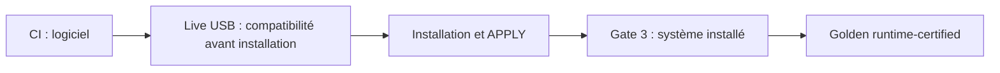

# Prouver que la machine est prête

La cible est **Fedora 45 Workstation / GNOME 51** sur le PC réel. Une CI verte vérifie un commit ; la certification Golden demande les essais du système installé. Le profil reste `pending` jusqu'à la qualification et la promotion du média final signé et des dépendances stables.

| Étape | Ce qu'elle établit | Guide canonique |
|---|---|---|
| CI au commit exact | Tests logiciels et laboratoires Linux QEMU | [CI](CI_VALIDATION.md) · [Laboratoire Fedora/GNOME](FEDORA_GNOME_CI_LAB.md) |
| Live USB sur le PC | Inventaire et essais avant installation, portée `PREINSTALL_ONLY` | [Contrôle Live](FEDORA45_LIVE_PREFLIGHT.md) |
| Installation puis convergence | Configuration définitive, baseline, dry-run, sauvegarde vérifiée, APPLY, redémarrage | [Installation](INSTALLATION_GUIDE.md) · [Contrat](EXECUTION_CONTRACT.md) |
| Gate 3 sur Fedora installé | Matériel, bureau, applications, sauvegarde et Rocky lorsque KVM est activé | [Fiche physique](PHYSICAL_QUALIFICATION_CHECKLIST.md) · [Contrats complets](GOLDEN_COMPLETENESS_CLOSURE.md) |
| État conservé | Identités, versions et preuves du système qualifié | [Golden Release](GOLDEN_RELEASE.md) |

L'ordre et les commandes sont dans [le protocole de validation](THREE_GATE_VALIDATION.md). Le Live et le système installé doivent utiliser le même commit et le même plan de modules, avec une preuve Live exportée avant redémarrage puis importée sur le SSD.

**Code prêt** signifie que les contrôles logiciels du commit sont verts. **Golden runtime-certified** signifie que `./diagnostics/final-certification certify` a réussi sur le PC installé, pour les identités et la configuration courantes. La preuve Live ne remplace pas les services, extensions, sauvegardes, performances et cycles de veille du système final.

Une preuve devenue `STALE` doit être rejouée après le changement concerné. Ne pas déduire une certification actuelle d'un ancien rapport.

Pour approfondir : [architecture](ARCHITECTURE_PEDAGOGIQUE.md), [stabilité matérielle](HARDWARE_STABILITY.md), [qualification de fiabilité](RELIABILITY_QUALIFICATION.md), [fiche de preuves](QUALIFICATION_EVIDENCE_TEMPLATE.md), [dépannage matériel](RUNBOOK_GOLDEN_HARDWARE.md).
