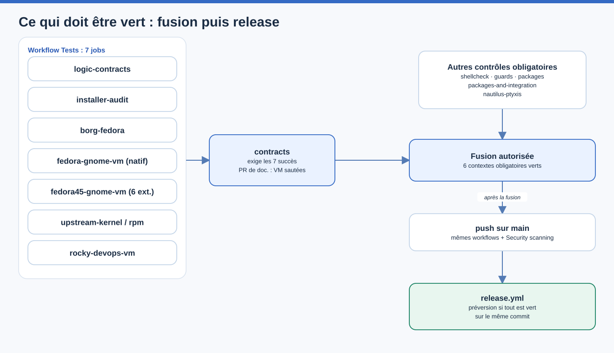

# CI et validation

> Mise à jour : 2026-11-06 · Responsable : @mathiasseguincadiche
> Dernière vérification : 2026-11-06 — contrôles documentaires et tests d'ancres relus contre `tests/test_docs_integrity.py` et ses fixtures ; revue des workflows et mesures CI du 2026-11-04 conservées — matériel : non vérifié

La CI de GitHub vérifie le logiciel : contrats statiques, paquets Fedora 45 réels, sessions GNOME 51 et VM Rocky dans des machines jetables. Elle ne touche jamais le PC et ne le certifie pas : seule la [Gate 3](QUALIFICATION.md) le fait.

## Ce que chaque preuve démontre

| Contrôle | Ce qui est démontré | Ce qui ne l'est pas |
|---|---|---|
| Contrats et gardes | cohérence du code, politiques, sources, refus attendus | santé du vrai PC |
| Conteneurs Fedora 45 | les paquets des manifests se résolvent et s'installent | comportement à l'écran, matériel |
| Laboratoire GNOME natif | GNOME 51 Wayland, redémarrage, Borg, restauration, reconstruction | les six extensions, le matériel |
| Laboratoire GNOME à six extensions | session avec les six extensions actives, redémarrage, restauration | installation depuis l'ISO Workstation, matériel |
| VM Rocky Linux | installation, bootstrap DevOps, redémarrage, restauration Borg | KVM de l'hôte réel |
| Gate 3 | essais sur le PC, liés au commit et à la configuration | validité automatique des versions suivantes |

## De la pull request à la release

Le workflow `Tests` lance sept jobs, et le job `contracts` exige leurs sept succès. La fusion dans `main` exige six contextes : `contracts`, `shellcheck`, `guards`, `packages`, `packages-and-integration` et `nautilus-ptyxis`. Le ruleset de `main` impose aussi une branche à jour avant fusion, et interdit la suppression et la réécriture de l'historique. Après la fusion, les workflows tournent à nouveau sur le commit de `main` ; `release.yml` ne publie la préversion que si huit workflows ont réussi sur ce même commit : `Tests`, la qualité du shell, la non-régression, le préflight des paquets, l'intégration de l'hôte et du bureau, l'audit de l'installateur et le scan de sécurité (`scripts/ci/check-release-gate.py`).

Source éditable : [`ci-fusion-release.drawio`](assets/diagrams/ci-fusion-release.drawio).

**Une PR verte ne prouve pas que `main` est vert.** Les workflows de PR testent le commit proposé (`github.event.pull_request.head.sha`) ; GitHub valide ensuite le commit de fusion, qui est un autre SHA. Après une fusion, filtrer la page Actions sur `main` et vérifier `Tests` pour ce SHA.

**`contracts` est rouge si une seule dépendance n'a pas réussi.** Il tourne même après un échec (`if: always()`) et refuse une dépendance échouée, annulée ou sautée : sur GitHub, un job sauté pourrait sinon satisfaire un contexte obligatoire. Un `contracts` rouge se corrige dans le job amont.

**Exception : une PR qui ne change que la documentation.** Le job `changes` classe les fichiers modifiés (`.github/scripts/docs-only-change.py`). Si tous sont en Markdown ou sous `docs/`, les trois VM sont sautées : les deux laboratoires GNOME et la VM Rocky, qui ne lisent aucun de ces fichiers. `contracts` n'accepte ce saut que pour ces trois jobs, seulement si `changes` a réussi et a conclu à une PR de documentation ; tous les autres jobs, dont les tests de documentation de `logic-contracts`, doivent réussir. Le push sur `main` exécute toujours les trois VM, et `release.yml` exige ce run. Une PR de documentation est estimée à 14 minutes au lieu de 22, la durée de `logic-contracts`.

**Un nouveau push annule le run précédent de la même PR** (`concurrency`, `cancel-in-progress`). Sur `main`, aucun run n'est annulé.

## Fiches des contextes obligatoires

Chaque fiche donne le fichier, ce que le job vérifie, ce qu'il ne prouve pas, et où regarder s'il échoue.

### `contracts` et les sept jobs de `Tests`

Fichier : `.github/workflows/tests.yml`. Déclenché par chaque PR et chaque push sur `main`. Le job `changes`, quelques secondes, ne fait que classer les fichiers modifiés.

| Job | Vérifie | Ne prouve pas | Si rouge |
|---|---|---|---|
| `logic-contracts` | plus de cent tests de contrat et de comportement (`tests/`), dont la sonde Docker sur le runner | ce qui demande Fedora, une VM ou le PC | ouvrir la première étape en échec : elle nomme le test ; le rejouer en local, par exemple `bash tests/test_structure.sh` |
| `installer-audit` | le catalogue des modules dans un conteneur Fedora 45, sans certifier ce conteneur ; refuse les blocages inattendus | un APPLY réel | lire le blocage listé par `scripts/ci/check-installer-audit.py`, puis l'artefact `installer-audit-<run_id>` |
| `borg-fedora` | sauvegarde et restauration Borg réelles, certification de sauvegarde, avertissements quotidiens, aller-retour `IA/Openclaw` | le disque externe du PC | l'étape en échec nomme le test ; le rejouer sur une machine où `borg` est installé |
| `upstream-kernel / rpm` | **PASS** : transaction des RPM exacts de la dernière stable kernel.org avec verrou DNF5 ; **DEFERRED** : retard de publication COPR identifié et prouvé, sans transaction RPM | en état DEFERRED, ni la disponibilité du dernier RPM ni son installation ; le démarrage réel n'est jamais prouvé ici | lire `status=PASS` ou `status=DEFERRED` dans l'artefact `upstream-linux-rpm-<run_id>` et le résumé ; toute autre erreur reste bloquante |
| `fedora-gnome-vm / lab` | laboratoire GNOME natif ([fiche](FEDORA_GNOME_CI_LAB.md)) | les six extensions, le matériel | `report.json` de l'artefact indique l'exercice en échec ; les journaux du démarrage concerné disent pourquoi ([rapports](FEDORA_GNOME_CI_LAB.md#rapports)) |
| `fedora45-gnome-vm / lab` | laboratoire à six extensions ([fiche](FEDORA_GNOME_CI_LAB.md)) | l'installation depuis l'ISO, le matériel | idem, plus l'état `ACTIVE` de chaque extension dans le rapport |
| `rocky-devops-vm` | vraie VM Rocky 10.2 : image authentifiée, bootstrap exact, redémarrage, restauration Borg à froid | le KVM et le réseau de l'hôte réel | artefact `fedora-gnome-custom-rocky-vm-pretest-<run_id>` : journal du bootstrap et inventaire ; distinguer panne d'un dépôt externe et défaut du bootstrap |
| `contracts` | que chaque job ci-dessus a réussi (seule exception : les VM sautées sur une PR de documentation) | rien par lui-même | corriger le job amont qu'il nomme ; `contracts` n'a jamais de défaut propre |

Pour `upstream-kernel / rpm`, seule la version annoncée stable par kernel.org et présente dans le COPR autorisé est recevable **pour une transaction RPM**. Quand le flux kernel.org est accessible et qu'un RPM Vanilla stable plus ancien est identifié dans le COPR autorisé, le job CI peut conclure en état **DEFERRED** (avertissement et preuve conservés) : **un workflow GitHub vert dans ce cas ne prouve pas que le noyau demandé est installable**. Il ne télécharge aucun RPM et les tests de refus de ce scénario tournent séparément. Si la provenance ou la version ne peuvent pas être vérifiées, la CI échoue ; un téléchargement de RPM qui échoue après les tentatives reste un échec. Le moteur d'installation physique ne change pas et refuse toujours tout RPM en retard.

`logic-contracts` démarre sans attendre les laboratoires : une régression de code apparaît en quelques minutes.

### `shellcheck`

Fichier : `.github/workflows/shell-quality.yml`. Vérifie `bash -n` puis ShellCheck sur tous les scripts suivis. Les exemptions globales sont limitées, pour ne pas masquer les variables inutilisées ou les fautes de nom. En cas d'échec, l'artefact du job contient la sortie complète.

### `guards`

Fichier : `.github/workflows/non-regression.yml`. Vérifie les invariants d'architecture :

- la barrière de la machine réelle reste fermée dans Git ;
- isolation de l'exécution : une VM ou un conteneur n'est jamais pris pour le PC ; séparation du Live USB et du système installé ;
- Wayland comme contrat, sans `force_probe`, passthrough GPU ni partage VirtioFS de l'hôte ;
- garde réseau KVM, refus de purger le pare-feu, aucun formatage dans les modules ;
- invité Rocky : pas de SSH par mot de passe ni de sudo sans mot de passe, AWS CLI vérifié par sa signature, Kubernetes limité à `v1.37` ;
- Kickstart épinglé, sauvegarde fermée par défaut, absence de secret évident dans le dépôt.

**Si rouge :** l'étape en échec nomme l'invariant ; chercher dans le diff l'élément qu'elle interdit. Une garde ne s'assouplit pas pour faire passer un changement : le changement s'adapte, ou une décision écrite (ADR) modifie la règle.

### `packages`

Fichier : `.github/workflows/fedora-package-preflight.yml`. Dans un conteneur Fedora 45 :

- résout tous les manifests ;
- vérifie les dépôts éditeurs (VS Code, Brave), les identifiants Flathub et les remplacements multimédia ;
- télécharge et contrôle les quatre archives d'extensions du verrou (UUID, compatibilité GNOME Shell 51, SHA-256).

Il tourne aussi chaque dimanche, pour détecter une rupture externe sans attendre un commit.

**Si rouge :** distinguer un paquet réellement absent des dépôts Fedora 45 (corriger le manifeste) d'une indisponibilité passagère d'un dépôt ou de Flathub (relancer le job une fois le service rétabli).

### `packages-and-integration`

Fichier : `.github/workflows/fedora-host-pretest.yml`. Installe réellement le contrat de l'hôte dans un conteneur Fedora 45, puis valide, avec un utilisateur normal :

- le centre de contrôle, Bash et le dock ;
- les réglages GNOME 51, dont Vitals, et l'installation de DING et Show Desktop Button depuis leurs archives revues ;
- RPM Fusion, les dépôts éditeurs signés et Flathub ;
- l'artefact LD240 épinglé, sans matériel ;
- les liaisons de capture du portail.

Hebdomadaire lui aussi. Il ne remplace ni le Live USB ni une vraie session GNOME.

**Si rouge :** l'étape en échec désigne le domaine (centre de contrôle, Bash, dock, GNOME, dépôts) ; le test correspondant de `tests/` se rejoue en local.

### `nautilus-ptyxis`

Fichier : `.github/workflows/desktop-integration-pretest.yml`. Installe GNOME, Nautilus et le catalogue GTK4, puis vérifie les paquets, l'extension File Roller pour Nautilus, les schémas GSettings, l'énumération GVfs par D-Bus, LocalSearch, et les commandes et fichiers `.desktop` de Nautilus et Ptyxis. Il ne mesure pas le démarrage à froid graphique, réservé à la Gate 3.

**Si rouge :** un paquet ou un schéma GSettings absent vient en général d'un changement de Fedora ; vérifier le manifeste `manifests/packages-nautilus.txt` ou le catalogue GTK4.

## Workflows non obligatoires

Ces workflows ne sont pas des contextes obligatoires. Un échec reste à corriger, mais ne bloque pas la fusion par lui-même.

| Workflow | Déclenchement | Vérifie |
|---|---|---|
| `fedora-gaming-pretest.yml` | push, PR, hebdomadaire | Steam depuis le dépôt `rpmfusion-nonfree-steam` sans lancer l'interface, Vulkan et Mesa x86_64 et i686, GameMode, MangoHud, GOverlay, Gamescope, aucun dépôt GPU tiers |
| `fedora-appimage-pretest.yml` | push, PR, hebdomadaire | FUSE 2 et 3, extraction des AppImage de type 1 et 2 sans les exécuter, Gear Lever sur Flathub |
| `resource-monitor-fedora-pretest.yml` | push, PR | réglages Vitals revus pour GNOME 51 |
| `live-preflight.yml` | PR et push sur les fichiers du Live | sonde Live en lecture seule, audit couleur sans écriture, refus hors Live |
| `fedora-installer-audit.yml` | push sur `main`, manuel | même audit que le job `installer-audit`, qui le couvre sur les PR ; exigé par `release.yml` |
| `fedora45-package-preflight.yml` | PR, hebdomadaire | toutes les résolutions Fedora 45, espace utilisateur Intel Arc (Vulkan, VA-API), transaction du noyau amont |
| `release-readiness.yml` | PR sur les profils, hebdomadaire | état réel des dépôts Fedora et des verrous candidats ; l'activation de RPM Fusion, des deux COPR et le rafraîchissement des métadonnées y tolèrent l'échec (`\|\| true`), car ce workflow fait un état des lieux, sans rien valider |
| `external-links.yml` | hebdomadaire, manuel | les liens externes de tous les fichiers Markdown (`scripts/ci/check-external-links.py`) : une page disparue (404, 410) ou un nom introuvable échoue ; un refus anti-robot (401, 403, 429) ou une erreur serveur n'est qu'un avertissement |
| `fedora45-gnome-preview.yml` | PR, hebdomadaire | laboratoire GNOME natif, rapport de prévisualisation |
| `weekly-log-retention.yml` | push, PR | purge prudente des journaux (`scripts/maintenance/weekly-log-cleanup.py`) |
| `security-scanning.yml` | push, PR, hebdomadaire | CodeQL pour Python, Gitleaks sur chaque commit de la PR |
| `release.yml` | push sur `main` | publication de la préversion, seulement si tout est vert sur ce commit |
| `fedora44-legacy-lab.yml` | manuel | laboratoire Fedora 44 historique |

## Fournisseurs externes

Une partie des échecs vient d'un service tiers. La CI échoue alors franchement plutôt que de transformer une panne réseau en réussite :

- **Images** : toutes les images Fedora viennent de `registry.fedoraproject.org`. `tests/test_ci_maturity_contract.sh` interdit le retour d'ECR Public, qui avait renvoyé `toomanyrequests`. La seule image tirée d'un registre public est busybox, pour la sonde Docker, avec plusieurs miroirs ; l'image sans shell est construite localement (`FROM scratch`).
- **Flathub** : `scripts/ci/ensure-flathub.sh` ajoute le dépôt officiel avec des tentatives bornées, et échoue s'il reste injoignable. Aucun `--no-gpg-verify`. Chaque application est ensuite vérifiée par `flatpak remote-info`.
- **RPM Fusion** : `scripts/ci/enable-rpmfusion.sh` essaie `mirrors.rpmfusion.org` puis `download1.rpmfusion.org`. Chaque tentative passe par `scripts/packages/install-rpmfusion-release.sh`, partagé avec le module de production ([provenance](SUPPLY_CHAIN.md#dépôts-rpm-fusion)). `tests/test_rpmfusion_ci_bootstrap_contract.sh` interdit le retour à une URL unique.
- **OpenH264** : le dépôt Cisco est désactivé pendant certaines transactions de la CI, quand aucun paquet du contrat n'en dépend. Le poste de production garde ses fonctions multimédia.

Pour diagnostiquer un échec, suivre le [runbook CI](TROUBLESHOOTING.md#un-contrôle-github-actions-devient-rouge) : lire l'étape qui échoue, distinguer un défaut d'une panne externe. Ne jamais masquer l'échec avec `|| true` ni désactiver `journal_health`.

## La documentation est testée

`tests/test_docs_integrity.py` bloque :

- un lien local cassé, une ancre Markdown absente (y compris les titres accentués ou répétés), un guide inaccessible depuis le README ;
- une commande `./control.sh` que le code ne connaît pas ;
- un chemin du dépôt cité qui n'existe pas ;
- un guide sans bloc de métadonnées ;
- un bloc Mermaid, un schéma sans sa paire `.drawio` / `.svg`, ou une paire qui diffère de ce que produit `tools/diagrams/build.py` (`tests/test_diagram_sources.py`) ;
- un inventaire logiciel différent des manifests.

`tests/test_docs_integrity_behavior.py` exerce les règles sur des copies jetables du dépôt : notamment un lien valide, des ancres absentes, des titres répétés et un faux titre dans un bloc de code. Les conventions sont dans le [guide du contributeur](../CONTRIBUTING.md#écrire-la-documentation). La validation des ancres concerne les liens Markdown locaux, pas les URL externes ni un rendu visuel sur le PC.

## Ce qui reste à prouver sur le PC

La CI ne peut pas vérifier :

- l'Arc B580 sur `xe` : rendu Vulkan, Level Zero, OpenCL, VRR, lancement d'un jeu Steam ;
- l'écran à 240 Hz, la veille et la reprise ;
- les deux T705, le firmware, l'état réel de Secure Boot ;
- le rendu de DING et l'action Show Desktop dans une vraie session ;
- le démarrage à froid de Nautilus, les périphériques MTP, AFC et GPhoto ;
- l'isolement du LAN par le garde KVM, le passage Ethernet ↔ Wi-Fi, l'accès à une VM depuis un autre hôte.

Ces preuves appartiennent à la [qualification](QUALIFICATION.md).
