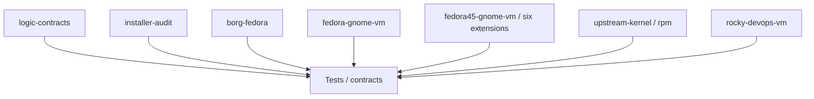

# CI et validation bout-en-bout

La CI combine contrats statiques, intégration Fedora 45, laboratoire Fedora/GNOME et vraie VM Rocky Linux 10.2. Elle complète les certifications sur la machine physique ; elle ne les remplace pas.

## Lire les workflows GitHub sans confondre les preuves

| Contrôle | Ce qui est démontré | Ce qui ne l'est pas |
|---|---|---|
| Contrats et sécurité | cohérence du code, politiques, sources et guards | santé du vrai PC |
| Conteneurs Fedora 45 | paquets RPM, manifestes et intégrations attendues | comportement sur l'écran physique |
| `fedora-gnome-vm / lab` | GNOME 51 natif, reboot, Borg, reprise et reconstruction | activation des six extensions et matériel B580/T705 |
| VM Rocky Linux | installation, accès réseau et récupération DevOps | disponibilité du KVM de l'hôte réel |
| `fedora45-gnome-vm / lab` | six extensions GNOME 51 actives, reboot et récupération | promotion du média final, Gate 2 visuelle et matériel réel |
| Gate 3 | essais physiques liés au commit et à la configuration | validité automatique des versions suivantes |



Le job bloquant `upstream-kernel / rpm` valide une transaction de paquets noyau **réelle sur Fedora 45**, cible du poste de travail. Il ne considère comme recevable que la version exacte annoncée stable par kernel.org et présente dans les dépôts COPR autorisés. Une publication COPR anticipée de la série suivante ne prouve pas sa stabilité ; sans RPM exact, le job échoue volontairement, et `contracts` reste rouge. Les essais Fedora 44 restent historiques, manuels et distincts.

**Pourquoi `contracts` peut être rouge alors que lui-même n'a aucun bug ?** Il attend strictement le succès de ses sept dépendances. Si un laboratoire GNOME est en échec, le contrôle final est rouge **par conception**.

### Après une fusion, regarder le `push` sur `main`

Les workflows de PR extraient explicitement le SHA de tête proposé (`github.event.pull_request.head.sha`). La PR est vérifiée sur son propre SHA, puis GitHub relance la validation du **commit de fusion**. Ce sont deux validations distinctes. Après fusion, filtrer la page **Actions** sur `main`, vérifier le SHA puis consulter `Tests` et `contracts` : une PR toute verte n'autorise pas à affirmer que le nouveau HEAD est vert avant la fin du `push`.

Un résultat rouge exige les journaux de **l'étape causale**, pas un `|| true` ou la désactivation de `journal_health`. Le [runbook CI](TROUBLESHOOTING.md#un-contrôle-github-actions-devient-rouge) explique les incidents courants.


## Tests de contrats

`.github/workflows/tests.yml` valide notamment :

- structure et politiques hardware/GNOME ;
- applications et multimédia ;
- **Gaming Golden Steam/Proton/Vulkan sans couplage KVM** ;
- KVM/libvirt ;
- bootstrap Rocky Linux ;
- accès VM ;
- backup/recovery ;
- gouvernance CI ;
- Bash UX et dock ;
- **Nautilus complet / GVfs / Sushi / File Roller** ;
- **Ptyxis natif et séparation terminal/Bash** ;
- **ergonomie desktop DING + Show Desktop Button** ;
- **LAB GNOME VirtualBox fail-closed** ;
- durcissement pré-1.0 ;
- **fail-closed du guard KVM** ;
- **authentification de l'image Rocky** ;
- **cohérence documentation ↔ code/config** ;
- **bootstrap RPM Fusion CI résilient et partagé**.

## Contrat documentaire

La documentation est testée comme une partie du produit.

La CI bloque notamment :

- retour d'anciennes commandes `baseline-doctor record-*` ;
- profil GNOME qui oublierait l'une des **six extensions fonctionnelles** : Dash to Dock, AppIndicator, Desktop Icons NG, Show Desktop Button, Vitals ou Tiling Assistant ;
- documentation qui exclurait encore Desktop Icons alors que DING est désormais Golden ;
- disparition de `~/Bureau`, de la Corbeille ou de `Super+D` du contrat ergonomique documenté ;
- retour de l'ancienne affirmation selon laquelle Fedora 45 fournirait DING comme RPM ;
- disparition de draw.io du catalogue documentaire alors qu'il reste géré ;
- valeurs `devops-nat`/`virbr50`/CIDR incohérentes avec la configuration ;
- suppression du portail débutant/glossaire/runbook ;
- liens Markdown locaux cassés dans les documents inspectés ;
- réintroduction de notes publiques spécifiques à un connector/outillage de maintenance.

Ce test ne remplace pas la relecture éditoriale humaine, mais empêche les divergences factuelles déjà identifiées de revenir silencieusement.

## Nautilus et Ptyxis

`tests/test_nautilus_integration_contract.sh` protège :

- la séparation GNOME core / Nautilus ;
- le manifeste Files complet ;
- les backends SMB/MTP déclaratifs ;
- `NAUTILUS_ENABLE_PREVIEWS` et la politique de miniatures ;
- Sushi et l'intégration File Roller ;
- l'absence du workaround IBus dans le module Nautilus ;
- l'appel du doctor Nautilus par la certification finale.

`tests/test_ptyxis_contract.sh` protège :

- Ptyxis comme terminal Fedora natif ;
- le doctor terminal distinct de `shell-doctor` ;
- la certification finale de Ptyxis ;
- l'absence de Toolbx implicite dans le HOST Golden.

## Gaming

`tests/test_gaming_contract.sh` protège le socle Gaming canonique et borné :

- `GAMING_ENABLE="true"` comme réglage Golden canonique ;
- fallback runtime restant désactivé si la configuration n'est pas chargée ;
- Steam isolé dans le manifeste RPM Fusion dédié ;
- Vulkan/Mesa x86_64 **et i686** ;
- GameMode, MangoHud, GOverlay, Gamescope et `steam-devices` ;
- Proton géré par Steam, sans Proton-GE/Wine imposé globalement ;
- absence de Mesa git/COPR, `force_probe`, kernel gaming et tuning `sysctl` global ;
- `gaming-doctor` raccordé aux doctors Arc/display sur bare-metal ;
- certification finale raccordée à `gaming-doctor` lorsque le profil canonique est chargé ;
- KVM restant indépendant de `gaming.stack`.

## Desktop ergonomics

`tests/test_desktop_ergonomics_contract.sh` exige :

- DING lié à l'artefact GNOME Extensions review `75162`, version de site `145`, GNOME Shell `51` ;
- absence de faux paquet `gnome-shell-extension-desktop-icons-ng` dans le manifest Fedora 45 ;
- `~/Bureau` comme dossier XDG Desktop ;
- Corbeille visible, Home/volumes externes/volumes réseau masqués ;
- Show Desktop Button lié à l'artefact GNOME Extensions review `75965`, version de site `59`, GNOME Shell `51` ;
- UUID `show-desktop-button@amivaleo` ;
- bouton `left-end`, clic gauche `toggle-desktop`, `Super+D`, badge désactivé ;
- diagnostic GNOME et workflows Fedora couvrant ces invariants.

Cette CI valide configuration, provenance et schémas. Elle ne prétend pas prouver visuellement que les icônes sont rendues sur le framebuffer ou que plusieurs vraies fenêtres GNOME se masquent/restaurent : cette preuve appartient au GATE 2 VirtualBox puis au bare-metal.

## VirtualBox GNOME LAB

`tests/test_virtualbox_gnome_lab_contract.sh` protège le LAB GATE 2 :

- identité VirtualBox doublement validée par `systemd-detect-virt --vm = oracle` et DMI ;
- Fedora 45, GNOME Shell 51 et Wayland requis ;
- entrypoint limité aux modules GNOME settings/extensions ;
- dépendances système limitées à `curl`, `unzip`, `xdg-user-dirs`, `glib2` ;
- DING et Show Desktop Button installés depuis leurs artefacts GNOME-reviewed pinés ;
- doctor LAB strictement read-only ;
- interdiction de charger l'orchestrateur complet ou les modules kernel/hardware/KVM/backup ;
- rejet dynamique de la CI avec code sécurité `50` ;
- confirmation par le doctor que `install.sh --apply` et la baseline bare-metal restent bloqués en VirtualBox.

La procédure normative est [`VIRTUALBOX_GNOME_LAB.md`](VIRTUALBOX_GNOME_LAB.md).

## Shell quality

Tous les scripts suivis sont vérifiés par `bash -n` et ShellCheck.

Les exemptions globales sont limitées afin que les variables inutilisées et fautes de noms ne soient pas masquées à l'échelle du dépôt.

## Bootstrap RPM Fusion dans la CI

Les workflows Fedora qui ont besoin de RPM Fusion utilisent tous `scripts/ci/enable-rpmfusion.sh` au lieu d'installer directement une URL unique.

Le helper conserve une politique fail-closed : il tente d'abord les endpoints MirrorManager `mirrors.rpmfusion.org`, effectue des retries bornés, puis utilise `download1.rpmfusion.org` comme endpoint officiel direct de repli. Si Free ou Nonfree reste indisponible sur tous les endpoints, le workflow échoue ; aucun paquet ou dépôt n'est considéré validé par défaut.

`tests/test_rpmfusion_ci_bootstrap_contract.sh` verrouille ce comportement et interdit le retour à un bootstrap mono-endpoint dans les workflows Package, Host et Gaming.

## Fedora 45 package preflight

Résolution des manifests, y compris les manifests Nautilus dédiés, RPM Fusion, dépôts VS Code/Brave, Flathub, swaps multimédia, extensions GNOME 51 et packages KVM, y compris GnuPG nécessaire à l'authentification d'image Rocky.

Pour l'ergonomie desktop, il télécharge et valide les archives gérées : DING review `75162`/version `145`, Show Desktop Button review `75965`/version `59` et Vitals review `74743`/version `85`, ainsi que la release GitHub officielle Tiling Assistant v56. Le workflow contrôle les UUID, la compatibilité GNOME Shell 51 et les payloads attendus.

Ce workflow tourne sur push/PR et périodiquement afin de détecter une rupture externe sans commit. Son activation RPM Fusion passe par le bootstrap partagé ci-dessus.

## Performance runtime Fedora Linux

Le contrat `tests/test_performance_runtime_contract.sh` verrouille la couche de performance :

- AMD P-State/EPP et TuneD/tuned-ppd restent les mécanismes CPU/desktop ;
- `scx_rusty` est installé comme capacité mais `sched_ext_enable_by_default=false` ;
- zram utilise `zram-generator-defaults` sans override de taille/swappiness ;
- le benchmark T705 est limité à `none` et `mq-deadline`, sur fichier scratch, avec restauration du scheduler ;
- GameMode n'autorise aucun overclock GPU ;
- les tweaks globaux `sysctl -w`, `nohz_full`, ASPM/APST forcés et `force_probe` sont interdits ;
- le Control Center expose la surface `perf` en CLI et dans le menu interactif ;
- la certification finale exige `performance_contract=PASS` et le profil Golden normal ;
- le bundle Golden capture `performance-runtime.policy` et son SHA-256.

La CI vérifie la présence/résolution des paquets et les contrats statiques. Le smoke test SCX, les EPP réellement exposés, les schedulers NVMe et les frametimes restent des preuves bare-metal.

## Fedora 45 Gaming pretest

`.github/workflows/fedora-gaming-pretest.yml` est le gate dédié au profil Gaming. Dans un conteneur Fedora 45, il :

1. active les métadonnées RPM Fusion Fedora 45 via le bootstrap résilient partagé ;
2. résout et installe le manifeste Gaming Fedora natif ;
3. vérifie la présence du dépôt `rpmfusion-nonfree-steam` ;
4. résout et installe le RPM Steam depuis ce dépôt dédié ;
5. vérifie le RPM, la propriété du binaire et le desktop entry **sans lancer l'interface Steam** ;
6. vérifie les payloads Vulkan/Mesa x86_64 et i686 ;
7. vérifie GameMode, MangoHud, GOverlay, Gamescope et `steam-devices` ;
8. refuse les dépôts GPU tiers inattendus ;
9. exécute `tests/test_gaming_contract.sh`.

Ce gate prouve la disponibilité et la cohérence du userspace Gaming Fedora 45. Il ne simule pas une Arc B580, un rendu Vulkan physique, le VRR, 240 Hz, l'authentification Steam ou le lancement d'un jeu.

## Fedora 45 desktop integration pretest

`.github/workflows/desktop-integration-pretest.yml` est un gate ciblé Files/terminal. Dans un conteneur Fedora 45, il :

1. installe réellement GNOME core, les manifests Nautilus base/optionnels et le catalogue GTK4 ;
2. exige les RPM Nautilus/GVfs/Sushi/File Roller/Ptyxis ;
3. vérifie le payload `file-roller-nautilus` pour l'API extensions-4 de Nautilus ;
4. vérifie le schéma Nautilus et l'énumération GIO dans une session D-Bus ;
5. exécute `nautilus --version` ;
6. vérifie la commande et le desktop entry Ptyxis ;
7. vérifie le schéma Ptyxis et `ptyxis --version`.

Ce workflow ne prétend pas mesurer le cold-start graphique réel ni la perception utilisateur. Ces preuves restent au GATE runtime.

## Fedora 45 host integration pretest

Dans un conteneur Fedora 45, installe réellement le contrat HOST/GNOME/KVM/backup, teste Bash UX et dock via un utilisateur normal, valide RPM Fusion, vendor RPM, Flathub et extensions. L'activation RPM Fusion utilise le même bootstrap résilient que Package et Gaming.

Un utilisateur de test installe DING et Show Desktop Button depuis leurs artefacts GNOME-reviewed, converge `~/Bureau` et les préférences, puis relit les GSettings et les marqueurs de provenance.

Ce workflow ne simule pas VirtualBox ou une session GNOME graphique : le LAB GATE 2 reste une preuve runtime distincte.

Il tourne aussi périodiquement.

## Architecture non-regression

Bloque notamment :

- ouverture du gate machine réelle ;
- confusion VM/conteneur avec bare-metal ;
- X11 comme contrat ;
- `force_probe` ;
- GPU passthrough ;
- VirtioFS HOST-share ;
- affaiblissement KVM ;
- flush firewall ;
- formatage dans les modules ;
- SSH guest par mot de passe ;
- installateur AWS non signé ;
- Kickstart non piné ;
- affaiblissement du backup fail-closed.

## KVM network fail-closed

Le contrat statique exige :

```text
mode emergency
        ↓
reconcile
        ↓
mode normal seulement après validation
```

Le dispatcher NetworkManager ne doit plus masquer un échec de reload avec `|| true` et ne doit pas lancer un reload asynchrone laissant une fenêtre où l'ancien LAN serait considéré encore valide.

La preuve runtime finale reste bare-metal.

## Authentification image Rocky

Le contrat exige :

- empreinte Rocky Linux épinglée ;
- signature GPG de `CHECKSUM` ;
- SHA-256 de l'image ;
- appel du verifier par le script de création ;
- politique activée dans `vm-profiles.conf`.

## Rocky Linux 10.2 real VM pretest

Le workflow :

1. télécharge l'image Rocky Linux ;
2. télécharge `CHECKSUM` et sa signature ;
3. authentifie la liste ;
4. vérifie l'image ;
5. démarre une vraie VM QEMU (KVM si disponible, TCG sinon) ;
6. exécute le bootstrap exact ;
7. vérifie Docker/Node/Java/Kubernetes/cloud/IaC ;
8. redémarre pour tester la persistance.

Il tourne périodiquement afin de surveiller les dépôts externes et signatures.

## Ce qui reste runtime/physique

- rendu visuel réel DING et action Show Desktop dans une session GNOME complète (GATE 2 puis bare-metal) ;
- vrai cold-start Nautilus ;
- intégration périphériques réels MTP/AFC/GPhoto ;
- Arc B580/`xe` ;
- Level Zero/OpenCL réel ;
- **rendu Vulkan Arc B580, VRR/adaptive-sync et lancement réel d'un jeu Steam/Proton** ;
- GNOME/Wayland/display 240 Hz physique ;
- suspend/resume ;
- les deux T705 ;
- firmware/BIOS ;
- Secure Boot ;
- isolation LAN KVM réelle ;
- changement Ethernet/Wi-Fi réel ;
- second-host LAN → VM.

Voir aussi [`GITHUB_GOVERNANCE.md`](GITHUB_GOVERNANCE.md), [`NAUTILUS.md`](NAUTILUS.md), [`PTYXIS.md`](PTYXIS.md), [`GAMING.md`](GAMING.md), [`VIRTUALBOX_GNOME_LAB.md`](VIRTUALBOX_GNOME_LAB.md) et [`SUPPLY_CHAIN.md`](SUPPLY_CHAIN.md).

## Fedora/GNOME : boot et reprise isolée

Le job réutilisable `fedora-gnome-vm.yml`, appelé par `Tests`, exerce de vrais
boots QEMU Fedora 45/GNOME 51, le reboot, Borg et une restauration à froid
UEFI/TPM logiciel suivie d'une reconstruction sur image neuve. `contracts` dépend
de ce job : un échec ou un skip bloque le contexte obligatoire et la publication.
Voir [la portée exacte et les rapports](FEDORA_GNOME_CI_LAB.md).
Les gates WSL2/VirtualBox/bare-metal, la validation visuelle et le démarrage
Linux amont restent à qualifier sur leurs environnements réels.

Le check agrégé `contracts` s'exécute même après un échec grâce à `always()`
et refuse explicitement une dépendance échouée, annulée ou sautée. La suite
rapide `logic-contracts` démarre indépendamment du laboratoire pour exposer
les régressions de code sans attendre les boots VM.

## Linux amont officiel

Le contexte obligatoire `contracts` attend aussi `upstream-kernel / rpm` : Fedora 45 réel, dépôts Vanilla autorisés, candidate égale à kernel.org, cinq RPM exacts, verrou DNF5 appliqué et transaction réellement résolue/téléchargée. Ce preflight ne démarre pas le noyau ; son boot et le matériel restent DEFERRED. Une publication COPR en retard bloque ce contrôle.

Le laboratoire attend aussi le scope actif et le bus GNOME de l'écran de connexion après la déconnexion. Un essai a identifié une course entre la création de ce scope et l'arrêt immédiat de GDM (`Result=resources`, PID disparu avant rattachement). L'attente observe l'état réel ; les unités échouées, journaux et coredumps restent bloquants, sans remise à zéro.

### Reprise Rocky Linux 10.2

Le job réutilisable vm-pretest.yml est une dépendance obligatoire de contracts : un échec ou un job ignoré bloque la fusion et la publication. Le laboratoire contrôle Q35/UEFI, l'OS réel, SELinux, le bootstrap exact, un changement de boot ID, puis une restauration Borg à froid sans chiffrement (disque, NVRAM et seed, SHA-256 et fichiers témoins). Les sources sont supprimées avant extraction. Les logs, l'inventaire RPM et les erreurs du démarrage sont conservés. Les privilèges du compte CI servent seulement à cette VM jetable ; le profil de production garde sudo avec mot de passe.

## Flathub : fournisseur externe, erreurs de réseau et preuve

Les prétests Fedora 45/45 vérifient toujours les identifiants des applications Flatpak sur le vrai catalogue Flathub. Les workflows concernés utilisent désormais le même bootstrap strict `scripts/ci/ensure-flathub.sh` : dépôt stable officiel sous `https://dl.flathub.org/repo/flathub.flatpakrepo`, tentatives limitées, **échec obligatoire si le dépôt reste inaccessible**. Aucun `--no-gpg-verify` ni liste d'applications fictive ne transforme un incident réseau en PASS.

Le module de production utilise également cette adresse CDN officielle, mais reste soumis aux guards d'APPLY et à la gestion du remote par Flatpak. Le téléchargement du fichier .flatpakrepo n'est pas une preuve de disponibilité de toutes les applications : chaque `flatpak remote-info` reste obligatoire.

## Images de conteneur

Les conteneurs **Fedora 45** des principaux workflows utilisent le registre officiel `registry.fedoraproject.org/fedora:45`, y compris le préflight réutilisable du noyau Linux amont dont l'image est paramétrée par la release Fedora. L'ancienne source ECR Public (`public.ecr.aws/docker/library/fedora:45`) a déjà provoqué `toomanyrequests: Data limit exceeded` avant même l'exécution de Nautilus/Ptyxis. Le contrat `tests/test_ci_maturity_contract.sh` interdit son retour pour les images Fedora 45 à référence fixe.

Certains workflows Fedora **45** et le test de sonde Docker **busybox** utilisent encore ECR Public selon leur configuration. Les conteneurs ne tirent pas les images Fedora 45 anonymement de Docker Hub. La sonde construit son image vide localement (`FROM scratch`).

Un autre blocage rencontré vient de `ciscobinary.openh264.org` : dans certains jobs d'installation Fedora, le dépôt Cisco OpenH264 est désactivé **uniquement pendant la transaction du laboratoire CI** lorsqu'il n'est pas nécessaire aux paquets du contrat. Cela ne supprime pas les fonctionnalités multimédias exigées sur la workstation de production.
