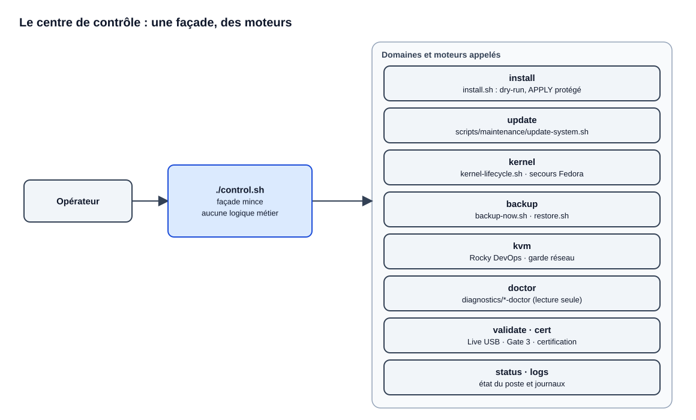

# Centre de contrôle

> Mise à jour : 2026-11-05 · Responsable : @mathiasseguincadiche
> Dernière vérification : 2026-11-05 — chaque commande routée par `control.sh` et `lib/control_center.sh` présente sur cette page (contrôlé par `tests/test_docs_integrity.py`), rétention contre `config/operator-retention.policy` — matériel : non vérifié

`./control.sh` est le point d'entrée unique de l'opérateur. C'est une façade mince : l'installation, les sauvegardes Borg, les mises à jour DNF5, le cycle de vie du noyau, KVM et les diagnostics restent implémentés dans leurs moteurs dédiés. Cette page fait foi pour la liste des commandes `./control.sh`.

```bash
./control.sh
./control.sh help
```

Sans argument, `./control.sh` ouvre le menu interactif ; `help` affiche la liste des commandes et de leurs actions, sans rien exécuter. `./menu.sh` lance la même interface pour compatibilité.

Avant les premiers enrôlements matériels, `./control.sh install prepare-tools` installe explicitement les outils de baseline. Cette préparation est proposée dans le menu Installation ; elle ne lance aucune mesure ni certification.

## Une façade, des moteurs spécialisés



L'opérateur passe toujours par `./control.sh`, une façade sans logique métier. Chaque domaine délègue à son moteur : `install.sh` pour le dry-run et l'APPLY, `scripts/maintenance/update-system.sh` pour les mises à jour, le cycle de vie du noyau, les scripts de sauvegarde, la création Rocky et le garde réseau KVM, les doctors en lecture seule, puis la validation Live, la Gate 3 et la certification.

Source éditable : [`centre-de-controle.drawio`](assets/diagrams/centre-de-controle.drawio).

`control.sh` expose des commandes lisibles mais **ne retire aucun garde-fou**. Les moteurs `install.sh`, mises à jour, sauvegardes, virtualisation et diagnostics restent séparés, vérifiables et soumis aux mêmes préconditions.

| Intention | Exemple | Effet |
|---|---|---|
| Comprendre l'état | `./control.sh status` | observation |
| Diagnostiquer | `./control.sh doctor all` | lecture seule |
| Préparer une installation | `./control.sh install dry-run` | plan non mutant |
| Installer réellement | `./control.sh install apply` | **mutation protégée, PC physique uniquement** |

Fedora 45 / GNOME 51 est la cible sélectionnée et son profil est promu (`ready`) ; l'APPLY reste soumis à ses autres gardes. Le [schéma d'architecture expliqué](ARCHITECTURE.md) détaille les relations entre commandes et moteurs.

## Tableau de bord

```bash
./control.sh status
```

Le tableau de bord affiche :

- version et SHA Git ;
- Fedora / environnement runtime ;
- noyau courant et politique **N / N-1 · max 2 par canal** ;
- Intel Arc B580 / `xe` ;
- état Git ;
- second T705 `/data` EXT4 ;
- profil Gaming / Steam / Vulkan ;
- état Performance Fedora Linux et profil TuneD actif ;
- sauvegarde Borg ;
- certification Golden ;
- KVM / `devops-nat` ;
- besoin de reboot.

Une certification dont le fingerprint runtime, la configuration effective ou le plan de modules ne correspond plus est affichée `STALE`. Le certificat doit également contenir le contrat performance Golden.

## Validation : Live USB, puis système installé

La CI vérifie le logiciel ; ces commandes vérifient le PC. L'ordre des étapes fait foi dans le [guide d'installation](INSTALLATION_GUIDE.md#le-parcours).

Depuis le Live :

```bash
./control.sh validate live plan
./control.sh validate live run
./control.sh validate export live /chemin/support-externe-inscriptible
```

Après installation et redémarrage sur SSD :

```bash
./control.sh validate import /chemin/live-SHA_DU_COMMIT_AUDITE.json
./control.sh validate status
./control.sh validate gate3 status
./control.sh validate help
```

`validate help` rappelle la syntaxe exacte de ces commandes.

La preuve Live porte `PREINSTALL_ONLY`. Les essais du système installé et la certification complète sont décrits dans [le protocole](QUALIFICATION.md), avec les procédures de [préinstallation Live](FEDORA45_LIVE_PREFLIGHT.md) et d'[installation](INSTALLATION_GUIDE.md).

## Installation

```bash
./control.sh install dry-run
./control.sh install backup
./control.sh install apply
```

Ces commandes délèguent à :

```text
install.sh --dry-run
prepare-preapply-backup.sh
install.sh --apply
```

Le chemin APPLY conserve ses protections : PC physique, Git propre, baseline, cohérence entre dry-run, configuration et plan, sauvegarde pré-APPLY relue depuis le dépôt Borg, et phrase de confirmation.

## Mises à jour

```bash
./control.sh update check
./control.sh update all
./control.sh update dnf
./control.sh update flatpak
./control.sh update firmware
./control.sh update status
./control.sh update log
./control.sh update reboot
./control.sh update finalize
```

`update all` et `update dnf` préparent une transaction **DNF5 hors ligne** après une sauvegarde complète Borg.

```text
sauvegarde complète Borg
        ↓
résolution latest-stable du canal configuré
        ↓
installonly_limit = 4 (N, N-1, secours Fedora, place d'installation)
        ↓
dnf5 --refresh upgrade --offline
        ↓
./control.sh update reboot
        ↓
N = nouveau noyau par défaut
N-1 = noyau précédent
        ↓
./control.sh update finalize
```

La finalisation vérifie la transaction, `dnf5 check`, le noyau N, le défaut GRUB, retire les noyaux amont plus anciens que N-1 en conservant le noyau Fedora de secours, puis converge Flatpak si nécessaire et lance les diagnostics.

Pour le firmware : **aucun flash automatique**. `fwupdmgr` ne sert qu'à l'inventaire et à la consultation.

## Noyau — N / N-1

La politique **Kernel Vanilla stable** suit Linux amont officiel : version de kernel.org, dernier stable direct, puis rétention N / N-1.

- canal unique `vanilla`, RPM sans patch `@kernel-vanilla/stable` ;
- refus des RC, des autres canaux et des RPM en retard sur la dernière stable ;
- N comme défaut GRUB et N-1 pour retour au démarrage précédent ;
- deux versions amont au maximum ; le noyau actuellement démarré n'est jamais retiré ;
- un noyau Fedora signé conservé comme entrée GRUB de secours, jamais par défaut ([ADR 0020](adr/0020-fedora-kernel-boot-fallback.md)) ;
- récupération Fedora complète explicite (`rollback-fedora`).

Les mises à niveau majeures d'un système déjà installé ont un parcours séparé : `./control.sh upgrade plan|prepare|reboot|finalize|status` ([mise à niveau 44 → 45](UPGRADE_FEDORA_45.md)). Une installation neuve n'en a pas besoin.

```bash
./control.sh kernel status
./control.sh kernel doctor
./control.sh kernel install-latest
./control.sh kernel prune
./control.sh kernel rollback
./control.sh kernel fallback
./control.sh kernel refresh-fallback
./control.sh kernel rollback-fedora
```

`rollback` sélectionne N-1 sans supprimer N. `fallback` rend le noyau Fedora de secours défaut GRUB sans rien supprimer ; `install-latest` revient ensuite au dernier amont. `refresh-fallback` remplace le secours par le dernier noyau Fedora signé. `rollback-fedora` sert uniquement à une récupération d'urgence : il quitte le canal amont.

Si ni N ni N-1 ne démarrent, maintenir **Maj** ou appuyer sur **Échap** au démarrage pour afficher GRUB, puis choisir l'entrée Fedora sans `vanilla` dans son nom.

## Diagnostics

```bash
./control.sh doctor all
./control.sh doctor baseline
./control.sh doctor kernel
./control.sh doctor graphics
./control.sh doctor storage
./control.sh doctor data
./control.sh doctor display
./control.sh doctor gnome
./control.sh doctor apps
./control.sh doctor media
./control.sh doctor gaming
./control.sh doctor polish
./control.sh doctor remote
./control.sh doctor kvm
./control.sh doctor backup
```

`doctor all` lance `diagnostic.sh`, qui regroupe plus de vingt doctors : certains (KVM, jeu, accès distant) ne réussissent qu'une fois la Gate 3 menée. `doctor data` contrôle le second T705 EXT4 et les racines `/data/Documents`, `/data/Projets`, `/data/ISO`, `/data/Jeux`, `/data/IA/Openclaw`. `doctor polish` contrôle les réglages de finition du bureau ([GNOME](GNOME.md)).

`doctor gaming` contrôle le profil de jeu, `/data/Jeux`, Steam et Vulkan, et les invariants Arc, Wayland et affichage observables sur le PC physique.

Le profil facultatif d'accès distant a ses propres commandes, toutes en lecture seule :

```bash
./control.sh remote status
./control.sh remote doctor
./control.sh remote info
```

`remote status`, `remote doctor` et `doctor remote` lancent le même contrôle, `diagnostics/remote-doctor`. `remote info` affiche la MAC, la diffusion LAN et l'adresse Tailscale à reporter sur le relais Wake-on-LAN. Voir l'[accès distant](REMOTE_ACCESS.md).

## Performance Fedora Linux

Le mode normal du poste est `balanced` ; `performance` et `powersave` sont des bascules explicites et réversibles ([performance](PERFORMANCE.md)).

```bash
./control.sh perf status
./control.sh perf balanced
./control.sh perf performance
./control.sh perf powersave
./control.sh perf sched-status
./control.sh perf sched-smoke
./control.sh perf zram
./control.sh perf nvme
./control.sh perf nvme-benchmark
./control.sh perf frametime /chemin/mangohud.csv
./control.sh perf game COMMAND [ARG ...]
```

Le menu interactif **Performance Fedora Linux** expose les mêmes diagnostics et mutations sûres. Le smoke test SCX et le benchmark NVMe demandent une action explicite ; le benchmark restaure toujours le scheduler initial.

La certification finale appelle `performance-doctor --certify` : TuneD doit être revenu sur le profil Golden normal, zram doit respecter le contrat Fedora, SCX reste fail-safe selon sa politique, le scheduler NVMe reste `benchmark-only` et GameMode doit être disponible lorsque le profil de jeu est activé.

## KVM et machines virtuelles

### Diagnostic et réseau

```bash
./control.sh kvm status
./control.sh kvm guard-check
./control.sh kvm guard-reconcile
./control.sh kvm certify
./control.sh kvm nautilus-refresh
```

Le garde réseau échoue fermé. `guard-reconcile` passe d'abord par un état restrictif avant de reconstruire les règles normales ([réseau KVM](KVM_NETWORK.md)).

### Création Rocky DevOps

Dans le menu interactif, **KVM → Créer Rocky DevOps** demande le chemin de l'image cloud et permet de préciser une clé SSH ou une clé Rocky Linux locale.

CLI :

```bash
./control.sh kvm create-rocky \
  --cloud-image /data/libvirt/iso/Rocky-10-GenericCloud-Base-10.2-20260525.0.x86_64.qcow2
```

`CHECKSUM` et `CHECKSUM.asc` sont attendus à côté de l'image par défaut et sont authentifiés avant création du disque.

## Sauvegarde et restauration

```bash
./control.sh backup now
./control.sh backup daily
./control.sh backup list
./control.sh backup check
./control.sh backup deep
./control.sh backup restore latest
./control.sh backup dr-plan
./control.sh backup prune
```

Les restaurations passent par un dossier d'essai (staging) à inspecter avant toute copie. Borg protège l'hôte et les données utilisateur, dont `/data/IA/Openclaw` ; les disques et métadonnées des VM restent exclus et s'exportent à la main. Détail des sources, de la rétention et des restaurations : [sauvegarde et restauration](BACKUP_RESTORE.md).

## Certification

```bash
./control.sh cert status
./control.sh cert record-suspend
./control.sh cert certify
./control.sh cert baseline-status
./control.sh cert baseline-certify
```

La certification finale exige la preuve Live courante importée, les preuves physiques, cinq cycles de veille, le matériel et l'affichage, `/data`, le jeu, la sauvegarde et KVM selon le profil ([qualification](QUALIFICATION.md#certification-finale)).

### Archive Golden longue durée

Après certification réelle :

```bash
./control.sh cert archive /mnt/archive/golden-2026 \
  /chemin/Fedora-Workstation-Live-45.iso \
  /chemin/offline-rpm-flatpak-cache
```

Le moteur exige un certificat PASS courant et scelle les payloads fournis par l'opérateur. Il ne télécharge aucun média externe automatiquement.

## Journaux et rétention

Les commandes de consultation lisent les journaux sans rien modifier :

```bash
./control.sh logs list
./control.sh logs tail
./control.sh logs boot-failure
```

`logs list` affiche les dix derniers runs, les rapports et les preuves d'état ; `logs tail` montre la fin du `main.log` du dernier run. `logs boot-failure` lance `scripts/collect-boot-failure.sh`, qui écrit dans `reports/` les avertissements, erreurs noyau, coredumps et unités en échec du **démarrage précédent** : c'est le premier geste après un démarrage raté ([dépannage en urgence](TROUBLESHOOTING.md#en-urgence)).

La rétention s'applique aux journaux et rapports transitoires :

```text
logs = 90 jours
reports = 180 jours
state/ = conservé
state/releases/ = conservé
```

```bash
./control.sh logs retention
./control.sh logs prune
```

Les preuves Golden et `state/releases/` ne sont jamais supprimées par cette rétention.

## Couleurs

```bash
NO_COLOR=1 ./control.sh status
```

`NO_COLOR=1` désactive les couleurs ANSI.
