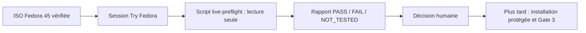

# Fedora 45 Live USB — préqualification matérielle non destructive

Cette étape se place **après les validations CI et avant toute installation sur NVMe**. Elle ne remplace ni la baseline physique complète ni la Gate 3 après installation. Le profil Fedora 45 reste `pending`.

## Pourquoi ce préflight existe avant l'installation Fedora 45

Une session **Live USB** est un moyen de vérifier les fondamentaux avant d'écrire sur les NVMe. C'est particulièrement utile avec la B580, l'écran QD-OLED, le Wi-Fi 7 et les deux SSD PCIe 5.0 : la compatibilité doit être constatée, pas déduite de la présence d'un paquet.



**Attention :** le script Live **ne formate rien, ne monte pas les disques en écriture et ne promeut pas le profil 45**. Son éventuel code retour zéro ne constitue jamais une autorisation automatique d'APPLY. Après la session Live, il reste à suivre [UPGRADE_FEDORA_45.md](UPGRADE_FEDORA_45.md) et [INSTALLATION_GUIDE.md](INSTALLATION_GUIDE.md).


## Procédure

1. Télécharger le média Fedora Workstation 45 officiel et vérifier sa signature / somme de contrôle selon les instructions Fedora. Créer la clé USB bootable.
2. Démarrer sur **Try Fedora** (session Live), sans lancer l'installateur ni monter les partitions internes en écriture.
3. Se connecter à Internet, puis récupérer le dépôt à un **SHA explicitement choisi et vérifié**. Ne jamais exécuter de script distant avec `curl | bash`.
4. Dans le terminal Live, en utilisateur normal (sans `sudo`) :

```bash
git clone https://github.com/mathiasseguincadiche/FEDORA_GNOME_CUSTOM.git
cd FEDORA_GNOME_CUSTOM
git rev-parse HEAD
bash diagnostics/live-preflight.sh | tee "$HOME/fedora45-live-preflight.tsv"
```

Le code de sortie de la commande de diagnostic peut être conservé avec `set -o pipefail` avant le pipeline. Le rapport enregistré dans le HOME Live est **temporaire** : le copier manuellement sur un support externe autorisé, après revue et suppression des identifiants sensibles. Ne pas pousser automatiquement des informations matérielles vers GitHub.

## Contrat de sécurité

- Le script refuse `root`, les systèmes non-Fedora et les environnements qui ne présentent aucun indice de session Live.
- Il n'exécute aucune installation, modification de partition, montage, écriture EFI, changement de firmware, de service ou de configuration du système.
- `PASS` signifie uniquement que le contrôle indiqué a été observé ; `FAIL` signale un écart ; `NOT_TESTED` interdit de considérer l'élément comme certifié.
- Le script ne lance pas les doctors de convergence de l'installation existante : certains exigent des verrous d'identité, des chemins persistants ou des actions qui n'ont pas de sens en Live.
- Un code retour 0 signifie **absence d'échec détecté dans les contrôles exécutés**, et non autorisation automatique d'installer.

## Vérifications manuelles complémentaires

Contrôler GNOME/Wayland, résolution et fréquence 2560×1440/240 Hz, blancs et artefacts de la B580, audio lecture/capture, Wi-Fi 7/6 GHz, Ethernet 5 GbE, USB, températures, ainsi que veille/réveil (la clé Live peut modifier le comportement). Documenter les écarts et leurs preuves.

**Décision :** n'autoriser l'installation qu'après examen humain des FAIL et NOT_TESTED critiques. Après installation, exécuter les contrôles de baseline, de sauvegarde, de persistance et la certification Gate 3 sur le vrai PC. Aucune promotion automatique de Fedora 45 n'est permise.
