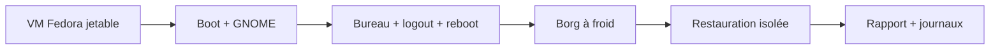

# Laboratoire Fedora/GNOME sur GitHub

Ce prétest fonctionne exclusivement sur un runner GitHub jetable. Il ne lance
aucune commande sur le PC de l'opérateur. Le job réutilisable
`.github/workflows/fedora-gnome-vm.yml` est appelé par `Tests` sur les push vers `main` et les pull requests.
Le contexte obligatoire `contracts` attend les deux laboratoires GNOME et les autres validations :
logic-contracts, installer-audit, borg-fedora, upstream-kernel / rpm et rocky-devops-vm. La publication attend donc aussi ce laboratoire.

## Les deux laboratoires Fedora/GNOME : ce que chacun prouve

| Profil laboratoire | Exercices | Non certifié |
|---|---|---|
| **Fedora 45 / GNOME 51 native preview** | GNOME 51 Wayland, maintenance, bureautique, redémarrage et récupération | six extensions personnalisées finales, matériel réel |
| **Fedora 45 / GNOME 51 candidate complet** | session Wayland avec les **six** extensions réellement actives, ZIP épinglés/empreintes, RPM Fedora réels, redémarrage et restauration QEMU | publication finale Fedora, installation ISO Workstation, tests visuels humains et matériel réel |

La nouvelle CI obligatoire `.github/workflows/fedora45-gnome-vm.yml` ne modifie ni `profile.json` (`pending`), ni le média de production. Elle utilise le seed Cloud Fedora 45 Beta avec sa signature et son SHA verrouillés, puis installe les quatre ZIP candidats **uniquement dans une VM jetable** ; En date du 18 octobre 2026, les RPM Fedora 45 standards **Dash to Dock 105-2.fc45** et **AppIndicator 64-2.fc45** ne déclarent pas GNOME 51 compatible. Le laboratoire **Fedora 45 / curated uniquement** installe explicitement les deux RPM officiels Fedora **Dash to Dock 110-1.fc45** et **AppIndicator 66-1.fc45** depuis `updates-testing` avec `dnf --enablerepo=updates-testing install`, sans activer ce dépôt globalement. Leurs versions RPM exactes et leurs déclarations GNOME 51 dans `metadata.json` sont vérifiées avant le démarrage de GNOME ; aucune tolérance aux extensions incompatibles n'est activée. Ce choix ne change ni le laboratoire natif ni les dépôts du PC de production. Ce choix de paquet de **test** ne prouve pas qu'il appartient à la version stable finale ; une nouvelle validation des paquets Fedora officiels sera nécessaire lors de la promotion du profil Fedora 45. Le contrôle exige les six rôles `ACTIVE`, `enabled`, des métadonnées GNOME 51 et la provenance SHA des quatre archives, puis rejoue redémarrage, restauration et reconstruction. Un paquet incompatible reste **FAIL**, jamais `DEFERRED`.

Le laboratoire natif sans extensions reste utile pour isoler les défauts GNOME, mais **son succès ne remplace pas** celui du laboratoire avec les six extensions. La CI donne une preuve logicielle QEMU seulement : rien ne qualifie le second T705, la B580 ou la certification physique.

**Un plantage GNOME n'est pas une réussite.** Les coredumps, erreurs critiques, services en échec et incohérences de reprise doivent rester bloquants, même s'ils apparaissent au dernier logout. Le job `contracts` dépend du succès effectif des laboratoires.

Pour voir comment la VM et les preuves se rattachent à la machine physique, consulter [ARCHITECTURE_PEDAGOGIQUE.md](ARCHITECTURE_PEDAGOGIQUE.md).

## Image et démarrage

Les deux laboratoires principaux utilisent le seed Fedora Cloud 45 Beta verrouillé et signé, contrôlé par `.github/scripts/fedora45-preview-media.py`. Le laboratoire historique manuel utilise seul `.github/fedora44-cloud.lock` et la clé Fedora 44. Les images de laboratoire ne remplacent jamais le média Workstation final de production.

Sources officielles : [Fedora Cloud](https://www.fedoraproject.org/cloud/download/) et [clés Fedora](https://fedoraproject.org/security/).

QEMU démarre un disque autonome, UEFI OVMF, TPM logiciel swtpm et un GPU virtio.
L'accélération disponible est enregistrée ; TCG permet l'émulation lorsque
KVM est absent. Les limites de temps restent bloquantes. Le disque virtuel du
fixture est limité à 10 Gio ; sa capacité maximale plus 2 Gio de réserve doit
tenir sur le runner avant chaque création. Les captures à froid dimensionnent
l'espace d'après les tailles logiques des membres. L'original CI est supprimé
après vérification Borg avant extraction, puis la copie et le dépôt jetables
sont supprimés après le boot récupéré, avant reconstruction. Ces contrôles
évitent de retenir plusieurs générations de disques jusqu'au pic de stockage. GitHub indique que
la virtualisation imbriquée est techniquement possible mais non officiellement
prise en charge : [documentation des runners](https://docs.github.com/en/actions/concepts/runners/github-hosted-runners).
Le laboratoire ne nécessite aucun runner installé chez l'utilisateur.

GNOME 51 est installé sur Fedora Cloud, puis lancé par GDM en session Wayland
réelle. L'autologin et les réglages empêchant la veille sont propres à cette
image éphémère. Avant chaque arrêt/redémarrage, le laboratoire attend que
GNOME retire lui-même son marqueur de protection d'initialisation (environ
une minute), puis revérifie session, réglages persistants et extensions actives.
La session se ferme par `gnome-session-quit --logout --no-prompt`, puis GDM
s'arrête avant le redémarrage/arrêt système. Le rapport exige
`session_shutdown=gnome-logout`.
Le runner s’abonne au moniteur QMP avant la demande de reboot du système,
puis attend un événement `RESET` émis par l’invité avant de retenter SSH.
Il ne force aucune remise à zéro depuis l’hôte. L’identifiant du boot doit
également changer. Cette attente évite de provoquer des refus PAM critiques
en interrogeant SSH pendant que Fedora bloque les connexions à l’arrêt.
Le contrôle des erreurs critiques reste intégral : [événements QEMU](https://www.qemu.org/docs/master/interop/qemu-qmp-ref.html#event-reset).
Il ne supprime jamais ce marqueur et ne réactive pas les extensions pour
faire réussir un redémarrage. Le journal persistant permet aussi de refuser
un crash ou une erreur critique sur le boot précédent, y compris à l'arrêt.
La fermeture de session contrôle aussi immédiatement ces erreurs après l’arrêt
de GDM, y compris pour la dernière VM qui ne sera pas redémarrée.
Ce scénario ne qualifie pas un redémarrage précipité pendant la première
minute d'initialisation, ni un reboot direct avec `systemctl` pendant que
le bureau est ouvert. Ce dernier chemin a produit des timeouts d'arrêt de
GNOME Shell et SIGABRT dans le laboratoire ; le contrôle du boot précédent
les a rendus bloquants. Il reste à qualifier sur les autres environnements.
Aucun timeout de GNOME, mécanisme de protection ni contrôle des coredumps
n'est affaibli pour faire réussir ce parcours. SELinux reste enforcing et firewalld actif. Les quatre extensions utilisateur
DING, Show Desktop Button, Vitals et Tiling Assistant utilisent leurs installateurs de
production et les artefacts/hash du verrou existant. Les trois premières viennent de GNOME Extensions ; Tiling Assistant vient de sa release GitHub officielle. Avec Dash to Dock et AppIndicator fournis par RPM, les six extensions doivent être ACTIVE. Les ZIP sont téléchargés
avec TLS strict par le runner, vérifiés puis transférés dans la VM ; le même
installateur revérifie leur hash et leurs métadonnées depuis ce cache absolu.
Aucun téléchargement non authentifié ni option curl insecure n'est utilisé.

## Exercices et critères

| Exercice | Résultat requis |
|---|---|
| Média | Signature de la clé Fedora 45 + paire nom/SHA exacte |
| Démarrage | Fedora 45, SSH, cloud-init terminé, identité du boot enregistrée |
| GNOME | GDM, Shell 50, session logind Wayland active, bus Shell, extensions ACTIVE, processus Nautilus/Ptyxis et portal |
| Redémarrage | Identifiant du boot différent, GNOME et données/TPM persistants |
| Fichiers Borg | Vrai moteur du projet, dépôt non chiffré, archive exacte vérifiée ; roundtrip quotidien existant rejoué dans Fedora |
| Archive VM à froid | QEMU et swtpm arrêtés avant capture ; disque sans backing, NVRAM et TPM inclus ; vérification intégrale Borg et comparaison des membres |
| VM récupérée | Démarrage des fichiers extraits, GNOME, données, canary TPM NV identique, réseau restrict=on |
| Fedora reconstruit | Seconde image neuve, réinstallation indépendante de GNOME, données absentes avant extraction ; archive exacte restaurée en staging puis fichiers de test remis et comparés |

Le réseau de récupération utilise `restrict=on` avec un seul port SSH sur
127.0.0.1. QEMU interdit les connexions sortantes et conserve ce canal de
contrôle explicite : [documentation réseau QEMU](https://www.qemu.org/docs/master/system/invocation.html).
Le test refuse une connexion sortante réussie. La VM originale est arrêtée et
son dossier jetable supprimé après vérification de l'archive et avant de démarrer
la copie récupérée. Cette suppression concerne uniquement les données de test CI.
Les originaux de production restent conservés selon le runbook opérateur.

## Rapports

L'artefact `fedora-gnome-boot-recovery-<run_id>` conserve 14 jours :

- `report.json` : commit du code exact, étapes, quatre identifiants de boot,
  archive/id, hash du disque et de la NVRAM, chiffrement, isolation et méthode de fermeture de session ;
- consoles QEMU, sorties installation/restauration et signature du média ;
- journaux complets du boot et des boots précédents, du noyau et de l'utilisateur, unités en échec,
  inventaire des paquets et sessions pour chaque étape.

Un crash enregistré par systemd-coredump, un message journal de priorité
critique ou une unité système/utilisateur en échec bloque le test. Les autres messages restent disponibles pour analyse.
Une lecture de journal en échec reste un échec. Aucun PASS n'est écrit si une
étape manque ou si un redémarrage conserve le même identifiant de boot.
Les clés SSH, user-data, disques et dépôts Borg ne sont pas publiés en artefact.

## Portée des preuves

Le rapport porte `scope=fedora-gnome-qemu-pretest`. Il n'écrit aucun fichier
de certification officiel. Restent explicitement DEFERRED :

- Gate 1 WSL2 et Gate 2 VirtualBox avec contrôle visuel humain ;
- Gate 3 et matériel physique Ryzen/B580/T705/écran ;
- APPLY complet de production et démarrage du noyau Linux amont ;
- restauration des VM Rocky/Windows de production, UUID/libvirt/réseau,
  TPM Windows et éventuels logiciels associés.

Le noyau du laboratoire reste celui de Fedora Cloud. Installer GNOME sur une
image Cloud n'exerce pas l'installateur Anaconda/Kickstart du média Workstation.
La reconstruction vérifie les fichiers de test et GNOME ; elle ne démontre
pas la restauration de tous les paquets, jeux ou services de la workstation.

Le [runbook de reprise isolée](ISOLATED_RECOVERY_RUNBOOK.md) et
[les trois gates](THREE_GATE_VALIDATION.md) définissent les essais opérateur
restants sur le même commit. Un PASS CI conserve toutes ces limites.

Le check obligatoire `contracts` s'exécute avec `always()` puis contrôle
explicitement que chacune des sept dépendances a conclu `success`. Un job dépendant
simplement sauté peut être accepté comme check requis par GitHub ; ici tout
`skipped`, `failure` ou `cancelled` produit un véritable échec du check agrégé.
Voir [les conditions GitHub](https://docs.github.com/en/actions/how-tos/write-workflows/choose-when-workflows-run/control-jobs-with-conditions).

### Protection contre le crash de déconnexion de Gtk4-DING (GNOME 51)

La qualification Fedora 45 applique **uniquement dans la VM jetable** le garde-fou
issu de l'exploration amont `fix-mutter-crash` de Gtk4 Desktop Icons NG : un
sous-processus d'icônes ne doit jamais être relancé si l'extension est en cours
de désactivation. Le ZIP EGO officiel reste intact, épinglé par SHA-256 et
recontrôlé avant installation. Le fichier `dingManager.js` installé doit être
exactement le résultat déterministe du correctif ; l'audit indépendant
reconstruit et vérifie ses octets contre le ZIP revu. Un changement amont non
revu ou un fichier modifié entraîne un échec, pas une tolérance implicite.

Ce correctif **n'est pas encore une promotion production Fedora 45** : une
version upstream publiée et auditée, ou une décision explicite de distribution
d'un correctif local validé, reste nécessaire pour l'installation finale.
Le test continue à exiger la vraie déconnexion GNOME, six extensions actives,
zéro coredump et une reprise après redémarrage et restauration. Un unique
passage vert ne prouve pas à lui seul la disparition d'une panne intermittente.
