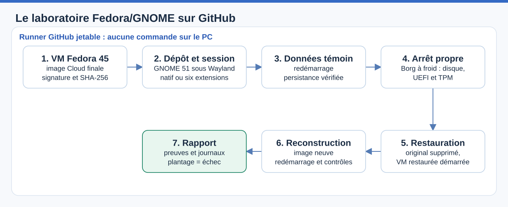

# Laboratoire Fedora/GNOME de la CI

> Mise à jour : 2026-11-04 · Responsable : @mathiasseguincadiche
> Dernière vérification : 2026-11-04 — relu contre `.github/workflows/fedora-gnome-vm.yml`, `.github/workflows/fedora45-gnome-vm.yml`, `.github/scripts/fedora-gnome-vm.sh`, `.github/scripts/fedora-gnome-guest.sh` et `scripts/gnome/install-pinned-extension.sh` — matériel : non vérifié

Le laboratoire démarre une vraie session GNOME 51 dans une VM QEMU, sur un runner GitHub jetable. Il redémarre, sauvegarde, restaure puis reconstruit cette VM. Rien ne s'exécute sur le PC de l'opérateur, et aucun runner n'est à installer chez lui.

Les deux variantes sont des dépendances du job `contracts` ([CI](CI_VALIDATION.md)) : un échec bloque la fusion et la publication.

## Les deux laboratoires

| Job | Extensions | Ce qu'il prouve | Ce qu'il ne prouve pas |
|---|---|---|---|
| `fedora-gnome-vm / lab` | aucune (mode `native`) | GNOME 51 Wayland, redémarrage, sauvegarde, restauration, reconstruction | les six extensions, le matériel |
| `fedora45-gnome-vm / lab` | les six (mode `curated`) | session avec les six extensions actives, archives épinglées, RPM Fedora exacts, redémarrage, restauration | installation depuis l'ISO Workstation, tests visuels humains, matériel |

Le laboratoire natif isole les défauts de GNOME lui-même ; son succès ne remplace pas celui du laboratoire à six extensions. Aucun des deux ne modifie `profiles/fedora45/profile.json` ni le média de production.

Sur le runner, une VM Fedora 45 démarre depuis l'image Cloud finale vérifiée. Le dépôt est installé, la session GNOME 51 contrôlée, et des données témoin doivent survivre à un redémarrage. La VM est ensuite arrêtée et sauvegardée à froid par Borg ; l'original est supprimé et la copie restaurée doit redémarrer. Enfin, une image neuve est reconstruite et redémarrée, et le rapport conserve preuves et journaux. Un plantage, à n'importe quelle étape, fait échouer le laboratoire.

Source éditable : [`laboratoire-gnome.drawio`](assets/diagrams/laboratoire-gnome.drawio).

## Image et machine virtuelle

Les deux laboratoires partent de l'image finale `Fedora-Cloud-Base-Generic-45-1.4.x86_64.qcow2`, définie dans `.github/fedora45-preview-media.json`. `.github/scripts/fedora45-preview-media.py` vérifie la signature de son `CHECKSUM` par la clé Fedora 45 et son SHA-256, épinglé indépendamment. Jusqu'au 4 novembre 2026, les laboratoires partaient de l'image Beta 1.3, dont la mise à jour coûtait plusieurs minutes à chaque démarrage. Cette image de laboratoire ne remplace jamais le média Workstation de production. Le laboratoire Fedora 44 historique, manuel, utilise seul `.github/fedora44-cloud.lock`.

La VM utilise l'UEFI OVMF, un TPM logiciel (swtpm) et un GPU virtio. Elle tourne avec KVM quand le runner l'expose, sinon en émulation TCG ; l'accélération utilisée est enregistrée. GitHub indique que la virtualisation imbriquée fonctionne sans être officiellement prise en charge ([runners hébergés](https://docs.github.com/en/actions/concepts/runners/github-hosted-runners)).

Le disque de la VM est limité à 10 Gio, et sa taille maximale plus 2 Gio de réserve doit tenir sur le runner avant chaque création. Les disques intermédiaires sont supprimés dès qu'ils ne servent plus, pour ne pas cumuler plusieurs générations.

SELinux reste en mode Enforcing et firewalld actif dans la VM. L'ouverture de session automatique et l'absence de mise en veille sont propres à cette image jetable.

## Démarrage et redémarrage

GNOME 51 est installé sur l'image Cloud puis lancé par GDM, en vraie session Wayland. Avant chaque arrêt, le laboratoire :

1. attend que GNOME retire lui-même son marqueur de protection d'initialisation (environ une minute), sans jamais le supprimer ;
2. revérifie la session, les réglages persistants et les extensions actives ;
3. ferme la session par `gnome-session-quit --logout --no-prompt`, puis arrête GDM. Le rapport exige `session_shutdown=gnome-logout`.

Pour redémarrer, le runner écoute le moniteur QMP de QEMU et attend l'événement `RESET` émis par l'invité avant de retenter SSH ([événements QEMU](https://www.qemu.org/docs/master/interop/qemu-qmp-ref.html#event-reset)). Il ne force aucune remise à zéro, et l'identifiant de démarrage doit changer. Interroger SSH pendant l'arrêt provoquait des refus PAM critiques.

Le journal persistant permet de refuser un plantage ou une erreur critique du démarrage précédent, y compris pendant l'arrêt. La dernière VM, qui ne redémarre pas, est contrôlée juste après l'arrêt de GDM.

**Cas non qualifiés.** Le laboratoire ne couvre ni un redémarrage pendant la première minute d'initialisation, ni un `systemctl reboot` lancé avec le bureau ouvert. Ce second chemin a produit des délais d'arrêt de GNOME Shell et un SIGABRT ; le contrôle du démarrage précédent les a rendus bloquants. Il reste à qualifier sur le PC. Aucun délai de GNOME ni contrôle des coredumps n'est affaibli pour faire réussir ce parcours.

## Extensions

Dash to Dock et AppIndicator sont installés depuis les RPM Fedora, aux versions exactes de `profiles/fedora45/gnome-rpms.json` (110-1.fc45 et 66-1.fc45). Dans la VM seulement, `scripts/gnome/install-fedora45-rpm-extensions.sh --lab-testing` ajoute `updates-testing` à cette transaction ; ce dépôt n'est jamais activé globalement ni sur le PC. Ces versions sont dans les dépôts stables depuis la promotion du profil, le 3 novembre 2026, et le PC ne les installe que depuis ces dépôts.

Gtk4 DING, Show Desktop Button, Vitals et Tiling Assistant sont installés par l'installateur de production, à partir des archives et empreintes du verrou. Le runner télécharge les archives en TLS strict, les vérifie et les transfère dans la VM ; l'installateur revérifie leur empreinte et leurs métadonnées.

Le laboratoire exige les six rôles `ACTIVE` et `enabled`, des métadonnées déclarant GNOME 51 et la provenance des quatre archives. Aucune tolérance aux extensions incompatibles n'est activée : un paquet incompatible est un échec, jamais un report.

### Correctif d'arrêt de Gtk4 DING

À la déconnexion, Gtk4 DING v145 pouvait relancer son processus d'icônes pendant sa propre désactivation, et faire planter la session. `scripts/gnome/ding-shutdown-fix.py` applique la correction explorée en amont (branche `fix-mutter-crash`) : ne plus relancer ce processus pendant la désactivation.

L'archive officielle reste intacte, épinglée et revérifiée ; seul `dingManager.js` est modifié, et le fichier installé doit être exactement le résultat attendu. Si l'amont change ce fichier, le correctif refuse de s'appliquer et demande une nouvelle revue. L'empreinte du correctif est inscrite dans le profil promu (`ding_patch_sha256`), et `scripts/gnome/install-pinned-extension.sh` l'applique aussi sur le PC. Un passage vert ne prouve pas à lui seul la disparition d'une panne intermittente : la Gate 3 l'observe sur le matériel.

## Exercices et critères

| Exercice | Résultat exigé |
|---|---|
| Média | signature de la clé Fedora 45 et paire nom / SHA-256 exacte |
| Démarrage | Fedora 45, SSH, cloud-init terminé, identifiant de démarrage enregistré |
| GNOME | GDM, GNOME Shell 51, session Wayland active, bus du Shell, extensions actives, processus Nautilus, Ptyxis et portail |
| Redémarrage | nouvel identifiant de démarrage ; GNOME, données et TPM persistants |
| Fichiers Borg | moteur du projet, dépôt non chiffré, archive exacte vérifiée |
| Archive de la VM à froid | QEMU et swtpm arrêtés avant capture ; disque autonome, NVRAM et TPM inclus ; vérification intégrale par Borg |
| VM restaurée | démarrage depuis les fichiers extraits, GNOME, données, témoin TPM identique, réseau isolé |
| Fedora reconstruit | image neuve, GNOME réinstallé, données absentes avant extraction puis restaurées en staging et comparées |

La VM restaurée tourne sur un réseau QEMU `restrict=on`, avec un seul port SSH sur 127.0.0.1 ; toute connexion sortante réussie fait échouer le test ([réseau QEMU](https://www.qemu.org/docs/master/system/invocation.html)). L'original est supprimé avant le démarrage de la copie : cela ne concerne que les données de test de la CI.

## Rapports

L'artefact du job (`fedora-gnome-boot-recovery-<run_id>` ou `fedora45-gnome51-six-extensions-<run_id>`) est conservé 14 jours. Il contient :

- `report.json` : commit testé, étapes, quatre identifiants de démarrage, archive, empreintes du disque et de la NVRAM, isolement, méthode de fermeture de session ;
- consoles QEMU, sorties d'installation et de restauration, vérification du média ;
- journaux complets de chaque démarrage, unités en échec, inventaire des paquets.

Bloquent le test : un plantage enregistré par systemd-coredump, un message de priorité critique, une unité en échec, une lecture de journal impossible, une étape manquante, un redémarrage qui garde le même identifiant. Les clés SSH, disques et dépôts Borg ne sont jamais publiés.

## Portée des preuves

Le rapport porte `scope=fedora-gnome-qemu-pretest` et n'écrit aucun fichier de certification. Restent à prouver ailleurs :

- le Live USB et l'usage du système installé ;
- la Gate 3 et le matériel (Ryzen, B580, T705, écran) ;
- l'APPLY de production et le démarrage du noyau Linux amont, le laboratoire gardant le noyau de l'image Cloud ;
- l'installateur Anaconda et le Kickstart du média Workstation ;
- la restauration de tous les paquets, jeux et services du poste, et celle de la VM Rocky de production.

Le [runbook de reprise isolée](ISOLATED_RECOVERY_RUNBOOK.md) et la [qualification](QUALIFICATION.md) définissent ces essais, sur le même commit. L'articulation entre VM et machine physique est dans l'[architecture](ARCHITECTURE.md).
