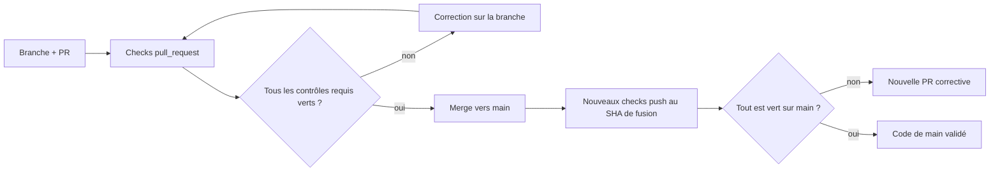

# GitHub governance — pré-1.0

`main` est une branche de production : aucun changement ne doit contourner la validation automatisée.

## Ruleset attendu sur `main`

**Attention :** les six noms ci-dessous sont les contextes attendus par la politique documentée, et non le nombre total de workflows d'une PR. Une vérification du ruleset GitHub effectif est nécessaire avant de les présenter comme des réglages actuellement actifs. Les workflows supplémentaires doivent également être terminés en succès avant toute fusion manuelle.

Configurer dans GitHub un ruleset ciblant `refs/heads/main` avec :

- pull request obligatoire avant fusion ;
- interdiction des force-push ;
- interdiction de supprimer `main` ;
- branche à jour avant fusion ;
- contextes obligatoires : **contracts**, **shellcheck**, **guards**, **packages**, **packages-and-integration**, **nautilus-ptyxis** ;
- le job Rocky Linux 10.2 est une dépendance de contracts sur chaque PR et push main ; son échec, annulation ou absence bloque le contrôle agrégé.

Tout check configuré comme obligatoire dans le ruleset doit produire un contexte sur **chaque pull request**. En particulier, le job `nautilus-ptyxis` du workflow Fedora 44 desktop integration pretest est volontairement déclenché sans filtre `paths:` sur les pull requests afin qu'une modification non Desktop ne reste jamais bloquée dans l'état `Expected — Waiting for status to be reported`.

Le dépôt contient `scripts/development/check-main-protection.sh` pour vérifier l'état public attendu de la protection. Ce script ne modifie aucun réglage GitHub.

## Le contrôle après fusion fait partie de la validation



**Pourquoi deux phases ?** Les contrôles de PR portent sur un SHA différent de celui du commit de fusion. Une exécution verte **avant** la fusion ne suffit pas à certifier le nouveau `main`. Inspecter aussi `Tests / contracts` et ses six dépendances après le `push`.

Les corrections CI doivent conserver des diagnostics exploitables et les protections fail-closed. Les restrictions des registres ou dépôts externes se traitent à la **source**, pas en désactivant le test. [Guide de lecture CI](CI_VALIDATION.md) · [runbook d'incident](TROUBLESHOOTING.md#un-contrôle-github-actions-devient-rouge).


## Discipline de branche et de merge

Les changements fonctionnels ou structurants sont préparés sur une branche dédiée puis proposés par pull request.

Politique de merge du projet :

```text
merge commit : OUI
squash merge : NON
rebase merge : NON
suppression automatique de la branche après merge : OUI
```

Le merge commit est retenu afin de conserver la frontière exacte de chaque PR, son SHA de tête validé et son rattachement à l'historique de revue. Les branches de travail sont jetables et doivent être supprimées automatiquement après fusion.

## Discipline de release

Toute modification fonctionnelle fusionnée dans `main` doit être reflétée dans :

```text
VERSION
CHANGELOG.md
README.md lorsque le contrat utilisateur change
```

La release candidate courante est décrite par `.github/release-manifest.env`. Le workflow `.github/workflows/release.yml`, déclenché uniquement après intégration de ce manifeste sur `main`, vérifie que la version de base du tag correspond exactement à `VERSION` puis crée la prerelease de façon idempotente.

Lire les valeurs actuelles dans les fichiers exécutables, sans maintenir un second numéro de version dans ce guide :

```bash
cat VERSION
cat .github/release-manifest.env
```

Le check obligatoire `contracts` dépend des jobs `installer-audit` et `borg-fedora` du workflow Tests. Leur échec ou absence empêche donc le check obligatoire de réussir, avec le ruleset existant : aucune nouvelle permission d'administration n'est nécessaire pour rendre ces essais bloquants.

Avant toute publication, le workflow attend le succès des sept workflows suivants sur le **même SHA**, avec un événement `push` sur `main` du dépôt source : Tests (incluant Fedora/Borg), Shell quality, Architecture non-regression, Fedora package preflight, Fedora host integration, Fedora desktop integration et Fedora installer audit. Une erreur, annulation, étape ignorée ou expiration du délai bloque la publication. Un succès sur une PR ou un autre commit ne suffit pas. Le SHA de `main` est revérifié avant publication.

Le tag est créé sur le SHA exact du push `main` qui introduit le manifeste. Si une release du même nom existe déjà sur un autre SHA, le workflow échoue au lieu de déplacer silencieusement le tag.

Les documents normatifs ne recopient pas inutilement le numéro de release dans leur titre ; ils suivent la version indiquée par `VERSION`. Les anciens numéros restent acceptables dans les release notes et le changelog lorsqu'ils décrivent explicitement l'historique.

## Contrat documentaire

La documentation est traitée comme une partie du produit. La CI doit notamment empêcher :

- commandes documentées qui n'existent plus ;
- contradiction entre profil GNOME et extensions réellement gérées ;
- contradiction entre GNOME core et le manifeste Nautilus dédié ;
- valeurs KVM documentées différentes de `virtualization.conf`/XML ;
- oubli d'une application professionnelle déjà présente dans les manifests ;
- liens Markdown locaux cassés dans le portail documentaire ;
- retour de textes de maintenance spécifiques à un outil externe dans la documentation publique.

## Limite d'automatisation

Les réglages GitHub de protection/merge ne sont jamais modifiés par `install.sh --apply`. Ils appartiennent à l'administration du dépôt, séparée de la convergence Fedora.

La configuration attendue est vérifiée après modification via l'API publique du dépôt. Si l'identité d'administration utilisée ne possède pas l'écriture `administration`, la modification doit être faite par un mécanisme GitHub explicitement autorisé ; la documentation seule ne constitue jamais une preuve que le réglage live est actif.
