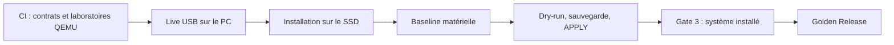

# Qualifier la workstation

Une CI verte vérifie un commit. **Golden runtime-certified** veut dire que `./control.sh validate gate3 certify` a réussi sur le PC installé, pour ses identités matérielles et sa configuration courantes. Entre les deux : le Live USB, l'installation, la baseline et la Gate 3.

Le profil Fedora 45 reste `pending` tant que le média final signé et les composants stables n'ont pas été promus ([fiche Fedora 45](FEDORA45_PRIMARY.md)). Aucun test ne remplace cette promotion.



| Résultat | Ce qu'il démontre | Ce qu'il ne démontre pas |
|---|---|---|
| CI verte au commit exact | les contrôles logiciels couverts | le matériel, un vrai démarrage du PC |
| Live `PREINSTALL_ONLY` | les observations avant installation sur ce PC | les services installés, les extensions, les sauvegardes, KVM |
| Baseline certifiée | un matériel assez sain pour autoriser l'APPLY | la veille, le bureau, les applications |
| Gate 3 `PASS` courant | le contrat Golden sur la machine installée | l'état futur : une évolution peut le rendre `STALE` |

Une preuve `STALE` se rejoue après le changement concerné ; ne jamais recréer ni éditer un marqueur à la main. Un nouveau commit ou plan de modules invalide la preuve Live ; un changement de configuration, de noyau ou de pilote invalide les preuves installées concernées.

## 1. CI au commit exact

Consulter les contrôles GitHub du **commit exact** à installer ([CI](CI_VALIDATION.md), [laboratoire Fedora/GNOME](FEDORA_GNOME_CI_LAB.md)). Les laboratoires QEMU exercent démarrage, session GDM Wayland, reboot, moteur Borg et restauration de VM avec des périphériques virtuels. Ils ne couvrent ni l'APPLY de production, ni Anaconda, ni Linux amont démarré, ni la B580, les T705 ou l'écran.

## 2. Live USB

Démarrer le média Fedora 45 final authentifié en mode essai et suivre le [contrôle Live](FEDORA45_LIVE_PREFLIGHT.md) :

```bash
./control.sh validate live plan
./control.sh validate live run
./control.sh validate export live /chemin/du/support-externe
```

La preuve (schéma 2) porte `environment=live-usb` et `hardware_certification=PREINSTALL_ONLY`. Elle est liée au commit, au plan de modules et à l'identité stable du PC (dont les séries des deux T705), pas au noyau ni à l'UUID racine qui changeront. **L'exporter avant de redémarrer** : le HOME du Live est temporaire. Après installation, au même commit :

```bash
./control.sh validate import /chemin/live-<commit>.json
./control.sh validate status
```

Une preuve d'une autre machine, d'un autre commit ou plan, ou d'un ancien schéma est refusée.

## 3. Baseline matérielle avant APPLY

La baseline prouve que le matériel est assez sain pour autoriser les mutations. Elle s'exécute sur la Fedora installée, après `./control.sh install prepare-tools` (qui installe `manifests/packages-baseline.txt`, dont `smartmontools`, sans rien mesurer). La veille n'en fait pas partie : elle est qualifiée après l'APPLY, pour qu'un défaut que l'APPLY corrige n'empêche pas d'installer son correctif.

**Identités.** Wi-Fi (PCI ID et pilote de cet exemplaire, verrou local jamais commité), Bluetooth (identité USB, pilote `btusb`), refroidissement (trois canaux NCT6687D distincts et actifs : pompe, ventilateur CPU, ventilateur boîtier), `/data` (numéro de série du second T705) :

```bash
./diagnostics/baseline-doctor enroll-wifi
./diagnostics/baseline-doctor enroll-bluetooth
./diagnostics/baseline-doctor list-cooling
./diagnostics/baseline-doctor enroll-cooling fanN fanM fanP   # pompe, CPU, boîtier
./diagnostics/baseline-doctor storage-identity
./diagnostics/baseline-doctor enroll-data NUMERO_DE_SERIE
```

**Charges.** Chaque essai exige la vitesse réellement configurée dans l'UEFI ; le projet ne modifie jamais timings, tensions ni profil mémoire.

```bash
./diagnostics/baseline-doctor run-memory-test 5600   # profil 6000 désactivé
./diagnostics/baseline-doctor run-memory-test 6000   # après réactivation et reboot
./diagnostics/baseline-doctor run-cpu-soak
./diagnostics/baseline-doctor run-nvme-test root
./diagnostics/baseline-doctor run-nvme-test data
./diagnostics/baseline-doctor certify
```

| Essai | Critère |
|---|---|
| RAM 5600 et 6000 | `stress-ng --verify` 60 min chacun sur 70 % de la mémoire ; log conservé avec son SHA-256. Une passe Memtest86+ hors OS reste recommandée en complément pour une première DDR5-6000 |
| CPU | 1800 s sur tous les cœurs, température lisible avant/pendant/après et < 95 °C, AMD P-State et boost vérifiés ; tout MCE, EDAC non corrigé, seuil thermique critique ou *hard lockup* refuse |
| NVMe | `fio` sur un fichier temporaire de 4 Gio en I/O direct avec CRC32C, jamais sur le disque brut ; `/` et `/data` sur deux NVMe physiques distincts |

L'empreinte enregistrée couvre carte mère, BIOS, UUID plateforme, CPU, B580 et pilote, classe mémoire testée, NVMe (modèle, série, firmware) et EDID. Un changement significatif (mise à jour BIOS, vitesse mémoire, écran) invalide la baseline : refaire les essais concernés.

L'APPLY n'est autorisé qu'avec : baseline certifiée, dry-run au même état, sauvegarde Borg pré-APPLY vérifiée et confirmation opérateur ([installation](INSTALLATION_GUIDE.md), [contrat d'exécution](EXECUTION_CONTRACT.md)).

## 4. Gate 3 — système installé

Tout se fait sur le PC, dans la vraie session GNOME Wayland, avec l'écran et les périphériques du quotidien. Aucun essai long ou interactif ne s'exécute pendant l'APPLY. La [fiche physique](PHYSICAL_QUALIFICATION_CHECKLIST.md) sert à consigner les résultats.

### Diagnostics de l'hôte

```bash
./diagnostics/kernel-doctor
./diagnostics/firmware-doctor
./diagnostics/graphics-doctor
./diagnostics/arc-compute-doctor
./diagnostics/storage-doctor
./diagnostics/data-storage-doctor
./diagnostics/hardware-components-doctor
./diagnostics/driver-doctor
./diagnostics/application-runtime-doctor
```

`driver-doctor` exige : B580 `8086:e20b` sur `xe`, Ethernet 5G sur `r8169`, les deux T705 sur `nvme`, xHCI sur `xhci_hcd`, audio sur `snd_usb_audio`, NCT6687D-R sur `nct6683`, le Wi-Fi identique à l'enrôlement, les modules critiques `intree`, et aucune pile NVIDIA/akmod. Un débind, un passage à `vfio-pci` ou un module critique externe invalide la certification.

`application-runtime-doctor` vérifie `manifests/application-runtime-contract.tsv` : paquet et exécutable réels avec smoke test pour les RPM ; fichier `.repo` identique à la source auditée pour les RPM vendor ; origine `flathub`, runtime, exécution dans le sandbox et export `.desktop` pour les Flatpak. Slack, MarkText et draw.io sont des exceptions `community-unverified` listées dans `UNVERIFIED_FLATHUB_ALLOWLIST`.

### Preuves physiques

```bash
./control.sh validate gate3 gpu-soak
./control.sh validate gate3 network-lan
./control.sh validate gate3 network-wifi
./control.sh validate gate3 audio-cert
./control.sh validate gate3 display-cert
./control.sh validate gate3 physical-status
```

| Preuve | Critère |
|---|---|
| `gpu-soak` | 900 s minimum, 1 à 8 cubes Vulkan (2 par défaut) ; tout échec Vulkan, signal `xe`, erreur PCIe non corrigée ou AER bloque |
| `network-lan` | interface Ethernet connectée, IPv4 globale, route par défaut, DNS et HTTPS réels (IPv6 si une adresse globale existe) |
| `network-wifi` | même preuve plus une association `iw` réelle. Ni l'un ni l'autre ne prouve 5 Gb/s ou une liaison Wi-Fi 7/6 GHz |
| `audio-cert` | tonalité jouée, échantillon micro enregistré, puis phrase de confirmation exacte tapée par l'opérateur |
| `display-cert` | connecteur et EDID exacts sur la B580, 2560×1440 à ~240 Hz, VRR côté DRM, bloc *HDR Static Metadata* dans l'EDID, puis confirmation humaine après essai VRR et HDR dans GNOME |

Les preuves CPU/RAM/GPU enregistrent la durée demandée et la durée écoulée (`qualification_policy=2`) ; un essai arrêté trop tôt ne produit pas de PASS et les marqueurs plus anciens sans ces mesures sont refusés. Une nouvelle tentative invalide d'abord la preuve et la certification courantes : un échec ne peut pas laisser un ancien PASS actif.

### Périphériques

Identifier puis enrôler la sortie audio de la carte mère (ALC4080, identité MSI `0db0:cc78`, `snd_usb_audio`) et la webcam (Logitech Brio 100, `uvcvideo`). Aucun numéro ALSA ou USB n'est figé : la résolution suit VID/PID, produit, série et pilote. Si la machine présente un autre VID/PID, arrêter et documenter la révision matérielle.

```bash
./diagnostics/peripherals-doctor list
./diagnostics/peripherals-doctor enroll audio cardN
./diagnostics/peripherals-doctor enroll camera videoN
./diagnostics/peripherals-doctor test-camera          # 60 images 1080p MJPEG
./diagnostics/physical-runtime-doctor audio           # sortie enrôlée + micro Brio, écoute réelle
```

Wi-Fi 7/EHT ou canaux 6 GHz absents donnent `BLOCKED` si ces options sont obligatoires. Vérifier `iw phy`, le firmware et `iw reg get` : un point d'accès ou une réglementation sans 6 GHz n'est pas une panne. Aucun domaine réglementaire n'est forcé.

### Sauvegarde

```bash
./scripts/backup/backup-now.sh
./diagnostics/backup-doctor --certify
```

`--certify` exige une archive complète récente du même commit, son marqueur d'intégrité, un dépôt joignable et `borg check --verify-data`. Exercer aussi une restauration isolée ([reprise isolée](ISOLATED_RECOVERY_RUNBOOK.md)). Les VM restent hors Borg.

### Rocky DevOps et KVM

Après les diagnostics de l'hôte, créer Rocky selon le [démarrage KVM](KVM_QUICKSTART.md) (image vérifiée par CHECKSUM signé et keyring Rocky avant création du disque), puis :

```bash
./diagnostics/virtualization-doctor
./diagnostics/kvm-domain-doctor
./scripts/kvm/runtime_certification.sh
```

`kvm-domain-doctor` exige cgroups v2, accès direct à `qemu:///system`, les démons modulaires libvirt, et un XML Rocky conforme : Q35, `host-passthrough`, RAM et vCPU exacts, qcow2 VirtIO sur `/data` (`cache=none`, `discard=unmap`, profil I/O mesuré), réseau `devops-nat` en VirtIO, QEMU Guest Agent, VirtIO RNG, balloon, aucun `hostdev`. Les scripts de création ne lisent que `KVM_IO_SELECTED_PROFILE` (`io_uring`, `native` ou `threads`).

### Bureau GNOME

```bash
./diagnostics/gnome-runtime-doctor
./diagnostics/localsearch-doctor
./diagnostics/nautilus-ptyxis-doctor
./diagnostics/ptyxis-integration-doctor
./diagnostics/default-apps-doctor
./diagnostics/portal-functional-doctor --interactive --gate3
./diagnostics/nautilus-vm-live-doctor --certify
./diagnostics/application-usage-doctor --interactive
```

- **Session** : GNOME Shell sur D-Bus, Portal/PipeWire/WirePlumber actifs, extensions sans état `ERROR`/`OUT_OF_DATE`, aucune signature critique Shell/Mutter/GJS/portail dans le journal du boot.
- **LocalSearch** : service actif et fichier canari réellement trouvé par la recherche.
- **Nautilus → Ptyxis** : « Ouvrir dans la console » reste le chemin Fedora natif ; `gnome-terminal-nautilus` est interdit. Ptyxis respecte `--working-directory` avec des espaces.
- **Applications par défaut** : dossiers → Nautilus, PDF → Papers, images → Loupe, texte → GNOME Text Editor, vidéo → Showtime, archives → File Roller, web → Brave.
- **Portails** : FileChooser, OpenURI, Notification, ScreenCast et caméra. ScreenCast exige au moins dix images reçues via PipeWire ; annuler ou refuser fait échouer. Aucune image n'est enregistrée.
- **Fichiers des VM** : aller-retour SFTP réel vers Rocky (liste, écriture, relecture, suppression d'un canari).
- **Usage** : vraies applications ouvertes, une modification enregistrée et un PDF produits, Flatpak effectivement démarrés, confirmations humaines (interfaces, notifications, VS Code → Rocky). Aucun compte cloud ni jeton n'est créé.

### Veille, puis matrice UX

Cinq cycles physiques distincts de veille/réveil, enregistrés un par un. Après les cycles, refaire la capture webcam, l'audio et le partage d'écran.

```bash
./control.sh validate gate3 record-suspend    # après chaque cycle
./scripts/validation/gnome-ux-matrix.sh gate3
```

La matrice exige la preuve Live courante, les cycles de veille, une session GNOME saine, LocalSearch, Ptyxis, les associations, les portails, l'accès SFTP à Rocky si KVM est activé, et la confirmation visuelle de la stabilité après veille. Elle écrit `$STATE_ROOT/final/evidence/gnome-ux.ok`, lié à l'empreinte d'exécution et à la configuration effective.

### Certification finale

```bash
./control.sh validate gate3 certify
./control.sh validate status
```

Un PASS exige, en plus des doctors : la baseline valide (avec CPU, Bluetooth et refroidissement), la certification Borg stricte, les cinq preuves physiques, `gaming-doctor` en PASS, Rocky et sa certification KVM si KVM est activé, les applications gérées réellement lancées, les cinq cycles de veille, le démarrage à froid de Nautilus et la matrice UX. Seule cette commande crée `state/final/certified.ok` (avec `driver_contract=PASS`, `application_runtime_contract=PASS` et, si KVM est actif, `kvm_domain_contract=PASS`) et le bundle Golden.

## 5. Golden Release

Après la certification, `scripts/release/capture-golden-release.sh` écrit sous `state/releases/` :

```text
golden-release.json    rpm-nevra.tsv          flatpak-commits.tsv
gnome-extensions.tsv   runtime-stack.tsv      enabled-repositories.txt
hardware-ids.txt       fedora-media.lock      performance-runtime.policy
live-proof.json        MANIFEST.sha256
```

`runtime-stack.tsv` relève aussi N, N-1, le secours Fedora, le défaut GRUB et `installonly_limit`.

`golden-release.json` lie version et commit, configuration effective, plan de modules, contrat de performance, chaîne de validation et SHA-256 de la preuve Live, empreintes matérielle et d'exécution, noyau courant, N, N-1 et défaut GRUB, BIOS et microcode, B580 (`xe`, ReBAR, PCIe x8, EDID), média Fedora et inventaires RPM/Flatpak/extensions/dépôts.

La capture refuse s'il manque : exécution sur matériel physique hors session Live, preuve Live courante pour ce PC et cette source, baseline valide, B580 PCIe/ReBAR et T705 SMART/PCIe valides, noyau courant = N = défaut GRUB, au plus deux noyaux amont, `performance-doctor --certify` en PASS.

| Objet | À quoi il sert | Ce qu'il n'est pas |
|---|---|---|
| ISO Fedora signée | installer la base | une workstation personnalisée |
| Dépôt Git + profil promu | décrire la convergence prévue | une preuve que le matériel fonctionne |
| Golden Release | photographier les versions et preuves d'un système certifié | une sauvegarde des documents |
| Borg sur SSD externe | restaurer les données | un certificat du GPU ou de GNOME |

Pour une reconstruction autonome à long terme, sceller une archive hors du dépôt avec les payloads choisis (ISO, cache RPM/Flatpak). Le script ne télécharge rien et vérifie le `MANIFEST.sha256` du bundle avant de copier :

```bash
./control.sh cert archive /mnt/archive/golden-2026 /chemin/Fedora-Workstation-Live-45.iso /chemin/cache-offline
```

## Règles de stabilité

**Mesurer → reproduire → corriger → recertifier**, jamais une collection de réglages au hasard.

- Aucun `force_probe`, et aucun `s2idle`/`deep`, ASPM, APST ou C-State forcé globalement sans preuve spécifique.
- Un texte dégradé après veille est d'abord traité comme une renégociation écran/KMS/Mutter ; la réparation réapplique 1440p/~240 Hz, échelle 1.0, SDR et RGB complet.
- Le réseau KVM passe en mode d'urgence restrictif quand l'uplink change, avant de recalculer ([réseau KVM](KVM_NETWORK.md)).
- Après un redémarrage anormal, `scripts/collect-boot-failure.sh` collecte journal précédent, xe/DRM, ACPI, AER, NVMe, MCE/EDAC, watchdog, coredumps et pstore. Diagnostic par symptôme : [dépannage matériel](TROUBLESHOOTING.md#carte-mère-cpu-mémoire-et-stockage), [dépannage](TROUBLESHOOTING.md).

## Afficheur LD240 (facultatif)

Seul l'écran USB de l'AIO est concerné ; pompe et ventilateurs gardent leurs réglages UEFI. Le binaire communautaire `deepcool-digital-linux` v0.11.0-alpha est verrouillé par URL, version et SHA-256 dans `hardware/deepcool-ld240.lock` ; cette version alpha ne fait pas partie du profil stable. L'installation refuse une VM, exige la carte MSI attendue et l'USB `3633:000a`, et n'accorde l'accès qu'à ce VID/PID pour la session locale.

```bash
bash scripts/hardware/ld240-display.sh install
# reconnecter le périphérique USB, puis :
bash scripts/hardware/ld240-display.sh start
bash scripts/hardware/ld240-display.sh status
bash scripts/hardware/ld240-display.sh remove   # retour arrière
```

Une incompatibilité doit rester visible : ne pas désactiver SELinux ni ouvrir l'accès à tous les périphériques HID pour la contourner.
