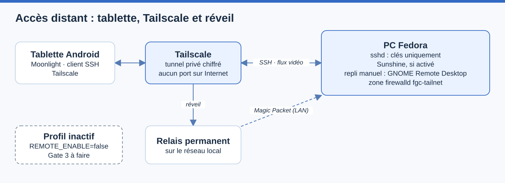

# Accès distant — Tailscale, SSH, Wake-on-LAN et Sunshine

> Mise à jour : 2026-11-06 · Responsable : @mathiasseguincadiche
> Dernière vérification : 2026-11-06 — résumé d'exécution de l'activation du profil ajouté et relu contre les étapes de la section 3 ; variables relues le 2026-11-04 contre `config/remote.conf`, modules `modules/remote/`, `scripts/remote/wol-send.py` et `diagnostics/arc-b580-av1`, non rejoué — matériel : non vérifié

**Objectif :** utiliser le PC Fedora depuis une tablette Android, à la maison ou à l'extérieur, sans ouvrir de port sur Internet, et pouvoir le réveiller quand il est éteint.
**Statut :** code réalisé ; profil **désactivé par défaut** (`REMOTE_ENABLE="false"`) ; qualification physique (Gate 3) non faite.
**Décision d'architecture :** [ADR 0017](adr/0017-remote-access.md).

Ce guide répond à trois questions : ce que le projet automatise, ce que l'analyse a changé dans l'architecture demandée, et dans quel ordre activer le profil.

## Le scénario : un PC puissant, une tablette comme terminal



La tablette Android atteint le PC Fedora par le tunnel privé Tailscale, sans port ouvert sur Internet : SSH par clés uniquement, Sunshine s'il est activé, GNOME Remote Desktop en repli configuré à la main. Pour réveiller le PC éteint, la tablette passe par le relais toujours allumé du réseau local, qui envoie le Magic Packet. Le profil est désactivé par défaut (`REMOTE_ENABLE=false`).

Source éditable : [`acces-distant.drawio`](assets/diagrams/acces-distant.drawio).

Le PC fixe reste l'unique environnement de travail : la tablette n'héberge ni les projets ni les VM, elle sert d'écran et de clavier à distance.

Sur le PC, le trafic du tailnet arrive dans la zone firewalld `fgc-tailnet`, et le garde réseau KVM interdit aux VM d'atteindre la plage Tailscale `100.64.0.0/10`. À la maison, la tablette peut aussi passer par Tailscale : la connexion devient alors directe sur le réseau local, avec une latence quasi identique, sans ouvrir SSH côté LAN.

## 1. Ce que l'analyse a changé dans l'architecture demandée

L'idée centrale est conservée : le PC reste l'unique poste de travail, la tablette n'est qu'un terminal. Cela évite deux machines à maintenir, et Git, les clés, les VM et les conteneurs restent au même endroit. L'analyse a cependant relevé sept points où le cahier des charges initial, tel qu'écrit, ne fonctionnerait pas seul ou serait moins sûr qu'il n'y paraît.

| # | Point | Constat | Réponse du projet |
|---|---|---|---|
| 1 | Le réveil à distance exige un relais | Tailscale ne peut pas réveiller un PC éteint : son client n'y tourne plus. Un appareil toujours allumé du réseau local doit envoyer le Magic Packet. | `scripts/remote/wol-send.py` pour le relais ; procédure à la [section 6](#6-relais-wake-on-lan). Le choix du matériel du relais reste à faire. |
| 2 | Sunshine sous GNOME/Wayland est la partie fragile | La capture passe par le portail (autorisation demandée) ou par KMS (capacité `cap_sys_admin`). Une mise à jour début 2026 a fait passer le portail avant KMS. Sunshine lancé avant l'ouverture de session n'a pas d'environnement graphique. | Profil optionnel (`REMOTE_SUNSHINE_ENABLE`), ouverture de session automatique sur option, mesures en Gate 3. Repli intégré à GNOME à la [section 5](#5-bureau-distant--sunshine-ou-gnome-remote-desktop). |
| 3 | L'AV1 de la B580 n'est pas confirmé de bout en bout | Le pilote média Intel gère l'encodage AV1 sur Battlemage, mais aucune source trouvée ne teste Sunshine sur B580. Sunshine retombe silencieusement sur H.264 logiciel si l'encodeur n'est pas utilisable. | `arc-b580-av1` vérifie l'encodage AV1 VA-API ; le journal Sunshine doit confirmer l'encodeur choisi (Gate 3). |
| 4 | Le pare-feu Fedora Workstation laisse déjà passer beaucoup | La zone `FedoraWorkstation` ouvre `ssh` et tous les ports 1025-65535 (TCP et UDP) sur le réseau local : les ports de Sunshine y sont atteignables, protégés seulement par l'appairage. | `REMOTE_SSH_LAN="false"` retire SSH de cette zone. Les ports hauts sont un risque assumé et documenté ([section 7](#7-sécurité--ce-qui-est-protégé-et-ce-qui-ne-lest-pas)). |
| 5 | L'expiration de clé Tailscale peut bloquer l'accès | Un nœud dont la clé expire quitte le tailnet : plus d'accès distant, alors que le PC est peut-être éteint. | Désactiver l'expiration de clé pour le PC et le relais ([section 4](#4-tailscale--expiration-de-clé-et-acl)). |
| 6 | Wake-on-LAN : trois couches, pas une | Il faut le BIOS, le pilote réseau et le profil NetworkManager ; NetworkManager n'active pas le Wake-on-LAN par défaut. Aucune source trouvée ne confirme le comportement du Realtek 5 GbE (RTL8126, pilote `r8169`) depuis un arrêt complet. | Profil NetworkManager en mode `magic`, filet `.link` optionnel, cinq cycles mesurés ([section 9](#9-qualification-gate-3--fiabilité)). |
| 7 | Isolation des VM et du tailnet | Le garde réseau KVM protège les routes qu'il découvre, mais `tailscale0` n'émet aucun événement NetworkManager : les routes Tailscale pouvaient apparaître après sa dernière reconstruction. | Le garde protège désormais `100.64.0.0/10` de façon statique (`KVM_EXTRA_PROTECTED_CIDRS`, posé par `remote.network`), avec un test. |

**Ce qui reste comme demandé :** Tailscale comme réseau privé, SSH par clés comme mode léger, Wake-on-LAN sur l'Ethernet filaire via NetworkManager, Sunshine et Moonlight pour le mode graphique, arrêt par `systemctl poweroff`, et la séquence de connexion du cahier des charges.

### Alternatives examinées

| Besoin | Choix retenu | Alternative | Pourquoi pas, pour l'instant |
|---|---|---|---|
| Réseau privé | Tailscale | WireGuard auto-hébergé, Headscale | Plus de contrôle, mais NAT, ACL et client Android à construire et à maintenir. À reconsidérer si dépendre d'un plan de contrôle tiers pose problème. |
| Bureau distant | Sunshine et Moonlight (latence, AV1, 120 FPS) | GNOME Remote Desktop (RDP), fourni avec Fedora | Intégré et signé Fedora, il ouvre une session distante sans connexion automatique, mais il est moins fluide et son accélération matérielle n'est pas confirmée pour GNOME 51. C'est le repli recommandé si Sunshine échoue en Gate 3. |
| SSH | OpenSSH durci | Tailscale SSH | Un seul mécanisme, mais le cahier des charges et le reste du projet (Ansible, clés) reposent sur OpenSSH. |
| Réveil sans relais | — | Prise connectée et « restaurer après coupure secteur » | Fonctionne sans carte réseau ni relais, mais dépend d'un cloud tiers et coupe le courant d'une machine éteinte proprement. Dernier recours. |

## 2. Ce que le projet automatise, et ce qui reste manuel

Le profil `remote` compte cinq modules, un doctor et un fichier de configuration, `config/remote.conf`. Tout reste inerte tant que `REMOTE_ENABLE="true"` n'est pas posé dans `config/local.conf`.

| Module | Automatisé | Reste manuel |
|---|---|---|
| `remote.preflight` | Outils, SELinux Enforcing, firewalld, ports valides, clé SSH publique présente, interface filaire | — |
| `remote.network` | Dépôt Tailscale, paquets, `tailscaled`, zone firewalld `fgc-tailnet`, Wake-on-LAN dans le profil NetworkManager, protection KVM du tailnet | Première connexion `tailscale up`, BIOS, relais |
| `remote.ssh` | Durcissement validé par `sshd -t`, retrait de SSH de la zone LAN | Ajout de la clé de la tablette |
| `remote.desktop` | Sur option chacun : Sunshine (COPR), son service utilisateur, connexion automatique avec verrouillage, extinction sans mot de passe | Appairage Moonlight, réglages Sunshine |
| `remote.validation` | `remote-doctor` | Cycles de fiabilité (Gate 3) |

```bash
./control.sh remote status      # contrôle complet, lecture seule
./control.sh remote info        # MAC, adresse de diffusion et adresse Tailscale à reporter sur le relais
./control.sh install dry-run    # simulation de tout le catalogue, sans modification
```

## 3. Activer le profil, pas à pas

**Préconditions :** Gate 3 du poste réussie, sauvegarde pré-APPLY du même commit, et une console physique à portée. La réactivation du profil réseau coupe brièvement la liaison : **ne pas appliquer ce module par SSH sur la même carte réseau.**

**Résumé d'exécution — où en est l'activation du profil :** reprendre à la première case non cochée ; un KO de `./control.sh remote status` sur SSH, SELinux ou l'isolation KVM est un arrêt, pas un obstacle à contourner.

- [ ] Clé SSH de la tablette ajoutée à `~/.ssh/authorized_keys`
- [ ] `REMOTE_ENABLE="true"` appliqué : dry-run puis APPLY, sauvegarde pré-APPLY comprise
- [ ] Tailscale connecté une seule fois, expiration de clé et ACL réglées
- [ ] BIOS réglé, relais Wake-on-LAN préparé
- [ ] `./control.sh remote status` affiche **0 KO**

1. **Clé SSH de la tablette.** Générer une clé sur la tablette, avec son client SSH, puis ajouter sa partie publique à `~/.ssh/authorized_keys` sur le PC. Sans clé, le préflight refuse de continuer : désactiver les mots de passe sans clé couperait tout accès.
2. **Activer le profil** dans `config/local.conf` :

   ```bash
   REMOTE_ENABLE="true"
   # Options à activer une par une, le moment venu :
   # REMOTE_SUNSHINE_ENABLE="true"
   # REMOTE_AUTOLOGIN="true"
   # REMOTE_POWEROFF_POLKIT="true"
   ```

3. **Simuler, puis appliquer :** `./control.sh install dry-run`, puis la séquence d'APPLY habituelle, sauvegarde pré-APPLY comprise.
4. **Connecter Tailscale, une seule fois :** `sudo tailscale up`, ouvrir le lien affiché et se connecter. Régler ensuite l'expiration de clé et les ACL ([section 4](#4-tailscale--expiration-de-clé-et-acl)).
5. **Régler le BIOS** ([section 8](#8-bios-msi-mag-b850m-mortar-wifi-version-1a66)) et **préparer le relais** ([section 6](#6-relais-wake-on-lan)).
6. **Contrôler :** `./control.sh remote status` doit afficher **0 KO**. Un `WARN` sur « Tailnet login » avant l'étape 4 est normal.

**Réussite :** `REMOTE ACCESS HEALTHY`. **Règle d'arrêt :** un KO sur SSH, SELinux ou l'isolation KVM bloque la suite ; ne pas passer à Sunshine avant de l'avoir résolu.

**Retour arrière :**

- remettre `REMOTE_SUNSHINE_ENABLE="false"`, puis repasser par le dry-run et l'APPLY, retire les seuls ports enregistrés par le projet et désactive Sunshine s'il a été activé par le projet ;
- remettre `REMOTE_AUTOLOGIN="false"` restaure les réglages de connexion automatique sauvegardés par le projet et désactive le verrouillage géré ;
- passer directement à `REMOTE_ENABLE="false"` rend les modules inertes, **mais n'annule pas** les changements déjà installés : désactiver d'abord chaque option, une par une.

Toute opération qui modifie le système se lance depuis la console physique, jamais par une connexion SSH qui pourrait être coupée.

## 4. Tailscale : expiration de clé et ACL

Dans la console d'administration Tailscale :

- **désactiver l'expiration de clé** pour le PC et pour le relais. Sinon, à l'échéance, le PC disparaît du tailnet ;
- **restreindre les accès par les ACL**. Elles sont la frontière côté tailnet : par défaut, `tailscaled` installe ses propres règles et accepte le trafic entrant sur `tailscale0`. La zone firewalld `fgc-tailnet` est un second verrou, dont l'effet exact est à vérifier en Gate 3 (`sudo nft list ruleset`).

Exemple **fictif**, à adapter et à valider dans l'éditeur d'ACL :

```json
{
  "tagOwners": { "tag:desktop": ["autogroup:admin"], "tag:relay": ["autogroup:admin"] },
  "acls": [
    { "action": "accept", "src": ["autogroup:member"], "dst": ["tag:desktop:22,47984,47989,48010,47998-48000"] },
    { "action": "accept", "src": ["autogroup:member"], "dst": ["tag:relay:22"] }
  ]
}
```

Le PC et le relais portent une étiquette ; la tablette, nœud personnel, n'en a pas besoin. Le port d'administration de Sunshine (47990) n'y figure pas : il reste local.

## 5. Bureau distant : Sunshine, ou GNOME Remote Desktop

### Vérifier l'AV1 de l'Arc B580, sans activer Sunshine

`./diagnostics/arc-b580-av1` est en lecture seule. Il cherche le nœud DRM du périphérique PCI Intel B580 `8086:e20b`, exige sa liaison au pilote `xe`, puis interroge ce nœud précis avec `vainfo`. Il ne déduit jamais l'AV1 de la seule présence d'une B580. Le lancer depuis le compte utilisateur, sans `sudo` :

```bash
./diagnostics/arc-b580-av1
./diagnostics/arc-b580-av1 --format json
./diagnostics/arc-b580-av1 --require-av1    # échoue si l'encodage et le décodage AV1 ne sont pas observés
```

Le verdict `CAPABILITY_OBSERVED` signifie seulement que le pilote VA-API expose `VAProfileAV1Profile0` avec des points d'entrée de décodage et d'encodage. Il ne prouve pas que Sunshine capture GNOME, que l'encodeur AV1 est réellement retenu, ni que la tablette décode sans pertes : le rapport laisse `sunshine_moonlight_end_to_end`, `tablet_av1_decode` et `wifi7_and_wol` à `NOT_TESTED`.

La Gate 3 doit encore démontrer : le codec réellement choisi, d'après les journaux Sunshine ; l'appairage Moonlight ; le décodage et l'autonomie de la tablette ; la latence et les pertes en Wi-Fi 7 ; la résolution et les FPS ; les cycles Wake-on-LAN et la reprise après veille. Un repli en H.264 est signalé comme tel, jamais présenté comme de l'AV1.

### Sunshine et Moonlight

Sunshine s'active avec `REMOTE_SUNSHINE_ENABLE="true"`. Il est installé depuis le COPR `lizardbyte/stable` (source amont, signée par COPR, voir la [provenance des logiciels](SUPPLY_CHAIN.md)). Ses ports sont autorisés dans la zone `fgc-tailnet`, d'après les valeurs par défaut documentées par LizardByte :

| Protocole | Ports | Rôle |
|---|---|---|
| TCP | 47984, 47989, 48010 | appairage, contrôle, RTSP |
| UDP | 47998, 47999, 48000 | vidéo, contrôle, audio |
| — | 47990 | administration : `origin_web_ui_allowed=pc`, `upnp=off`, port refusé en configuration et bloqué en entrée IPv4 et IPv6 par firewalld |

La zone LAN `FedoraWorkstation` peut déjà laisser passer ces ports hauts : vérifier les règles réelles avant de conclure qu'ils ne sont joignables que par le tailnet. Ces ports sont à reconfirmer avec `ss -tulpn` en Gate 3 : la documentation LizardByte n'a pas pu être relue depuis l'environnement de rédaction.

**Une session graphique doit être ouverte.** Après un réveil, le PC s'arrête sur l'écran de connexion GDM : sans session, Sunshine n'a rien à capturer. Deux options :

- `REMOTE_AUTOLOGIN="true"` : GDM ouvre la session seul et `REMOTE_LOCK_ON_AUTOLOGIN="true"` la verrouille aussitôt ; le mot de passe se saisit ensuite depuis la tablette. Le service `fgc-remote-lock.service` résout la session Wayland active et refuse le succès s'il n'observe pas `LockedHint=yes` ; seule la Gate 3 prouve le fonctionnement de bout en bout. Les disques n'étant pas chiffrés ([ADR 0002](adr/0002-no-secureboot-no-local-luks.md)), un accès physique reste un accès au compte ;
- ne pas utiliser Sunshine et passer par GNOME Remote Desktop.

Réglages de départ, issus du cahier des charges et à ajuster par la mesure :

| Profil | Résolution | Fréquence | Codec | Débit |
|---|---|---|---|---|
| LAN | 1440p | 120 FPS | AV1 | 40–80 Mb/s |
| Distant | 1080p/1200p ou 1440p | 60–90 FPS | AV1 | 15–40 Mb/s |

Points ouverts, à trancher par la mesure :

- **Méthode de capture** : portail (autorisation à valider) ou KMS (`cap_sys_admin`, compatibilité avec SELinux et le pilote `xe` à vérifier).
- **Écran OLED** : pendant une session distante, l'écran physique reste allumé et affiche le travail en cours. Le soin de l'écran impose de mesurer cet effet. Le projet communautaire `sunshine-screen-off` crée un écran virtuel sous GNOME, mais il est testé sur une autre distribution et n'est pas adopté ici.
- **Résolution de la tablette** : elle diffère de celle du PC, et Sunshine sous Wayland n'adapte pas toujours le mode d'affichage.

### Repli : GNOME Remote Desktop (RDP)

Fourni avec Fedora, il ouvre une session distante depuis l'écran de connexion (« Remote Login »), donc sans connexion automatique. Il se configure dans *Paramètres → Système → Bureau à distance*, ou avec `grdctl`, et demande un certificat TLS. Ce profil ne l'automatise pas, car il implique des identifiants. C'est le repli à envisager si Sunshine échoue en Gate 3.

## 6. Relais Wake-on-LAN

Un appareil toujours allumé du réseau local, avec Tailscale, envoie le Magic Packet : routeur compatible, NAS, Raspberry Pi ou mini-PC. Le plus simple à reproduire est un petit Raspberry Pi. Depuis la tablette, on se connecte en SSH au relais par son adresse Tailscale, puis on lance l'envoi ; une application web de réveil hébergée sur le relais (UpSnap, décrite par Tailscale) est une alternative plus confortable.

1. Sur le PC, une fois, relever les valeurs à reporter sur le relais :

   ```bash
   ./control.sh remote info
   ```

2. Copier `scripts/remote/wol-send.py` sur le relais (Python 3 suffit, sans dépendance), puis afficher le paquet sans l'envoyer :

   ```bash
   python3 wol-send.py aa:bb:cc:dd:ee:ff --print-packet
   ```

3. Envoyer réellement, avec l'adresse de diffusion **du vrai réseau local** :

   ```bash
   python3 wol-send.py aa:bb:cc:dd:ee:ff --broadcast 192.168.1.255
   ```

Les valeurs `aa:bb:cc:dd:ee:ff` et `192.168.1.255` sont des exemples fictifs : les remplacer par la MAC et la diffusion affichées par `remote info`.

Le script valide la MAC et l'adresse, envoie le paquet trois fois par défaut, à 0,3 seconde d'intervalle, sur le port UDP 9 (`--repeat`, `--interval`, `--port`). Il refuse avant tout envoi un intervalle hors de 0 à 5 secondes (négatif, `nan` ou infini compris), un nombre d'envois hors de 1 à 10 et un port hors de 1 à 65535 ; une erreur de socket donne un code de sortie non nul.

**Ce que l'envoi prouve :** rien sur le réveil du PC. Il dépend de la carte réseau et du firmware ; seuls les cycles de la Gate 3 le démontrent.

## 7. Sécurité : ce qui est protégé, et ce qui ne l'est pas

- **Rien n'est exposé à Internet** : ni SSH, ni Sunshine, ni le Wake-on-LAN. Le seul chemin d'entrée est le tailnet.
- **SSH** : clés uniquement, pas de connexion root, un seul utilisateur autorisé, `sshd -t` avant tout rechargement ; une configuration invalide est retirée automatiquement. Le fichier s'appelle `00-fgc-remote.conf`, car `sshd` applique la première valeur rencontrée : il doit précéder `50-redhat.conf`.
- **SELinux** reste Enforcing et firewalld actif : le préflight et le doctor l'exigent.
- **Isolation des VM** : la plage Tailscale est interdite aux VM KVM, et un test le vérifie.
- **Limite assumée sur le réseau local** : avec la zone `FedoraWorkstation` par défaut, les ports hauts de streaming (hors 47990, bloqué) peuvent rester joignables depuis le réseau domestique. Un appareil du réseau local pourrait donc tenter un appairage, qui exige un code. Durcir cette zone toucherait d'autres usages (partages, découverte) : ce n'est pas fait automatiquement.
- **Extinction sans mot de passe** (`REMOTE_POWEROFF_POLKIT`) : tout processus de l'utilisateur peut alors éteindre ou suspendre le PC. Le risque porte sur la disponibilité, pas sur l'accès ; l'option reste désactivée par défaut.

## 8. BIOS (MSI MAG B850M MORTAR WIFI, version 1.A66)

Le Wake-on-LAN depuis un arrêt complet dépend du BIOS. Les intitulés varient ; chercher dans les menus d'alimentation et de réveil :

- **réveil par le contrôleur PCIe ou réseau** (par exemple « Resume By PCI-E Device », « Wake Up Event Setup ») : activé ;
- **ErP / EuP Ready** : désactivé, car il coupe l'alimentation du contrôleur réseau à l'arrêt ;
- **restauration après coupure secteur** : au choix.

Les noms exacts de ce BIOS n'ont pas pu être confirmés : les relever sur la machine et les noter dans la [fiche de qualification](PHYSICAL_QUALIFICATION_CHECKLIST.md).

## 9. Qualification Gate 3 — fiabilité

Rien de ce qui suit n'est prouvable par la CI : ce sont des mesures sur le PC.

```text
5 × arrêt complet (systemctl poweroff)
5 × réveil par Magic Packet depuis le relais
5 × démarrage de Fedora sans intervention locale
5 × tailscaled actif et PC joignable
5 × SSH par clé depuis la tablette
5 × Sunshine joignable, puis Moonlight connecté (si activé)
```

Consigner aussi, après chaque arrêt, la sortie de `ethtool` (`Wake-on: g`) ; l'encodeur réellement choisi par Sunshine, d'après son journal ; l'état du verrouillage de session après le réveil ; la température et l'état de l'écran OLED pendant une session distante ; et le nombre de cycles qui ont demandé une intervention locale, qui doit être nul.

**Si le réveil échoue après un arrêt complet**, mais fonctionne après une veille : activer `REMOTE_WOL_LINK_FALLBACK="true"`, qui pose le réglage par `systemd-udev` indépendamment de NetworkManager, puis refaire les cycles. En cas de nouvel échec, comparer l'arrêt (S5) et la veille (S3), en réutilisant la qualification de veille du projet.

**Règle d'arrêt :** un seul cycle qui demande une intervention locale invalide la qualification du profil. L'état `enabled` de `fgc-remote-lock.service` ne prouve pas que la session est verrouillée : vérifier à chaque démarrage avec `loginctl show-session SESSION -p LockedHint`.

## 10. Dépannage

| Symptôme | Vérification |
|---|---|
| `remote-doctor` : « WoL active » en KO | `nmcli -g 802-3-ethernet.wake-on-lan connection show "PROFIL"` doit afficher `magic`, puis `sudo ethtool INTERFACE` doit montrer `Wake-on: g`. |
| Réveil impossible depuis l'extérieur | Le relais est-il joignable par Tailscale ? Envoie-t-il sur la diffusion du réseau local ? La carte réseau du PC garde-t-elle un voyant de liaison après l'arrêt ? |
| SSH refuse la connexion | La clé est-elle dans `authorized_keys`, et `AllowUsers` correct ? Depuis le réseau local, SSH est volontairement fermé : passer par l'adresse Tailscale. |
| Moonlight : « PC introuvable » | Ajouter l'hôte par son adresse Tailscale, et vérifier que Sunshine tourne, donc qu'une session est ouverte. |
| Flux en H.264 au lieu d'AV1 | `vainfo` doit lister `VAProfileAV1Profile0 : VAEntrypointEncSlice` sur le nœud de la B580 ; sinon Sunshine retombe sur H.264. |
| Garde réseau KVM en mode d'urgence | `sudo /usr/local/libexec/fedora-gnome-custom/kvm-network-guard check` doit afficher `guard_mode=normal`, avec `100.64.0.0/10` dans `protected_networks`. |

## 11. Sources et limites de vérification

Les affirmations de ce guide viennent de recherches faites lors de sa rédaction ; ce qui n'a pas pu être relu à la source est signalé.

- Tailscale ne réveille pas un PC éteint, et le relais : [Wake-on-LAN avec Tailscale et UpSnap](https://tailscale.com/blog/wake-on-lan-tailscale-upsnap) ; [routeurs de sous-réseau](https://tailscale.com/kb/1019/subnet-routers/).
- Sunshine : [documentation LizardByte](https://docs.lizardbyte.dev/projects/sunshine/v2025.118.151840/md_docs_2getting__started.html) ; [Sunshine Flatpak sous Wayland](https://discussion.fedoraproject.org/t/sunshine-flatpak-not-working-under-wayland/118302) ; [écran virtuel Sunshine sous GNOME (tiers)](https://github.com/fqazzazee/sunshine-screen-off).
- Encodage AV1 sur Battlemage : [Intel Media Driver 2024Q4](https://www.phoronix.com/news/Intel-Media-Driver-2024Q4).
- GNOME Remote Desktop et connexion distante : [fusion de la connexion graphique RDP](https://phoronix.com/news/GNOME-RDP-Remote-Login) ; [dépôt gnome-remote-desktop](https://github.com/GNOME/gnome-remote-desktop).
- Pare-feu de Fedora Workstation (ports 1025-65535) : [Fedora Magazine — contrôler le pare-feu](https://fedoramagazine.org/control-the-firewall-at-the-command-line/).
- Wake-on-LAN et NetworkManager : [Arch Wiki — Wake-on-LAN](https://wiki.archlinux.org/title/Wol) ; [correctif r8169 depuis S5](https://lkml.iu.edu/hypermail/linux/kernel/1811.0/01283.html).

**Non vérifié depuis l'environnement de rédaction :** le contenu actuel des documentations LizardByte et Tailscale (accès bloqué) ; la définition exacte du dépôt Tailscale (comparer `config/repos/tailscale.repo` à la version publiée avant la première installation) ; le comportement du Realtek RTL8126 depuis un arrêt complet ; Sunshine sur Arc B580. C'est pourquoi le profil est désactivé par défaut et passe par la Gate 3.

**Étape suivante :** la [qualification](QUALIFICATION.md), puis la [fiche physique](PHYSICAL_QUALIFICATION_CHECKLIST.md).
