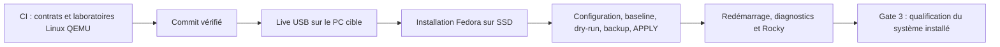

# Validation : CI, Live USB et système installé

Ce guide définit le parcours de qualification de **Fedora 45 / GNOME 51**. La CI vérifie le logiciel. Les essais opérateur se font directement sur le PC : d'abord depuis le Live USB, puis après installation. Aucun parcours Windows ou VirtualBox n'est requis.



Le profil Fedora 45 reste `pending` tant que le média Workstation final signé et les dépendances stables n'ont pas été qualifiés puis promus. Les tests ne remplacent pas cette promotion : voir [la fiche Fedora 45](FEDORA45_PRIMARY.md).

## 1. Vérifier le commit

Consulter les contrôles GitHub du **commit exact** à installer. Les laboratoires Linux QEMU testent des fonctions logicielles, des démarrages et des reprises avec des périphériques virtuels. Ils ne certifient ni la B580 ni les T705 ni l'écran physique. Voir [la CI](CI_VALIDATION.md) et [le laboratoire Fedora/GNOME](FEDORA_GNOME_CI_LAB.md).

Conserver ce commit et le plan de modules pour le Live et le système installé. Le checkout doit être propre ; les résultats et réglages locaux restent dans les emplacements ignorés prévus par le projet.

## 2. Observer le PC depuis le Live USB

Démarrer le média Fedora 45 final authentifié en mode essai, directement sur le PC cible, avec GNOME 51/Wayland. Suivre [le guide Live USB](FEDORA45_LIVE_PREFLIGHT.md) pour la préparation et les essais.

```bash
./control.sh validate live plan
./control.sh validate live run
./control.sh validate live status
./control.sh validate export live /chemin/du/support-externe-inscriptible
```

Les contrôles distinguent inventaire, accès réseau et confirmations humaines. Tout `FAIL` bloque la validation ; tout contrôle obligatoire `NOT_TESTED` reste à vérifier. Les contrôles facultatifs non exécutés restent visibles dans le rapport. Un succès produit un JSON `live-<commit>.json` avec sa somme SHA-256 lors de l'export.

La preuve native, au schéma 2, porte `environment=live-usb` et `hardware_certification=PREINSTALL_ONLY`. Elle est liée au commit, au plan de modules et à l'identité stable du PC, notamment les deux T705 de séries distinctes. Elle ne dépend pas de l'UUID racine ou du noyau qui changera à l'installation. Elle ne prouve pas les services installés, les extensions personnalisées, les sauvegardes ni KVM.

**Avant de redémarrer, exporter hors du HOME temporaire du Live.** La clé qui porte l'ISO peut être en lecture seule : utiliser un emplacement externe réellement inscriptible et vérifier les fichiers exportés. Ne pas éditer une preuve pour transformer un échec en succès.

## 3. Installer puis converger

Suivre [le guide d'installation](INSTALLATION_GUIDE.md) : installation graphique sur le T705 système identifié par sa série, second T705 `/data` préservé, puis redémarrage sur le SSD. Le Kickstart reste une voie avancée documentée dans ce guide.

Récupérer le **même commit**, puis importer le compte rendu :

```bash
./control.sh validate import /chemin/live-<commit>.json
./control.sh validate status
```

Une preuve d'une autre machine, d'un autre commit/plan ou d'un ancien schéma est refusée. Un changement de configuration locale nécessaire à l'installation ne la transforme pas en certificat du système installé.

Le parcours de convergence reste :

**Outils de baseline → configuration définitive et `/data` → baseline → dry-run final → sauvegarde vérifiée → APPLY → redémarrage.**

`install.sh --apply` exige une Fedora installée sur matériel physique, avec le profil final promu. La session Live sert aux observations avant installation ; elle n'est pas la cible de l'APPLY. Voir [le contrat d'exécution](EXECUTION_CONTRACT.md).

## 4. Qualifier le système installé — Gate 3

Commencer par les diagnostics de l'hôte installé. Créer ensuite Rocky DevOps, vérifier son réseau et son accès SFTP selon [le guide KVM](KVM_QUICKSTART.md). Aucune VM n'est nécessaire avant l'installation de Fedora ; Rocky fait partie de la certification Golden complète lorsque KVM est activé.

Suivre [la fiche physique](PHYSICAL_QUALIFICATION_CHECKLIST.md) et [la fermeture des contrats](GOLDEN_COMPLETENESS_CLOSURE.md). Elles décrivent les essais CPU/RAM/NVMe, B580, écran, réseau, audio, USB, sauvegarde et les cinq cycles physiques de veille/reprise.

```bash
./control.sh validate gate3 status
./control.sh validate gate3 record-suspend
# Répéter l'enregistrement après chacun des cinq cycles physiques distincts.
./scripts/validation/gnome-ux-matrix.sh gate3
./control.sh validate gate3 certify
./control.sh validate status
```

La matrice GNOME s'exécute dans la vraie session du système installé. Elle vérifie les interactions bureau, applications, portals et accès Rocky. Un échec ou une partie non exécutée reste un résultat à traiter, sans fabriquer de marqueur PASS.

Seule la certification finale réussie produit `state/final/certified.ok` et le [bundle Golden](GOLDEN_RELEASE.md), pour la configuration et le runtime mesurés. Une évolution du noyau, du pilote ou de la configuration peut rendre les preuves installées `STALE`. Une modification du commit ou du plan impose de refaire le relevé Live avec cette source.

## Lire le résultat sans surinterpréter

| Résultat | Ce qu'il démontre | Étape suivante |
|---|---|---|
| CI verte au commit exact | Contrôles logiciels couverts réussis | Essais Live sur le PC |
| Live `PREINSTALL_ONLY` | Observations avant installation sur ce matériel | Installer puis qualifier le système final |
| Gate 3 `PASS` courant | Contrats Golden de la machine installée qualifiés | Conserver les preuves, maintenir et requalifier les changements |

Utiliser [la fiche de preuves](QUALIFICATION_EVIDENCE_TEMPLATE.md) pour suivre les essais, et [la reprise isolée](ISOLATED_RECOVERY_RUNBOOK.md) pour distinguer une sauvegarde vérifiée d'un système effectivement récupéré.

La qualification du système final inclut le noyau Linux amont stable retenu par le projet. Les VM restent hors Borg et sont exportées manuellement par leur propriétaire.
